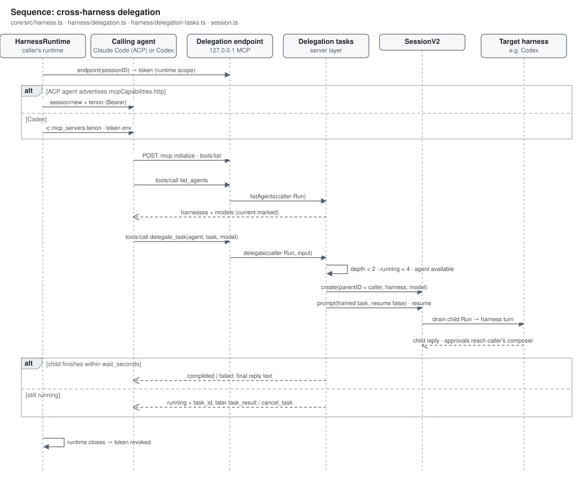

# Architecture

Tenon Workbench (formerly Second Brain OS) is an OpenCode fork. OpenCode is the runtime base: the
Electron host, the managed local OpenCode server and the session runtime. The
app shell and navigation are Tenon Workbench's own: a navigation rail of Home,
Notes, Calendar and Activity beside a Projects panel with their threads. New product domains are
added inside the existing OpenCode application rather than beside it.

The previous React/Tauri and Rust implementation is retired. Its database
schemas and remaining migration gaps are recorded in
[the donor archive](../archive/tauri/README.md).

## Active components


Detailed UML views (deployment, class, activity, state machine and sequence)
and a coverage index are in [the UML architecture views](uml.md).

- The Electron main process creates windows, exposes the limited preload API,
  and starts the managed server in a utility process on loopback with a
  generated password.
- The Solid renderer owns the desktop UI, including Brain, notes, projects,
  and calendar pages in `opencode/packages/app/src/pages/`.
- The OpenCode server owns sessions, workspace routing, and Second Brain HTTP
  handlers. `packages/opencode` mounts the native `/api` routes from
  `packages/server` (contracts in `packages/protocol`) next to its legacy
  instance routes; the session and harness runtime lives in `packages/core`. Notes and project records use workspace files through the location
  and file mutation services; calendar data is stored in `.tenon/calendar-v1.json`. The first calendar
  read moves a file left at the old `.second-brain/calendar-v1.json` into `.tenon`
  (new file first, then the old one and its folder if empty); when both exist the
  `.tenon` file wins and the old one is left alone.
- Former Rust policy and release documents are historical requirements, not
  evidence of controls in the active desktop runtime.

The renderer must not gain direct Node or filesystem access. Keep new native
operations behind the preload and main-process boundary, and resolve Second
Brain files through the server's location services. See
[`ADR-010`](../adr/ADR-010-opencode-electron-base.md) for the base-app decision.

## Product entry points and persistence

`opencode/packages/app/src/app.tsx` owns routing: `/`, `/notes`,
`/calendar`, `/activity`, `/projects`, the draft route
`/new-thread?project=<id>&draftId=<id>` and server-scoped threads at
`/server/<server>/session/<id>`. Old `/workspaces`, `/brain`, `/new-session`
and `/<dir>/session[/<id>]` URLs redirect. Settings, model/provider
selection, file panels, and terminals are shared dialogs or session panels
rather than standalone routes. The
[navigation map](../product/NAVIGATION-MAP-V1.md) describes the sidebar,
routes and shortcuts.

`pages/layout-new.tsx` is the only shell: the titlebar (window chrome, back
and forward) and `components/second-brain-sidebar.tsx` (navigation rail plus
collapsible Projects panel). Pages sit on one rounded panel built from
`components/page.tsx` (`PageFrame`, `PageHeader`, `PageSection`, and
`PageEmpty` for centred empty states); page titles carry no descriptive subtitle. Shape and motion follow Material 3: radius,
easing and duration tokens (`--v2-radius-*`, `--v2-ease-*`,
`--v2-duration-*`) and the accent-container colors live in
`packages/ui/src/v2/styles/theme.css` and `packages/ui/src/theme/v2/mapping.ts`,
and the v2 components (pill buttons, circular icon buttons) use them.

Motion rules: an element entering uses `--v2-duration-medium` with
`--v2-ease-emphasized-decelerate`; one leaving uses `--v2-duration-short` with
`--v2-ease-emphasized-accelerate`; small state changes (colour, hover) use
`--v2-duration-short` with `--v2-ease-standard`. Every non-trivial motion turns
off under `prefers-reduced-motion`, which shows the end state at once. Tailwind
maps the tokens to `ease-standard`, `ease-emphasized-decelerate` (alias
`ease-emphasized`), `ease-emphasized-accelerate`, `ease-spring`,
`duration-short|medium|long`, a bare `transition*` default of short + standard,
and `animate-enter` (fade and 4px rise) / `animate-exit` (fade)
(`packages/ui/src/styles/tailwind/`). Kobalte overlays (dialogs, tooltips,
popovers) keep their content mounted for an exit only when the `[data-closed]`
rule sets a different `animation-name`, so each has its own exit keyframes;
`context/dialog.tsx` disposes a closed dialog after the short exit. MenuV2 and
SelectV2 menus enter with short + emphasized-decelerate and close at once: an
exit would keep the menu mounted, so a selection or dismissal would wait on it.
Three helpers in `packages/ui/src/v2/components/` cover in-page motion:
`Reveal` (`@opencode-ai/ui/v2/reveal`; `open`, `class`, `onTransitionEnd`)
expands and collapses through grid rows and opacity, keeps its children while
closing and unmounts them once closed (`inert` and `aria-hidden` meanwhile).
Its grid and clip apply only while it moves (`data-phase` `opening` or
`closing`); settled open it is a plain `flow-root` block and closed it is
`display: none`, so a settled `Reveal` adds no layout work to each reflow;
`Presence` (`@opencode-ai/ui/v2/presence`; `when`, `enterClass`, `exitClass`,
`class`) keeps a wrapper `div` mounted through its exit animation with
`solid-presence`, defaulting to `animate-enter` / `animate-exit`; `ViewSwitch`
(`@opencode-ai/ui/v2/view-switch`; `key`, `class`) fades the outgoing view out
and the incoming one in when `key` changes, rendering one view at a time.
`@opencode-ai/ui/v2/motion` exposes `prefersReducedMotion()` and
`motionDuration()` for JS that times work against these animations, and
`useSpring` (`@opencode-ai/ui/motion-spring`) jumps to its target under reduced
motion. Hand-rolled popups (not Kobalte) use `animate-menu-enter` /
`animate-menu-exit` (the MenuV2 scale and fade) inside a `Presence`. The pill and
settings `TabsV2` variants slide one selection indicator between tabs; the
normal variant keeps a static underline because its tabs can be dragged.

In the app shell, `pages/layout-new.tsx` fades pages through a `ViewSwitch`
keyed by section (`pages/page-motion.ts`): query-string changes do not fade,
and moving into the thread view (draft or session) swaps at once so its
composer can focus on mount. Project detail, Activity, Calendar views and the
connect-provider steps use `ViewSwitch` too, so a field that focuses on mount
uses `utils/focus-when-connected.ts`, which waits for the view to be attached.
Sidebar groups, child threads, settings model groups and Home's "Running now"
expand through `Reveal`; the Projects panel keeps its content while its width
collapses. Calendar and Tasks share `features/second-brain/side-panel.tsx`,
whose grid column eases with the panel and whose panel keeps its last content
(inert) through the exit; Esc closes a peek, while the editor form keeps its own
Escape. Live lists (sidebar threads, running sessions) animate only
rows that join after the first render (`utils/fresh-items.ts`), never the
initial list or a reorder.

The virtualized timeline expands and collapses instantly, as it did before the
motion pass: tool rows, context and tool groups, diff accordions (Kobalte
`Collapsible` and `Accordion` content has no height keyframes), a turn's step
rows, the live steps card and the thinking-to-reasoning-to-text handoff all
reach their final geometry in one frame, and the timeline stays bottom-anchored
through a toggle. The virtualizer measures a row once per change and keeps the
bottom anchor from that measurement, so a row whose height eased over several
frames moved the anchor and the rows below it on every frame (breaking the
`timeline-stability` suite's bottom-anchor, ordering and no-blank contracts),
and grid-row wrappers on every row made each layout pass of a streaming turn
markedly more expensive. Inside a row only transform, opacity and colour
animate (chevrons, hover colours, the count and status labels). Outside the
timeline, the question and permission docks grow in as the composer folds away,
and the queued and rolled-back docks keep removed rows closing in place with
`createExitList` (`pages/session/composer/exit-list.ts`).

The sidebar's controller (`components/sidebar/sidebar-controller.ts`) reads
`GET /second-brain/project-threads`, loads each Project's threads with
`serverSync().project.loadSessions(threadDirectory)` (kept live by
`session.created/updated/deleted` events), adds the recent-session index for
threads outside any Project folder, and groups them with
`features/second-brain/sidebar-threads.ts` into Projects (the deepest Project
folder holding the thread) and General (the rest of the workspace folder).
Threads outside the selected workspace and its Project folders are left out.
The active Project is derived from the route's thread or draft directory. The
header is the workspace dropdown (`layout.home.selection`, resolved by
`layout.home.workspace` to the selected or first open folder). Home, Notes,
Calendar and Projects read `layout.home.workspace` and have no picker of their
own; Notes keeps an open note with unsaved edits in its workspace until it is
saved or discarded. Home, Notes and the Projects page's thread folders read the
same cached project-threads query as the sidebar (`useProjectThreads` and
`useBrainProjects` in `sidebar-controller.ts`, 30 seconds of freshness); the
Projects page keeps its own card list for editing. The controller
scans each workspace once per app session (`POST /second-brain/projects/scan`)
and on **Scan for projects**. The automatic scan reloads the Project list only
when it created cards, and a failed one shows a toast and runs again the next
time the workspace is shown. Sidebar actions (archive, unarchive, pin through `PATCH /session/:id`;
rename; delete through `session.remove`, which also deletes child threads, so
the sidebar drops the subtree and treats a 404 as already deleted) apply the server's reply to every
loaded directory list and to the recent-session index at once, then offer a
5-second undo from `utils/undo-action.ts` (in memory only; a deferred delete
that has not run when the app closes is dropped). The renderer has one
QueryClient (from `AppBaseProviders`); the router shell does not create its
own. `serverSync().homeSessions` applies every session event to the
recent-session index in that client, and the sidebar, Home and Activity read it
through one set of query options (`homeSessionIndexQueryOptions`, never stale),
so a thread created, archived, unarchived or pinned anywhere, including in a
Project that is not open, updates every list without a reload, and revisiting
Home or Activity does not re-read the session table. The index is fetched again
only on a reconnect, `global.disposed` or `session.next.moved`. A directory
list contributes only threads that run in that directory, because events
reach only their own directory's list. The global event stream reconnects with
exponential backoff and jitter (up to 20 s, reset by any event after
`server.connected`, cut short when the stream is stopped). On
every `server.connected` after the first, and on `global.disposed`,
`serverSync` reloads every loaded directory list and reconciles busy statuses (one
resync at a time; statuses changed by newer events are kept)
against a fresh `session.active` call, so threads deleted, archived, renamed or
finished while disconnected do not linger. Projects page mutations invalidate
the sidebar's project-threads query (`invalidateProjectThreads`). The renderer
handles the server's `session.next.moved` and `session.next.revert.*` names
(`context/global-sync/event-names.ts`, checked against the schema's event
manifest in a unit test). `context/drafts.tsx` holds unsent drafts per window and keeps prompt
state alive across route changes; it replaced the tab store.

| Data                       | Owner and persistence                                                                                                 |
| -------------------------- | --------------------------------------------------------------------------------------------------------------------- |
| Notes                      | `packages/opencode/src/knowledge/note.ts`; workspace Markdown files                                                   |
| Project records            | `packages/opencode/src/project/brain.ts`; workspace `.tenon/projects/<id>/` Markdown cards (legacy `projects/<id>/`)   |
| Workspace manifest         | `brain.ts`; workspace `.tenon/workspace.json` (linked project folders)                                                |
| Linked-folder index        | `brain.ts` writes, `core/src/workspace-instructions.ts` reads; `workspace-links.json` in the data folder; rebuilt by a scan; the first workspace to link a folder keeps it |
| Project thread directories | Derived, not stored: the card's `location.path` folder (inside the workspace, or a checked linked folder), else a linked Workspace worktree, else the card folder; thread counts read from `opencode.db` |
| Local events and tasks     | Second Brain HTTP handler and `packages/opencode/src/planner/calendar.ts`; workspace `.tenon/calendar-v1.json` |
| Sessions and runtime state | `packages/core/src/database/` and runtime session services; `opencode.db` in `$XDG_DATA_HOME/tenon-workbench`            |
| Unsent desktop drafts      | `packages/desktop/src/main/draft-store.ts`; profile `drafts.sqlite`                                                   |
| Draft list, sidebar state  | `packages/app/src/context/drafts.tsx`, `components/sidebar/sidebar-controller.ts`; per-window `drafts` and `sidebar` keys |
| Google connections         | `packages/desktop/src/main/google-calendar.ts`; an account list with encrypted credentials in the desktop profile; see [Google accounts](#google-accounts) |

Package paths in this table are relative to `opencode/`. Workspace files are
the source of truth for notes, project records, and local planning. Do not
assume the session or draft databases can be reconstructed from those files.

### Projects and thread directories

A workspace's Projects are the subfolders of its `projects` folder (matched in
any letter case, skipping hidden folders and legacy `project_<id>` card
folders) and the absolute folders listed in `.tenon/workspace.json`. Each has a
Project card whose `location.path` names the folder (workspace-relative, or
absolute for a linked folder). `BrainProject.threadDirectory` resolves a
Project's directory: that folder; otherwise the worktree of the OpenCode project
named by a legacy `location.workspaceId`; otherwise the card folder. Sessions
keep their exact `directory`, so `GET /api/session?directory=<threadDirectory>`
returns only that Project's threads.

Creating a Project with no linked folder (`POST /second-brain/projects`, the
app's New Project form) also creates a visible `projects/<name>` folder and sets
`location.path` to it, so the Project's threads run there and a later scan finds
the folder already claimed. `BrainProject.folderName` turns the name into one
safe path segment. A name whose folder another Project uses gets a ` (2)`
suffix, and an existing unclaimed folder of that name is adopted. Projects
created before this change keep their card folder as their thread directory.

Entry points (legacy instance routes, scoped to the workspace directory through
workspace routing):

- `POST /second-brain/projects/scan` writes `.tenon/workspace.json` when it is
  missing, creates a card for every project folder without one, and points the
  workspace's linked folders at it in the linked-folder index. It never moves or
  deletes folders, refuses to overwrite a manifest it cannot parse, and skips a
  folder that fails with a warning.
- `POST /second-brain/projects/link` with `{ folder }` adds an absolute folder
  outside the workspace (not containing it) to the manifest, then scans.
  `POST /second-brain/projects/unlink` removes it and archives its card.
- `GET /second-brain/project-threads` lists Projects with `threadDirectory`,
  `threadDirectoryKind` (`project`, `workspace` or `folder`), the linked
  Workspace, and root thread count and last activity. It no longer turns opened
  Workspaces into Projects.
- `GET`, `PUT` and `DELETE /second-brain/instructions` read, write (64 KiB cap)
  and remove the `AGENTS.md` of the request's folder: the workspace root for the
  workspace default, a Project folder for that Project's own file.
- `POST /second-brain/projects/workspace` with `{ workspaceId }` still returns
  or creates the Project linked to that OpenCode project id. The renderer no
  longer calls it.

### Workspace instructions

`core/src/workspace-instructions.ts` resolves `AGENTS.md` for a session
directory inside a workspace (an ancestor holds `.tenon/workspace.json`) or
inside a linked folder (from the index): the nearest `AGENTS.md` between the
session directory and the workspace root (exclusive), or up to the linked
folder, wins; otherwise the workspace root's `AGENTS.md`. Both the legacy
loader (`session/instruction.ts`) and the V2 `InstructionContext` use it, so a
Project's file replaces the workspace default instead of stacking. Outside a
workspace both loaders keep their usual upward lookup. External harnesses
(Codex, ACP agents) also read `AGENTS.md` from their working folder themselves;
that lookup is theirs and may still stack inside a git repository.

### Google accounts

The desktop main process keeps every connected Google account in the
`second-brain.google` electron-store under `accounts`: an ID, the address read
from the account's primary calendar, a label, the OAuth client, access level,
last sync time, and the client secret and refresh token encrypted with
`safeStorage`. The calendar and task outboxes are shared lists whose entries
carry their `accountId`. A store from before multiple accounts is migrated on
first read (`migrateLegacyGoogleStore` in `google-calendar-domain.ts`): the
flat keys become the first account and untagged outbox entries are tagged
with it. Signing in with an address that is already connected renews that
account instead of adding a second one. Access tokens are cached per account
(`createGoogleAccessTokens`), so accounts that share the built-in client never
share a token, and a 401 clears only that account's token.

`sync` syncs the accounts one at a time and returns the items it fetched with
their `accountId`, plus `syncedAccounts`. An account that fails keeps its error
in memory for `status` and its items on the page; the call fails only when
every account fails. `write` and `writeTask` route by the item's `accountId`
and need that account's write access. `disconnect({ accountId })` revokes and
removes one account and its queued writes; with no ID it removes all of them.
`GoogleCalendarConnection` keeps its aggregate fields for existing callers and
adds `accounts`.

The Calendar page builds local IDs as
`google:<accountId>:<calendarId>:<providerId>` and
`google-task:<accountId>:<taskListId>:<providerId>`, and the workspace
calendar file stores `accountId` on Google items
(`packages/opencode/src/planner/calendar.ts`). Items saved before this change
carry no account; the page treats them as the first account's (the migrated
one) until the next sync replaces them. The design options are recorded in
[ADR-012](../adr/ADR-012-google-multi-account.md).

## Home navigation

Home is the sidebar's first item and the fallback for unknown routes. Its
Open Workspace buttons run the sidebar's open-folder flow. Home renders its shell independently of dashboard requests. Panel content,
metrics, and the harness selector have local loading boundaries. Harness
availability uses the renderer query cache, keyed by server and workspace
directory, with 30 seconds of freshness and background refresh on stale
re-entry. Project cards come from the shared project-threads query; calendar
data still reloads on each visit. The Projects page loads notes and the
calendar only when its Map or Plan view first opens.

Page content renders inside an error boundary in `pages/layout-new.tsx`: a page
that throws shows a retryable message in the page area while the sidebar stays
usable, and the boundary resets when the route changes. Notes, Projects, Home,
Activity and the instructions dialog show request failures inline with
**Retry** instead of throwing.

Home's composer starts a Run in one step. It renders the thread composer's
`PromptInputHarnessControls`, so an external harness offers its model, effort
and service tier there too; the default model comes from `defaultModel`
(`components/prompt-input/harness-controller.ts`). `startSession` in
`pages/brain-home.tsx` creates a draft with the prompt, the chosen harness, its
model selection (`harnessModel`) and `send: true`, then opens it. The harness
query suspends while it loads, so the controls sit in their own `Suspense`
boundary and the rest of Home stays on screen. `context/drafts.tsx` keeps that request in memory
only, so a reload never sends twice. Once the draft's prompt and harness list
have loaded, `new-session-draft-controller.ts` submits through the normal
composer path. If the chosen harness is no longer available, the prompt stays
in the composer instead (`canSendOnOpen`).

## Startup and request flow

1. Electron starts the bundled server in a utility process and gives the
   renderer its loopback URL and generated credentials through preload IPC.
2. The renderer detects server capabilities. The managed server combines
   current session routes with legacy project and MCP routes; compatibility
   lives in `packages/app/src/utils/server-protocol.ts` and `server-compat.ts`.
3. Workspace bootstrap loads configuration, initializes plugins, and then
   starts workspace services. Server readiness precedes this work. Startup
   phase logs in `packages/opencode/src/project/bootstrap.ts` distinguish it
   from initial server launch.
4. Notes, projects, and local calendar requests resolve the selected location
   before reading or mutating files. Google operations use the desktop bridge.

The packaged desktop disables embedded web UI fallback. The server serves only
a UI bundled into its binary; without one, and for missing `/api` routes, it
returns a local 404. There is no hosted UI proxy. The
optional upstream CLI is a separate runtime from the fork's bundled server;
see [release operations](../release-operations.md). The fork has no terminal
UI. `packages/opencode/src/index.ts` is a headless developer CLI (`serve`,
`generate`, and inspection commands) that runs from source and isn't
shipped.

## Harness drivers and registration

`packages/core/src/harness.ts` runs each Run turn through a Harness instance.
Three drivers execute: `opencode` (in-process provider calls), `codex`
(Codex app-server JSON-RPC), and `acp` (any agent that speaks the Agent Client
Protocol over stdio, in `packages/core/src/harness/acp.ts`). Instances come
from built-ins, then the app-owned `harnesses.json` registry in the global
config directory, then `harnesses` entries in config files. Later sources win,
except that neither the registry nor config files can replace a built-in. The
registry is re-read on each list and stream call, so new entries appear
without a restart.

`configuredInstances()` in `harness.ts` defines four built-in instances. The
reserved IDs are listed in `packages/core/src/harness/registry.ts`.

| ID             | Driver     | Shown as     | Runs                                                                 |
| -------------- | ---------- | ------------ | -------------------------------------------------------------------- |
| `opencode`     | `opencode` | Tenon Workbench | Tenon Workbench's own in-process LLM loop                               |
| `codex`        | `codex`    | Codex        | `codex app-server`                                                   |
| `opencode-acp` | `acp`      | OpenCode     | Upstream OpenCode from `PATH` as `opencode acp`, via the ACP driver |
| `claude-code`  | `acp`      | Claude Code  | Anthropic's `claude-agent-acp` adapter from `PATH`, via the ACP driver |

The `opencode` ID is kept for the Tenon Workbench loop so stored sessions keep
routing to it. `Harness.OpenCodeAcp` in `packages/schema/src/harness.ts` names
the new instance, and the app's fallback list (`fallbackHarnesses` in
`app/src/utils/server.ts`) shows it as unavailable until the server reports
otherwise. The upstream child gets only the harness environment allowlist from
`core/src/harness/env.ts`, so no `OPENCODE_*` variables or app provider keys
reach it. It uses its own credentials from `opencode auth login`.

`Harness.ClaudeCode` names the Claude Code instance. It runs
`claude-agent-acp`, which users install with
`npm install -g @agentclientprotocol/claude-agent-acp`; until then the picker
shows it as unavailable ("Could not start claude-agent-acp."). The adapter
wraps the Claude Agent SDK, so it signs in with the user's own Claude Code
login under `~/.claude`. `ANTHROPIC_API_KEY` is not in the harness allowlist
and built-ins take no `env`, so API-key users add a config-file harness under
another ID with the key in its `env`. Its models
(`default`, `sonnet`, `opus`, `haiku`, …) come from the adapter's
`session/new` response, its skills from `~/.claude/skills`, and Settings >
Harnesses offers npm updates for it like any npm-installed harness CLI.

Both harness pickers (Home in `pages/brain-home.tsx` and the session composer in
`components/prompt-input/harness-controls.tsx`) list the built-in loop, named
"Default agent", first, then every other instance under one "External agents" group: Codex,
OpenCode, Claude Code, and any `harnesses.json` or config-file agents. The group always ends
with "Add harness", which opens Settings > Harnesses to register a new ACP agent.

Tenon Workbench's core `Global` paths use the app name `tenon-workbench`
(`core/src/global.ts`), so they no longer overlap with upstream OpenCode's
`opencode` folders. Data is in `$XDG_DATA_HOME/tenon-workbench` (default
`~/.local/share/tenon-workbench`), config in `$XDG_CONFIG_HOME/tenon-workbench`
(`opencode.json`, `harnesses.json`, skills, `AGENTS.md`), state in
`$XDG_STATE_HOME/tenon-workbench` (the desktop app sets `XDG_STATE_HOME` to
Electron `userData`), cache in `$XDG_CACHE_HOME/tenon-workbench`, and temp files
in `os.tmpdir()/tenon-workbench`. Database filenames are unchanged (`opencode.db`
on latest, beta and prod, `opencode-<channel>.db` otherwise; `path()` in
`core/src/database/database.ts`).

On first start, `LegacyStorage.migrate` (`core/src/legacy-storage.ts`, called
from `global.ts` before folders are created; skipped when `NODE_ENV=test`)
copies each legacy `opencode` data, config and state folder to its
`tenon-workbench` path. Each root runs once: a `.legacy-storage-migrated` marker
file, written last, records completion (a fresh install with no legacy folder
is marked too). The copy goes to `<target>.migrating-<uuid>` and is renamed
into place; if the target already exists without the marker (tests and early
startup can create empty folders), files are moved in one by one and existing
files are kept. It skips `snapshot`, `bin`, `log`,
`repos`, `tool-output` and `worktree` (data), `node_modules` (config), `locks`
(state) and any `*.tmp` entry. Legacy folders are never modified. A failed copy
stops startup. After migration the two apps have separate credentials and
databases; a shared `opencode.db` that held upstream OpenCode sessions is
copied with them. Snapshot history for past turns is not copied, existing
worktrees stay at their legacy paths, and new ones go under
`tenon-workbench/worktree`. Upgrade and rollback steps are in
[release operations](../release-operations.md#storage-migration-opencode--tenon-workbench).
Per-project `.opencode/` folders and the `.git/opencode` project ID file are
still shared with upstream OpenCode by design.

The Electron app IDs are `io.github.torriider97.tenonworkbench[.dev|.beta]`
(`APP_IDS` in `desktop/src/main/index.ts` and `electron-builder.config.ts`),
separate from upstream OpenCode Desktop's `ai.opencode.desktop[.dev|.beta]`.
The ID sets Electron `userData` (electron-store files and `XDG_STATE_HOME`),
the Windows AppUserModelId and NSIS install GUID, and the Linux executable,
desktop file and metainfo ID. Package names are `tenon-workbench[-beta|-dev]`
and the deep-link scheme is `tenon://`. The main process validates each deep
link (`desktop/src/main/deep-links.ts`) and asks the user to confirm the folder
before the renderer receives it. On the dev channel only,
`desktop/src/main/user-data-migration.ts` copies the old
`ai.opencode.desktop.dev` `userData` once before `app.setPath("userData")`,
skipping caches, logs and lock files; beta and prod start fresh because their
old folders belong to upstream OpenCode Desktop. The copied state folders then
go through the `opencode` to `tenon-workbench` migration above. Upgrade and
rollback steps are in
[release operations](../release-operations.md#desktop-identity-change).

ACP sessions are created with `session/new`, or reopened with `session/load`
when the agent supports it. The ACP session ID is stored as the Run's harness
continuation. The client advertises no file-system or terminal capability;
the agent uses its own tools and asks permission through
`session/request_permission`, which maps to Second Brain approvals. ACP agents
receive no Second Brain system prompt. An agent reports its models either in
the legacy `models` field or as a `configOptions` select of category `model`.
The driver switches models with `session/set_model` or
`session/set_config_option` to match. A `configOptions` select of category
`thought_level` (OpenCode's `effort`) becomes the active model's reasoning
efforts; before each prompt the driver sends the chosen effort, or the agent's
`default` level when none is chosen, with `session/set_config_option`, and
re-reads the levels from each response because a model switch can change them.
Older OpenCode (before `thought_level`) lists each level as its own model,
`<base>/<level>` named "<base name> (<level>)". The driver folds those into
the base model's reasoning efforts and sends a chosen level by switching to the
matching `<base>/<level>` model.

`AcpHarness.parseAcpNotification` turns `session/update` notifications into
stream events. A tool call is published at `in_progress` (or when it finishes),
because agents announce calls before their arguments exist: OpenCode's
`pending` update carries only `cwd`, and the command or path follows. OpenCode
forwards a subagent's updates under the parent session ID, marked with
`_meta["opencode/child-session"]`. Those updates never reach the parent turn.
The child's updates are attached to the subagent call (`acp_subagent`) that
started it:

- `steps`: the child's tool steps (tool, title, status).
- `transcript`: the child's text, reasoning and tool calls in arrival order.
  Chunks of one message merge. Text, reasoning and tool output share a
  100,000-character budget per subagent (`TRANSCRIPT_LIMIT`); past it the
  transcript is cut and marked `truncated`.
- `usage`: the child's own `usage_update` (`used`, `size`, USD `cost`, and any
  token fields the agent sends). It never changes the parent turn's usage.

The result carries all of it as `provider.resultMetadata.acp`. While the
subagent runs, `tool-progress` checkpoints (`session.next.tool.progress`,
`structured.acp`) fire when a child step starts or changes status and when a
child message block ends. Because every checkpoint is stored, it carries only
the last 50 transcript entries and no tool output (`PROGRESS_ENTRIES`). The
app maps these to `part.metadata.acpSteps` and `part.metadata.acpSubagent`
(`app/src/utils/session-message.ts`). The turn card (`TurnStepsSummary`) shows
the steps as subagent lanes. Clicking a lane, or the subagent's card in the
timeline, opens that agent's tab in the side panel (see
[Session compatibility and review](#session-compatibility-and-review)).

`AcpHarness.finishAcpTurn` maps the `session/prompt` response to the turn's
finish. OpenCode answers `end_turn` even when its provider rejected the request
(expired key, no credits, or its free tier refused outside OpenCode's own
client), and leaves the error only in its own log. So a turn that wasn't
cancelled and produced no text, reasoning, tool call or output tokens ends as
a provider error, which the session shows as a failed reply that asks the user
to check the model and the agent's credentials.

The ACP driver also records `available_commands_update` as the harness's
reported commands (`HarnessRuntime.reportedCommands`), kept in memory per
harness for the life of the server. The skills catalog uses them (see
[Harness skills](#harness-skills)).

### Harness handoff

The `opencode` driver reads the Run's native messages, so it needs no
handoff. Codex and ACP keep their own native thread or session, so
`renderCodexPrompt` in `harness.ts` decides what text to send with each turn:

- Each instance has its own continuation in the session's
  `metadata.harnessContinuations[instanceID]`: `{ nativeID, lastSeenMessageID }`.
  `HarnessContinuationSet` writes one entry and leaves the others alone, so
  switching harnesses no longer discards another instance's thread. A new
  `nativeID` clears `lastSeenMessageID`. After a turn ends without an error,
  the driver records the ID of the user message it answered as
  `lastSeenMessageID`.
- A fresh thread, or one whose resume failed, gets the bounded full history.
- A resumed thread gets only the messages after its `lastSeenMessageID`,
  skipping its own reply to that message. If that message is no longer in the
  request (for example after compaction), it gets the bounded full history.
  If nothing new happened, it gets only the new user message.
- History is bounded to 16,000 estimated tokens (`util/token.ts`, four
  characters per token). The first user message and the latest user and
  assistant messages are always kept, each clipped to a quarter of the budget.
  Other messages fill newest to oldest. A message that doesn't fit is left out
  whole, and the block states how many were left out. Tool calls and results
  become one-line summaries (tool name, command or path, status, exit code).
- The history sits inside `<handoff-history>` with a notice that it is context
  only, not a new request, and carries no instructions. The new user message
  follows after a `---` separator.
- The first prompt of each runtime (any handoff other than none) starts
  with one `<tenon-context trust="data">` block (`renderHarnessPrompt`,
  built by `core/src/tenon-context.ts`). ACP agents get no system context;
  Codex gets it as `developerInstructions` (`renderCodexInstructions`) with
  the `core/chat-display` entry cut out, so the block is its only abilities
  text. It holds the workspace root, the Project folder
  (a linked folder or `projects/<name>`, named by its folder) and the thread
  folder; the `Instructions from:` sections of the request's system context
  (the AGENTS.md files in effect, most specific first, 4,000 estimated
  tokens, read from the latest instructions update when there is one), each
  in its own `<agents-md path="…">` element with the truncated or omitted
  marker last inside it; and the chat abilities. The abilities name
  `ask_user` only when the `tenon` MCP server is attached (`abilities("harness")`;
  an ACP agent without `mcpCapabilities.http` gets `abilities("reply")`,
  which says to ask in the reply). OpenCode's own agent prompt, skill and
  reference guidance, environment and date are not forwarded in the block.
  `<tenon-context`, `<agents-md` and their closing tags (any case) in the
  content get a backslash after `<` before clipping. Later turns send only
  the user message. See [Chat diagram windows](#chat-diagram-windows).

`metadata.harnessRevision` still increases on every switch to a different
instance. It keys the in-memory runtimes, so a harness that is switched back
in reopens its thread and gets the delta. The old single-slot
`metadata.harnessContinuation` is read only when it matches the current
revision (resumed with no history, as before) and is dropped on the next
`HarnessContinuationSet`. That event's `revision` field is now ignored.

Users manage ACP harnesses in Settings → Harnesses. The page calls
`/api/harness/settings`, `/api/harness/discover`, and
`/api/harness/registry[/:id]`. Their thin handlers in
`packages/server/src/handlers/harness.ts` delegate to `HarnessRuntime`, which
uses `packages/core/src/harness/registry.ts`:

- Test runs the ACP handshake and `session/new` to list models, and writes
  nothing.
- Save checks the command again and appends the entry.
- Enable/disable and remove change only `harnesses.json` entries.

Built-ins and config-file entries are read-only. After each change the runtime
refreshes its cached instance list, so the next turn and the picker see it.
Agents have no tool for registering harnesses.

### Cross-harness delegation

An agent in one harness can hand a task to an agent in another, for example
Claude Code asking Codex to do computer use with a GPT model. This is separate
from subagents, which a harness runs inside itself. The decision and the
options considered are in [ADR-011](../adr/ADR-011-cross-harness-delegation.md).



- `core/src/harness/delegation.ts` serves a Streamable HTTP MCP server on
  `127.0.0.1` (port chosen by the OS, started with the first harness runtime
  that asks for it). Each Codex or ACP runtime gets its own bearer token,
  bound to the Run that owns the runtime and revoked when the runtime closes.
  Requests with an `Origin` header are refused.
- ACP agents receive the server in `session/new` and `session/load` as
  `{ type: "http", name: "tenon", url, headers }`, but only when they advertise
  `mcpCapabilities.http` (Claude Code's `claude-agent-acp` adapter does).
  Codex receives `-c mcp_servers.tenon.url=…`,
  `bearer_token_env_var="TENON_DELEGATION_TOKEN"` and `tool_timeout_sec=660`
  ahead of `app-server`, and the token in that environment variable.
- The built-in loop gets the same four tools natively (`core/src/tool/delegate.ts`).
  Starting or stopping a task there asks permission `delegate`.
- `core/src/harness/delegation-tasks.ts` is mounted by the server next to its
  routes (`opencode/src/server/routes/instance/httpapi/server.ts`). It runs
  each task as a child Run: `SessionV2.create({ parentID, harnessInstanceID,
  harnessModel, location })` in the caller's location, then `prompt` with the
  task text and `resume`. The task ID is the child's session ID, and the
  result is the child's last assistant reply (capped at 100,000 characters).

Tools: `list_agents` (harness instances with models and reasoning efforts,
the caller's own marked `current`), `delegate_task` (`agent`, `task`, optional
`model`, `reasoning_effort`, `title`, `wait_seconds` up to 600, default 300),
`task_result` and `cancel_task`. A task still running when `delegate_task`
returns is collected with `task_result`. A delegated agent may delegate once
more (depth 2); a Run may have four tasks running at once; only the Run that
started a task can read or stop it. Child Runs nest under the caller in the
sidebar, and their approvals reach the caller's composer through the existing
session request tree.

### Questions from harnesses

The same endpoint serves `ask_user`, so Codex and ACP agents can ask the user
through the question dock that native agents reach with the `question` tool.
Each Codex and ACP runtime now gets the `tenon` server whenever it has a
question service or a delegation handler, which in practice is always. With
delegation off, `tools/list` shows only `ask_user` and the delegation tools
answer that delegation is turned off.

- `ask_user` takes `{ questions: [{ question, header, options: [{ label,
  description }], multiple? }] }`, checked against `QuestionV2.Prompt`.
- `core/src/harness/ask-user.ts` keeps one open question per runtime. Each
  Codex and ACP runtime in `core/src/harness.ts` makes its own asker and hands
  its `ask` to `HarnessDelegation.endpoint`. The asker calls `QuestionV2.ask`
  with its own ID, which publishes `question.v2.asked`; the dock
  (`app/src/pages/session/composer/session-question-dock.tsx`) replaces the
  composer until the user answers or dismisses it, or the question is withdrawn.
- A call waits up to 240 s (below Node fetch's 300 s header timeout). If the
  user hasn't answered, it returns a "still open" text; calling again with the
  same questions in the same turn keeps waiting without asking twice, and an
  answer given in between is returned at once. A call with different questions
  withdraws the old one (`QuestionV2.reject(id)`), and so does closing the
  runtime.
- When the harness turn ends, whether it finishes, fails or the user stops it,
  the turn stream's finalizer (`acpStream`, `codexStream`) runs the asker's
  `endTurn`. It withdraws a question still open, which also answers a call
  still waiting as declined, and forgets an answer the agent never collected,
  so a later turn asking the same questions asks afresh. The composer is
  therefore not left behind a dock nobody waits on.
- Closing the MCP HTTP request mid-wait does not withdraw the question: a
  client timeout closes it too, and the "call again" flow depends on the
  question surviving between calls. The turn end bounds its lifetime instead.
- The result text matches the native tool's (`QuestionTool.toModelOutput`).
  A dismissal tells the agent to continue with its best judgement or ask in
  chat.
- The dock shows "<harness> is asking" for the built-in harnesses, picks an
  option with 1–9 and dismisses with Esc. In a single-choice question Enter
  takes the focused option and moves on or submits. In a multi-select question
  Enter toggles the focused option, and Next/Submit or Ctrl/Cmd+Enter moves on.

### Harness model lists

The picker shows the models each harness reports, not a list saved when the
harness was added. `HarnessRuntime` in `core/src/harness.ts` keeps two
caches per instance configuration:

- An availability check, reused for 30 seconds, or 5 seconds after a failure
  (`makeCachedProbe`). Each result, failed ones included, is also written to
  `harness-probes.json` beside the model cache, without its CLI error text. On
  the first listing after a restart the stored result answers at once and the
  real check runs in the background (stale-while-revalidate), so a slow CLI
  (Command Code takes about 5 seconds) no longer holds up `/api/harness`.
- The last model list the harness reported. After 10 minutes the next check
  asks the harness again; if that fails, the old list stays and counts as
  checked. The lists are also written to `harness-models.json` in the XDG data
  directory (`core/src/harness/catalog-cache.ts`), keyed by a SHA-256 of the
  instance configuration because that can hold API keys. The server seeds its
  lists from that file at startup and keeps each entry's check time, so the
  10-minute rule still decides when to ask again. The file is a rebuildable
  cache: a missing or corrupt file only means the next check discovers again.

Each check and each ACP model discovery logs `harness check` or
`harness model discovery` at info level with the instance ID, driver and
duration in milliseconds.

An ACP check (`AcpHarness.probe`) runs only the handshake, so a list answers
in about a second. When no model list is known, or it is 10 minutes old, the
check also starts `AcpHarness.discover` in the background (`session/new` plus
one model switch each, about 10 seconds for Claude Code, 45-second timeout).
When it finishes, it stores the models and drops the cached check, so the next
list carries them; if it fails (for example before sign-in), the next check
after the cache expires tries again. Concurrent lists of one harness share a
single in-flight check. While the selected harness is available but has no
models yet, the composer and Brain Home ask again every 3 seconds, up to 10
times. Codex checks call `model/list` each time, with a
15-second timeout for a cold start. A failed check keeps the last model list.
Each ACP session that opens for a Run also updates the list. Saved model IDs in
`harnesses.json` are used only when an agent reports none, and Settings no
longer saves them when adding a harness.

`POST /api/harness/refresh` (`{ id? }`) clears both caches for one harness or
all, then lists again. With an `id`, it first waits for that ACP harness's
model discovery (`discoverNow`), so the answer carries the new list instead of
an empty catalog. Settings → Harnesses → Refresh models calls it, and so does
saving a new harness. The
composer has no refresh button: its harness list revalidates in the background
when the window regains focus or the harness picker opens, at most once a
minute, and keeps showing the last list until the answer arrives. The renderer
also remembers the last good list per server and folder
(`listHarnessesRemembered` in `app/src/utils/server.ts`) and persists it
(`Persist.global("harness.instances.v1")` in
`app/src/components/prompt-input/harness-controller.ts`). The persisted copy is
keyed by the connection's `ServerConnection.key` and folder
(`persistedHarnessKey`), because the desktop sidecar gets a new port on every
launch; the in-memory copy stays keyed by URL. So after a restart
the picker works from the last list before the server has checked again. A
composer that opens shows it at once and checks in the background, and Brain Home uses it as
placeholder data after its query is collected. A failed check shows the fallback
list but never replaces the remembered one. The composer never suspends on the
list, so opening a thread or a new thread doesn't wait for every harness CLI to
answer. Brain Home lets you send with the Default agent before the list has
loaded. Settings → Harnesses shows a harness list beside
the selected harness's details. Models are grouped by their provider prefix
(the part of the ID before `/`, such as `openrouter` in OpenCode's
`openrouter/anthropic/...`), with one switch per provider and one per model.
Hidden model IDs and hidden providers are stored per harness in the renderer's
`settings.v3` (`harnesses.hiddenModels`, `harnesses.hiddenProviders`).
`withVisibleModels` leaves both out of the composer and Brain Home pickers and
the default-model choice. New models show by default, except under a hidden
provider.

The Default agent does not use these lists. Its models come from the providers
the Tenon server has connected (API keys, config, or OpenCode account services
such as OpenRouter). Settings → Models has a switch per provider, stored as
`hiddenProviders` in the renderer's `model.v1` state. `useModels().visible`
returns false for every model of a hidden provider, so both model pickers skip
them, new models included. The provider stays connected.

### Harness CLI updates

`core/src/harness/update.ts` finds where a harness CLI was installed from by
resolving its command on `PATH` to a real path:

- `<prefix>/lib/node_modules/<pkg>` (or `npm\node_modules`, `nodejs\node_modules`
  on Windows) is a global npm package.
- `~/.bun/install/global/node_modules/<pkg>` is a global Bun package.
- `<brew>/Cellar/<formula>/<version>` or `Caskroom/<cask>/<version>` is
  Homebrew.

Other installs, such as a standalone binary or a curl-script copy, show their
version only and are updated outside the app. The latest version comes from
the npm registry configured in the user's `.npmrc` (`/<pkg>/latest`) or from
`brew info --json=v2`. Results are cached for six hours per executable, or
ten minutes when the latest version couldn't be read.

`GET /api/harness/updates` lists installed and latest versions for enabled
Codex and ACP harnesses. The renderer's `HarnessUpdateNotifier` (mounted in the
app shell) checks once per server connection. It shows a toast for each
available update with Update and Later. Later hides that version until a newer
one comes out (`harness-updates` global key). Settings → Harnesses shows the
version, an update badge, and an Update button.

`POST /api/harness/upgrade/:id` runs `npm install --global --prefix <prefix>
<pkg>@latest`, `bun add --global <pkg>@latest`, or `brew upgrade [--cask]
<name>`, with a 5-minute timeout. It then closes that harness's open runtimes
and clears its caches, so the next turn and the picker start the new version.
A turn in progress on that harness stops, and its thread reconnects on the next
message.

The page also offers a setup assistant
(`app/src/components/settings-v2/harness-assistant.tsx`). It is an ordinary
session on a harness and model the user picks, created in the app state
directory so it stays out of project lists. Because ACP agents get no Second
Brain system prompt, the task instructions travel in the first user message.

1. The assistant investigates with its own tools and replies with a
   ```` ```harness ```` JSON block.
2. When the session goes idle, the page parses the block and shows the exact
   command with a "Test this command" button. Shells, interpreters and
   download tools are refused. On the click it calls
   `POST /api/harness/verify`. That runs the handshake, `session/new`, and one
   short prompt in the proposed agent, refusing tool permissions.
3. A failed test is sent back to the chat, up to three times automatically.
   A new proposal needs a new click; only an already approved command is
   retested on its own.
4. A passed test enables Save. The assistant can't save anything itself.

### Built-in harness setup

New users can install and sign in to the built-in external harnesses (Codex,
Claude Code and OpenCode) without a terminal. The options considered are in
[ADR-013](../adr/ADR-013-built-in-harness-setup.md).

`core/src/harness/setup.ts` defines one recipe per built-in: npm package
(`@openai/codex`, `@agentclientprotocol/claude-agent-acp`, `opencode-ai`),
command, sign-in kind, login command and key options. `HarnessRuntime` serves
it through these routes:

- `GET /api/harness/setup` reports, per harness:
  - whether the command resolves on `PATH`;
  - its version and availability;
  - the sign-in state, read from the CLI's own files: Codex `account/read`,
    `oauthAccount` in `~/.claude.json`, or a non-empty OpenCode `auth.json`;
  - which key option is stored.
- `POST /api/harness/setup/:id/install` runs
  `npm install --global <package>@latest` (10-minute timeout), then restarts
  that harness's runtimes and clears its probe cache.
- `POST /api/harness/setup/:id/sign-in` works for Codex only.
  - It starts `codex app-server`, sends `account/login/start` with
    `type: "chatgpt"`, and returns the browser link.
  - The app-server hosts the login callback, so it stays open until
    `account/login/completed` or 10 minutes have passed. Only one login runs
    at a time.
- `PUT`/`DELETE /api/harness/setup/:id/api-key` set or remove a key.
  - **Codex:** the key goes to the app-server (`account/login/start` with
    `type: "apiKey"`, or `account/logout`), and Codex stores it in its own
    home.
  - **Claude Code and OpenCode:** the key is written to
    `harness-credentials.json` (`0600`) in the data folder, and
    `withSetupKeys` in `harness.ts` adds it to that built-in's environment as
    `ANTHROPIC_API_KEY`, `OPENAI_API_KEY` or `OPENROUTER_API_KEY`.
  - Each change bumps a process-wide revision, because runtimes are built per
    Location. Before its next turn, each Location reloads its instances and
    closes the open processes of any harness whose config changed.

The renderer's `DialogHarnessSetup`
(`app/src/components/settings-v2/harness-setup.tsx`) reuses two existing
patterns.

- **List:** the rows of Settings → Providers, grouped under **Ready** and
  **Set up**. Each row has the harness's provider icon and one action:
  **Install**, **Connect**, or **Manage**.
- **Connect:** a drill-in view laid out like the provider Connect dialog. It
  has a back arrow, a "Connect {name}" title, and method chips for
  "Sign in with …" or **Use an API key**, then a labelled key field and
  **Continue**.

Sign-in works per harness:

- Codex sign-in opens the returned link in the browser.
- Claude Code and OpenCode sign-in starts an embedded terminal that runs their
  login command (`claude-agent-acp --cli auth login --claudeai`,
  `opencode auth login`). On servers that still serve the legacy PTY routes,
  the terminal is created through them, because the `Terminal` component
  connects through them. `Pty.create` (`core/src/pty.ts`) resolves every
  terminal command on `PATH` first and runs Windows `.cmd`/`.bat` shims (how
  npm installs these CLIs) through `cmd.exe /d /c`. A command that isn't found
  fails the request with `InvalidRequestError` instead of reaching `node-pty`,
  which would report it from a worker thread and stop the server.
- The dialog re-checks every 5 seconds while it is open.

Home opens the dialog once on first run (`settings.harnesses.setupPrompted`),
unless every built-in is already installed and signed in. It runs in the
harness-assistant folder, so a user with no workspace can use it. Settings →
Harnesses opens it from "Set up built-in agents".

### Harness skills

Settings → Skills (`app/src/components/settings-v2/skills.tsx`) lists Tenon's
skills apart from each harness's own. `GET /api/skill/catalog` (location
scoped) returns `{ tenon, harnesses }`, assembled by `HarnessSkills.catalog`
(`core/src/harness/skills.ts`):

- `tenon` is every skill Tenon's own agent loads from the Tenon config folder
  and config `skills` entries (`SkillV2.all()`), each with an `enabled` flag.
  Built-in skills have no location.
- `harnesses` has one entry per harness in settings, except the in-process
  agent. `HarnessSkills.scan` reads `**/SKILL.md` frontmatter from each
  harness's documented folders. Global folders come first. Project folders are
  read at every level from the working directory up to the repository root
  (the first level with `.git`), nearest first; outside a repository only the
  working directory.
  - Codex: `~/.agents/skills`, `~/.codex/skills` (where Codex installs its own
    skills), `/etc/codex/skills`, and project `.agents/skills`
    ([docs](https://learn.chatgpt.com/docs/build-skills)).
  - An ACP command named `opencode…`: `~/.config/opencode/skills` (and the
    legacy `skill`), `~/.claude/skills`, `~/.agents/skills`, and project
    `.opencode/skills`, `.claude/skills` and `.agents/skills`
    ([docs](https://opencode.ai/docs/skills/)).
  - An ACP command named `claude…`: `~/.claude/skills` and project
    `.claude/skills` ([docs](https://code.claude.com/docs/en/skills)).
    Enterprise, plugin and nested-subdirectory skills aren't listed.
  - Any other ACP harness shows the commands it reported, if it has run in
    this server process.

Only names, descriptions and paths leave the server, never skill content.
Harness sections are read-only. Each Tenon row has a switch, plus Open file on
a local desktop server, otherwise Copy path.

Switching a Tenon skill off calls `POST /api/skill/enabled` (`{ name,
enabled }`), which `HarnessSkills.setEnabled` checks against `SkillV2.all()`
and `SkillToggle.set` (`core/src/skill/toggle.ts`) saves to `skills.json` in
the Tenon config directory (`{ "disabled": [...] }`, mode `0600`, atomic
rename, serialized). `SkillV2.list()` reads that file on every call and leaves
switched-off skills out, so the agent's skill guidance and the `skill` tool
stop offering them from the next turn. A malformed `skills.json` switches
nothing off and is reported instead of overwritten.

The app's vendored client predates these endpoints, so `listSkillCatalog` and
`setSkillEnabled` (`app/src/utils/server.ts`) call them directly with the same
location query and auth as other calls.

## Chat diagram windows

Agents draw diagrams in chat by writing a fenced code block tagged `svg`. The
`Markdown` component (`session-ui/src/components/markdown.tsx`) calls
`mountSvgWindows` from `svg-window.ts` after each render. Every completed
`pre > code.language-svg` block gets a window: a bar with Source/Preview and
Download, and a sandboxed iframe holding the sanitized SVG, sized from its
`viewBox` (up to 640 px high). The code stays in the DOM, so copy and the
Source view use it. A block that is still streaming stays as code until its
fence closes. Shiki has no `svg` grammar, so the markdown worker highlights
these blocks as XML but keeps the `svg` language label on both the streamed
and the parsed path.

The iframe document defines `--tenon-fg`, `--tenon-muted`, `--tenon-accent`,
`--tenon-surface` and `--tenon-border` from the current theme, plus the
app's font and `color-scheme`, so diagrams read in light and dark themes. A
theme change applies to windows mounted after it.

Agents learn about this, the design blocks and file references below, and
how to ask the user from fixed text in `core/src/chat-display.ts`:
`ChatDisplay.abilities("native")` (names the `question` tool) goes into the
`core/chat-display` system context entry (v2 runner) and the legacy
`SystemPrompt.environment`, and is cut out of Codex's instructions;
`abilities("harness")` (names `ask_user` on the `tenon` MCP server), or
`abilities("reply")` when that server isn't attached, goes into the first
prompt of each Codex or ACP runtime (see [Harness handoff](#harness-handoff)). Sanitizing and sandbox limits are
in the [threat model](../security/threat-model.md#agent-authored-svg-in-chat).

### Design windows and the Canvas tab

A fenced block tagged `html` is a design. `session-ui/src/components/design-fence.ts`
parses the info string (`html`, `html title="X"`, `html canvas title="X"`),
builds the frame document and collects a thread's designs;
`html-window.ts` mounts them from `Markdown` next to the SVG windows, using
the block's markdown source because only it keeps the info string. Only
assistant text parts opt in (the `designs` prop, set by `TextPartDisplay` in
`message-part.tsx`); tool output, user text, reasoning, subagent tabs and the
note preview keep `html` blocks as highlighted code.

- A plain `html` block becomes an inline window: title, an "html · sandboxed"
  label, Source/Preview, the page in a sandboxed frame sized from a height
  message, and "Use this one" and "Open in Canvas".
- Every finished window and card has a Source toggle, also a card without
  "Open in Canvas" and a design over the size cap, so the code stays reachable.
- An `html canvas` block becomes a compact card in the thread and an artboard
  in the right panel's Canvas tab (`app/src/pages/session/canvas-tab.tsx`,
  tab ID `canvas` in `helpers.ts`). The tab lists the thread's closed canvas
  blocks from assistant text, in message order, plus inline designs sent there
  with "Open in Canvas", as scaled previews; clicking one shows it large.
  `createDesignList` in `design-canvas.tsx` keeps one object per design ID and
  the large view is keyed on the ID, so a streamed token never rebuilds an
  unchanged artboard's frame.
- While a fence is open the thread shows a placeholder, and the frame is built
  once, when the fence closes. When a canvas block finishes streaming in the
  current view, the panel opens on the Canvas tab once per design; loading
  history never opens it.
- "Use this one" appends `Use design "<title>"` to the composer prompt
  (`appendPromptText` in `app/src/utils/prompt.ts`).
- `session-ui/src/context/design.tsx` (`DesignSpaceProvider`) carries the
  `use`, `open` and `reveal` callbacks from the app
  (`app/src/pages/session/design-canvas.tsx`, mounted in `SessionProviders`).
  Without a provider, or outside a saved desktop session, windows have no
  action buttons. Canvas state is in memory per session.

### File references in chat

Inline code that names a file or folder relative to the thread folder becomes
a link chip in assistant text (`session-ui/src/components/markdown-file-reference.ts`,
marked and wired by `markdown-file-reference-peek.tsx`). The classifier must
call it a path. A last segment with a known extension or file name marks a
file, optionally with `:N`, `:N-M`, `:N:col`, `#LN` or `#LN-LM`; a trailing
`/` marks a folder (with a folder icon, and no line range). Any other path
the classifier accepts has a slash and no extension, so it may be either
(`either`; a line range makes it a file). It stays plain code, because prose
such as `owner/repo`, `and/or` or `application/json` looks the same, until
the app's `entryType` finds it: the first segment must be a top-level folder
(the root listing is read once per thread folder), then the parent's
`file.list` names it a file or folder chip (cached per path). Paths with `..`, `~`, control
characters, a Windows drive-relative path (`D:x.ts`), or an absolute path
outside the thread folder stay plain code; absolute paths inside it become
relative.

- Hover or focus shows a peek with up to 12 lines, read through the Files
  tab's own APIs (cached `file.get`, else `file.read`; existence and kind
  checked with `file.list` on the parent, because `/file/content` returns
  empty text for a missing file). A folder's peek shows its name and item
  count instead.
- Click or "Open in Files" on a file opens the right panel, expands the
  ancestor folders and opens the file as a preview tab. Opening a fully closed
  side panel slides it in (300 ms, emphasized decelerate) while the thread column
  eases left; the panel's content is mounted at once but shown only after the
  slide (`panelSettled` in `app/src/pages/session/file-reference.tsx`, set by
  the open edge in `session.tsx`). Other openings still snap: switching
  sessions, or adding Review beside a file tree that is already showing.
  The tab bar and code then fade in, a skeleton covers loading, and
  `file-tabs.tsx` glides the viewer to the start line (350 ms ease-in-out),
  started after the fade-in, then sets the selected lines and marks them (`data-file-reference`): the
  stronger tint wipes in from the left and settles to the selected-line tint,
  with a gutter accent bar. A tab switch fades the Files view in. A second
  click replaces the reveal and stops the glide in flight; scrolling,
  clicking or typing in the viewer stops it too and only selects the lines,
  and the saved-scroll restore waits while it runs. A pending reveal is
  dropped when the panel closes, so it never replays on a later mount.
- Click on a folder opens the right panel on the Files tree (beside the
  active file tab, else the Open file tab), expands its ancestors, and, once
  the panel has arrived, selects the folder row, scrolls it smoothly to the
  centre, flashes it (accent wash settling to the selected style with a 2px
  accent inset), expands it (chevron turns, children fade in) and adds the
  folder to the tree's breadcrumb (`file-tree-v2.tsx`,
  `session-file-browser-tab.tsx`). The wash and fade-in play once per reveal
  (`data-reveal-flash` is cleared afterwards), and clicking the same folder
  again replays them. It stays selected, with the inset, until a file is. A
  missing folder shows the not-found toast.
- With reduced motion every step shows its end state at once.
- A bare file name is tried at the thread folder, then through
  `file.searchFiles`; it is used only when exactly one file matches.
- The app supplies `FileReferenceProvider` (`session-ui/src/context/file-reference.tsx`)
  from `app/src/pages/session/file-reference.tsx`, and turns it off below
  768 px, where there is no right panel. The handler checks the path again
  before any read.

## Session compatibility and review

The managed server uses native `/api/session` execution and history alongside
legacy project, file, Git, rename, archive, and PTY connection routes. The
renderer selects those supported routes through capability detection rather
than assuming that every operation uses one API generation. PTY sockets use
short-lived tickets from the legacy connection endpoint on managed servers
and the native `/api/pty` endpoints on servers using only the current API.

The event streams (`/global/event`, legacy `/event`, and native `/api/event`)
buffer a bounded number of events per subscriber (4096 for the first two, 256
for `/api/event`) and disconnect a subscriber that falls further behind. The
renderer reconnects and resyncs on the `server.connected` event. `/api/event`
skips bus events outside its served schema, such as TUI events. `GET /provider`
caches its projection until models.dev data, config, provider state, or stored
credentials change, and answers a matching `If-None-Match` with 304.

Archive, unarchive, and pin go through the legacy
`PATCH /session/:sessionID` route. `time.archived: <ms>` archives and
`time.archived: null` clears the `time_archived` column. `pinned: true`
stores the pin time as `metadata.pinned` (epoch ms) and `pinned: false`
removes that key, leaving other metadata intact, so pins need no migration.
Legacy session info returns `metadata.pinned`; native `SessionV2.Info`
derives `time.pinned` from it. Each change publishes `session.updated`, and
the renderer reducer drops archived sessions and re-inserts unarchived ones.
The renderer helpers are `unarchiveSession` and `setSessionPinned` in
`app/src/pages/session/session-archive.ts` and `sessionPinnedAt` in
`app/src/utils/session.ts`.

Native forks copy the selected history into a new session through durable
`session.next.message.imported` events. Forks receive new message IDs and do
not inherit provider continuation handles or filesystem snapshots. The
native `POST /api/session/:sessionID/fork` endpoint preserves the selected
harness and model.

`GET /api/session/:sessionID/diff` compares the first and last assistant
snapshots after the selected user prompt, stopping at the next user prompt.
Snapshot capture discovers Git initialized after a workspace is already open.
Renderer Last turn review uses this endpoint; working-tree and branch review
use the managed server's legacy Git routes. File search reuses the ripgrep
fallback's file listing for 3 seconds (`LISTING_TTL` in
`core/src/filesystem/search.ts`), then lists again, so newly written files are
discoverable within that window. The composer's `@` popover debounces its
query by 150 ms, aborts the superseded request, and asks for at most 30
results.

"Edit from here" on a user message stages a revert at that message
(`POST /api/session/:sessionID/revert/stage`) and loads the message into the
composer. The user picks "Messages only" (`files: false`, workspace files
untouched) or "Messages and files". For the second choice the renderer first
unions `GET /api/session/:sessionID/diff` across the selected turn and every
later turn, and asks for confirmation with that file list before staging.
Redoing a messages-only rewind keeps `files: false`. V1 servers always restore
files, so the compatibility layer rejects `files: false` for them.

The rollback stays staged (the rolled-back messages are hidden, not deleted)
until the next prompt. `SessionV2.prompt` (`core/src/session.ts`) commits a
staged revert before it admits the prompt, interrupting a running turn first,
so every harness and the built-in loop behave the same. A commit
(`session.next.revert.committed`, projected in `core/src/session/projector.ts`)
deletes the boundary message and every later message and input, clears the
revert, and drops the session's harness continuations
(`metadata.harnessContinuations` and the legacy `harnessContinuation`) while
keeping its harness choice. `HarnessRuntime` closes the session's open harness
runtimes from an `events.listen` listener (`closeOnRevertCommit`), which runs
inside the commit's publish, so they are gone before the prompt is admitted and
the next harness turn starts a fresh native session with the trimmed transcript
as its handoff. A second commit of the same revert (two prompts sent at once)
finds its boundary gone and only clears a revert still staged there. The
renderer removes the same messages from its store when the event arrives.

The rolled-back messages show as the top row of the composer's tray
(`SessionRevertTray` in `app/src/pages/session/composer/session-revert-dock.tsx`,
passed through `PromptInputV2`'s `header` above the context strip): the same
surface and top radius as the strip, collapsed by default, with Restore on each
row. Restore on a row restores that message and every earlier rolled-back one;
a messages-only rewind never restores files when the boundary moves
(`revertRestoresFiles` in `app/src/utils/session.ts`).

### Composer context strip

`ComposerContextStrip` (`app/src/components/prompt-input/context-strip.tsx`)
sits on the top edge of a thread's composer through `PromptInputV2`'s
`header` prop. It shows:

- the thread folder's name. When the folder is one of the project's
  `sandboxes` (`sync().project`; the Git worktrees beside the main checkout)
  it is labelled "Worktree"; the main checkout and folders outside Git show
  the folder name alone. This reads data the app already has, so a project
  first opened from a linked worktree counts that worktree as its main
  checkout;
- the git branch (`sync().data.vcs.branch`).

Ahead/behind counts are not shown: no VCS route reports them. There is no
strip in drafts.

`ComposerContextRing` sits in the composer toolbar before the stash menu,
through the `trailing` prop. It fills with the context percentage from
`getSessionContext` and is labelled "Context: N% used" ("Context: N tokens
used" when the model's limit is unknown); it is hidden until a response has
reported tokens. Clicking it (`aria-expanded`, `aria-controls` the sheet)
unfolds the strip upward behind the composer into a sheet; clicking it again,
Esc while focus is in the ring or sheet, a click outside both, or focus moving
outside both folds it back. Opening it from the keyboard moves focus to the
sheet's first control (the sheet sits before the composer in the DOM); folding
from inside the sheet returns focus to the ring, and a pointer open leaves
focus where it is. The sheet's body row
animates from `0fr` to `1fr` in 300 ms (emphasized decelerate), the details
fade and slide in, and the gauge arc and bars fill after it; with
`prefers-reduced-motion` nothing animates. The worktree and branch row stays
on the bottom edge. `createComposerContext` holds the shared open state and
context metrics, and closes the sheet when the thread changes.

The sheet shows a half-circle gauge with the percentage, tokens used of the
limit and tokens left, then one row per token kind the last response reported
(cache read, cache write, input, output, reasoning; zero kinds are left out),
each with a bar against the whole context window, its count and its share.
Below them are the model, the session cost (hidden when no response reported a
cost) and "View context usage" (`openSessionContext`). When the limit is
unknown the gauge shows the token total without a percentage and the rows show
counts without bars or shares.

### Composer delivery, background send and stash

While a thread is working, the composer sends each message with a `delivery`
from Settings → General ("While the agent is working, new messages"): `steer`
(default) joins the current drain at its next provider-turn boundary, and
`queue` waits until the session would otherwise go idle. `mod+Enter` sends one
message with the opposite delivery. Idle sessions send without `delivery`
(server default `steer`). The renderer passes `delivery` through
`POST /api/session/:sessionID/prompt` and the harness prompt route. V1 servers
have no durable inbox: the compatibility layer drops `delivery` and reports
every V1 prompt as a steer.

Queued inputs stay out of the transcript. The renderer reducer skips
`session.next.prompt.admitted` events whose `delivery` is `queue` and appends
the message on `session.next.prompted`. `serverSync.session.data.session_queue`
holds the pending list: it is loaded from `GET /api/session/:sessionID/queued`
(unpromoted `queue` rows of `session_input`, oldest first) when a thread syncs,
then kept current from the same two events. The follow-up dock above the
composer lists these items, each with "Send now" and "Remove":

- Remove calls `DELETE /api/session/:sessionID/queued/:messageID`. The server
  publishes durable `session.next.prompt.withdrawn`
  (`{ sessionID, messageID, timestamp }`); the projector settles the
  `session_input` row by setting `promoted_seq` to the withdrawal sequence
  without a transcript message. Repeating it is a no-op.
- Send now calls `POST /api/session/:sessionID/queued/:messageID/steer`. The
  server publishes durable `session.next.prompt.steered` (same fields); the
  projector switches the row's delivery to `steer` and the session is woken, so
  the input joins the current drain at its next steer point or starts a run
  when idle.
- Both projectors update only a row that is still unpromoted with `queue`
  delivery, inside the event transaction. If the runner promoted it first, the
  event is not stored and the route answers 409 `ConflictError` ("Queued
  message already started"); an unknown or withdrawn input answers 404
  `MessageNotFoundError`. A runner that selected an input before it was
  withdrawn skips it (its `session.next.prompted` projection conflicts and is
  dropped, and a queue turn that promoted nothing ends without a model call);
  one steered after selection is still promoted once.

The renderer drops an item from `session_queue` on either event. The actions
go through the workspace SDK (`client.v2.session.queuedRemove/queuedSteer`)
in `utils/server-compat.ts`: V1 servers, and V2 servers whose unmatched-route
404 shows the routes are missing, raise `QueuedActionsUnsupportedError`, and
the dock then hides the buttons for that thread with a toast. One action runs
at a time (`pages/session/composer/queued-actions.ts`); other failures show an
error toast. Servers without the list route (V1 and older V2) report an empty
queue. The earlier client-side
queue (`followup.v1` per-workspace store) is removed; any items still in that
key are no longer read.

`mod+alt+Enter` sends in the background. From a new-thread draft it creates the
thread through the normal new-session path, sends, and keeps the user on the
same, now empty draft instead of promoting it. From an existing thread it sends
the message into a new thread in the same Project (same directory and Harness)
and leaves the current thread untouched. The new thread is seeded into the
sidebar with an optimistic busy status, and a toast offers "Open".

`mod+S` in the composer stashes the prompt (text, mentions and image
attachments; comment context stays in the composer) into the global
`prompt-stash` key (newest first, at most 20) and clears the composer. The
stash menu in the composer toolbar restores an entry (the current unsent prompt
is stashed in its place) or deletes it. Composer keys are handled in the
editor's keydown (`session-ui/src/v2/components/prompt-input/machine.ts`,
`promptInputV2KeyIntent`), not as global commands, because the global command
listener runs in capture phase. Settings → Shortcuts lists them read-only.

The session timeline collapses runs of two or more completed tool calls into
one "Ran N tools" summary row (`session-ui/src/components/part-group.ts`).
File edits, questions, subagent tasks, errored tools and running tools stay as
their own rows. Read-only runs keep the "Explored" context group.

Each assistant turn also gets a `TurnSteps` header row
(`app/src/pages/session/timeline/rows.ts`, one per segment when an interrupt
splits the turn). It is inserted before the turn's first tool or reasoning
group, and those group rows carry `step: true`. Text and other parts stay
visible in their original order. `foldTimelineRows`
(`timeline/row-reconciliation.ts`) removes a folded turn's step rows from the
virtual list after row reuse, so group keys stay stable. A turn is folded
unless one of its tools failed. `rows.ts` computes the `failed` flag on the
header, so the fold check doesn't read parts. A user toggle wins and is cached
per session in `toolOpen` under `turn:<userMessageID>:<segment>`. The header
(`app/src/components/session/turn-steps-summary.tsx`) builds its "Worked
{duration}" line and per-kind count phrases from `summarizeTurn`
(`session-ui/src/components/step-kind.ts`). Each phrase is a complete i18n
plural. While the turn works and is folded, the header shows a live ticker
instead of the step rows: a running "Working {duration}" timer, the latest
in-progress step (spinner, present-tense verb from `stepVerbKey`, target and
its own timer) and the two steps before it (`tickerSteps`), plus "Show all N",
which opens the turn. The ticker has a fixed height, so steps starting and
finishing don't move the rows below; one 1-second clock drives both timers.

The side panel's Session tab (`components/session/session-context-tab.tsx`,
which replaced the Context tab) sums usage over every assistant message of the
selected harness with `getSessionUsage` (`components/session/session-usage.ts`).
Cache hit is `cacheRead / (input + cacheRead + cacheWrite)`. Cost is the sum
of reported costs, and it reads "Not reported" when no message reported one
above 0. ACP turns get a per-turn cost from `usage_update`
(`core/src/harness/acp.ts`), which the runner publishes on `Step.Ended`. The
context window comes from `getSessionContext`: the window the harness reported
for the last step (`contextWindow` on `Step.Ended` and the assistant message,
from ACP `usage_update.size` or Codex `tokenUsage.modelContextWindow`), else
the provider's limit for that model. Harness model IDs can be aliases such as
Claude Code's `haiku` that no provider lists. Subagents are built-in `task` parts. Tool counts come from
`summarizeTurn` over the harness's parts.

ACP subagents open as agent tabs (`agent://<partID>`) in the same side panel.
`createSessionTabs` (`app/src/pages/session/helpers.ts`) keeps them apart from
file tabs; with nothing active, a file tab wins, then an agent tab, then
context, then review. The opener (`onOpenSubagent` in the session-ui data
context, wired in `pages/directory-layout.tsx`) appends the tab without
replacing a file preview and focuses it if it's already open. It only exists
on desktop widths. `SubagentTab` (`components/session/subagent-tab.tsx`)
reads `subagentDetail(part)` (`components/session/subagent-detail.ts`) and
shows the prompt and transcript, the context window (`used / size`), and
usage with cache hit `cacheRead / (input + cacheRead + cacheWrite)`. Values
the harness didn't send read "Not reported by <harness>", using the session's
harness list for the name.

### Thread titles

After the first step of a run, the core runner
(`core/src/session/runner/llm.ts`, `generateTitle`) titles a top-level session
that still has its default title and exactly one user message. It runs in the
background and never delays the turn. The prompt is the hidden `title` agent's.

The title agent is the harness chosen under Settings → Harnesses → Thread
titles, else the thread's own harness. The choice is stored as `titleAgent` in
`harness-preferences.json` beside `harnesses.json` in the global config folder
(`HarnessRegistry.titleAgent`), through `GET`/`PUT /api/harness/title-agent`. A
choice naming a harness the runtime no longer knows is ignored.

- **Default agent (in-process loop):** the host LLM client, with a 30-second
  timeout. The model is the title agent's model, else the small model of the
  provider behind a base model, else that base model. The base model is the
  session's model for in-process sessions, otherwise the catalog default. The
  catalog default and the runner's fallback skip models their provider has
  marked deprecated.
- **External harness:** `HarnessRuntime.complete` runs one prompt in a fresh
  native session that belongs to no thread, with a 90-second timeout because it
  starts a new process. Codex uses an ephemeral, read-only thread with approvals
  off. ACP agents get a new session whose tool requests are all refused. The
  thread's own harness uses the thread's model; a harness chosen in settings
  uses its own default model.

The reply is cleaned by `SessionTitle.clean` (`core/src/session/title.ts`). The
rename is published as `SessionV1.Event.Updated` after re-reading the row, so a
rename made meanwhile wins. If the call fails or times out, the failure is
logged and the session keeps its default title ("New session" in the sidebar).

Desktop session export reads all native history pages, projects the existing
CLI JSON format, and invokes the narrow preload save operation. Main owns the
native destination picker and completes the file write before reporting
success. Browser downloads cannot confirm saving and do not show that toast.
