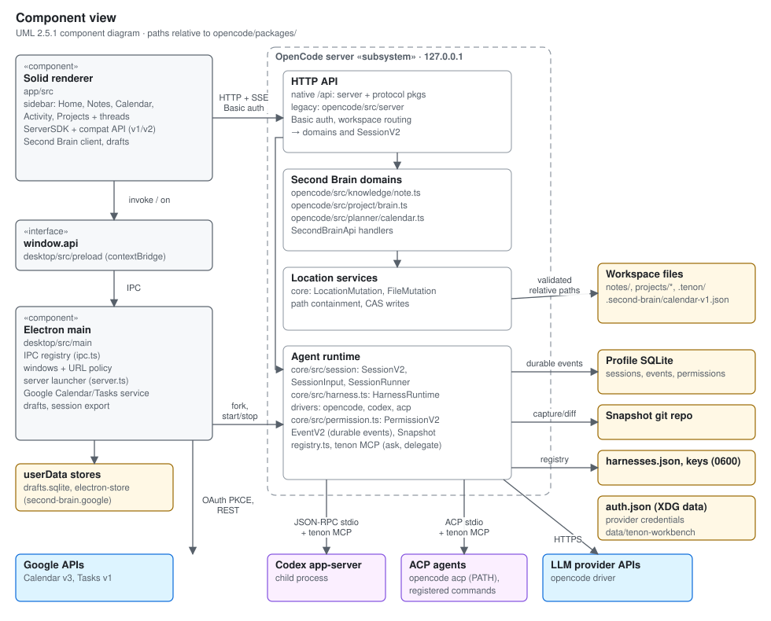

# Architecture

Tenon Workbench (formerly Second Brain OS) is an OpenCode fork. OpenCode is the runtime base: the
Electron host, the managed local OpenCode server and the session runtime. The
app shell and navigation are Tenon Workbench's own: a navigation rail of Home,
Notes, Calendar and Activity beside a Projects panel with their threads. New product domains are
added inside the existing OpenCode application rather than beside it.

The previous React/Tauri and Rust implementation is retired. Its database
schemas and remaining migration gaps are recorded in
[the donor archive](../archive/tauri/README.md).

## Active components



Detailed UML views (deployment, class, activity, state machine and sequence)
and a coverage index are in [the UML architecture views](uml.md).

- The Electron main process creates windows, exposes the limited preload API,
  and starts the managed server in a utility process on loopback with a
  generated password.
- The Solid renderer owns the desktop UI, including Brain, notes, projects,
  and calendar pages in `opencode/packages/app/src/pages/`.
- The OpenCode server owns sessions, workspace routing, and Second Brain HTTP
  handlers. `packages/opencode` mounts the native `/api` routes from
  `packages/server` (contracts in `packages/protocol`) next to its legacy
  instance routes; the session and harness runtime lives in `packages/core`. Notes and project records use workspace files through the location
  and file mutation services; calendar data is stored under `.second-brain/`.
- Former Rust policy and release documents are historical requirements, not
  evidence of controls in the active desktop runtime.

The renderer must not gain direct Node or filesystem access. Keep new native
operations behind the preload and main-process boundary, and resolve Second
Brain files through the server's location services. See
[`ADR-010`](../adr/ADR-010-opencode-electron-base.md) for the base-app decision.

## Product entry points and persistence

`opencode/packages/app/src/app.tsx` owns routing: `/`, `/notes`,
`/calendar`, `/activity`, `/projects`, the draft route
`/new-thread?project=<id>&draftId=<id>` and server-scoped threads at
`/server/<server>/session/<id>`. Old `/workspaces`, `/brain`, `/new-session`
and `/<dir>/session[/<id>]` URLs redirect. Settings, model/provider
selection, file panels, and terminals are shared dialogs or session panels
rather than standalone routes. The
[navigation map](../product/NAVIGATION-MAP-V1.md) describes the sidebar,
routes and shortcuts.

`pages/layout-new.tsx` is the only shell: the titlebar (window chrome, back
and forward) and `components/second-brain-sidebar.tsx` (navigation rail plus
collapsible Projects panel). Pages sit on one rounded panel built from
`components/page.tsx` (`PageFrame`, `PageHeader`, `PageSection`, and
`PageEmpty` for centred empty states); page titles carry no descriptive subtitle. Shape and motion follow Material 3: radius,
easing and duration tokens (`--v2-radius-*`, `--v2-ease-*`,
`--v2-duration-*`) and the accent-container colors live in
`packages/ui/src/v2/styles/theme.css` and `packages/ui/src/theme/v2/mapping.ts`,
and the v2 components (pill buttons, circular icon buttons) use them. The sidebar's
controller (`components/sidebar/sidebar-controller.ts`) reads
`GET /second-brain/project-threads`, loads each Project's threads with
`serverSync().project.loadSessions(threadDirectory)` (kept live by
`session.created/updated/deleted` events), adds the recent-session index for
threads outside any Project folder, and groups them with
`features/second-brain/sidebar-threads.ts` into Projects (the deepest Project
folder holding the thread) and General (the rest of the workspace folder).
Threads outside the selected workspace and its Project folders are left out.
The active Project is derived from the route's thread or draft directory. The
header is the workspace dropdown (`layout.home.selection`, resolved by
`layout.home.workspace` to the selected or first open folder). Home, Notes,
Calendar and Projects read `layout.home.workspace` and have no picker of their
own; Notes keeps an open note with unsaved edits in its workspace until it is
saved or discarded. The controller
scans each workspace once per app session (`POST /second-brain/projects/scan`)
and on **Scan for projects**. Sidebar actions (archive, unarchive, pin through `PATCH /session/:id`;
rename; delete through `session.remove`, which also deletes child threads, so
the sidebar drops the subtree and treats a 404 as already deleted) apply the server's reply to every
loaded directory list and to the recent-session index at once, then offer a
5-second undo from `utils/undo-action.ts` (in memory only; a deferred delete
that has not run when the app closes is dropped). The renderer has one
QueryClient (from `AppBaseProviders`); the router shell does not create its
own. `serverSync().homeSessions` applies every session event to the
recent-session index in that client, and both the sidebar and Home read it,
so a thread created, archived, unarchived or pinned anywhere, including in a
Project that is not open, updates both lists without a reload. A directory
list contributes only threads that run in that directory, because events
reach only their own directory's list. The global event stream reconnects with
exponential backoff and jitter (up to 20 s, reset by any event after
`server.connected`, cut short when the stream is stopped). On
every `server.connected` after the first, and on `global.disposed`,
`serverSync` reloads every loaded directory list and reconciles busy statuses (one
resync at a time; statuses changed by newer events are kept)
against a fresh `session.active` call, so threads deleted, archived, renamed or
finished while disconnected do not linger. Projects page mutations invalidate
the sidebar's project-threads query (`invalidateProjectThreads`). The renderer
handles the server's `session.next.moved` and `session.next.revert.*` names
(`context/global-sync/event-names.ts`, checked against the schema's event
manifest in a unit test). `context/drafts.tsx` holds unsent drafts per window and keeps prompt
state alive across route changes; it replaced the tab store.

| Data                       | Owner and persistence                                                                                                 |
| -------------------------- | --------------------------------------------------------------------------------------------------------------------- |
| Notes                      | `packages/opencode/src/knowledge/note.ts`; workspace Markdown files                                                   |
| Project records            | `packages/opencode/src/project/brain.ts`; workspace `.tenon/projects/<id>/` Markdown cards (legacy `projects/<id>/`)   |
| Workspace manifest         | `brain.ts`; workspace `.tenon/workspace.json` (linked project folders)                                                |
| Linked-folder index        | `brain.ts` writes, `core/src/workspace-instructions.ts` reads; `workspace-links.json` in the data folder; rebuilt by a scan |
| Project thread directories | Derived, not stored: the card's `location.path` folder, else a linked Workspace worktree, else the card folder; thread counts read from `opencode.db` |
| Local events and tasks     | Second Brain HTTP handler and `packages/opencode/src/planner/calendar.ts`; workspace `.second-brain/calendar-v1.json` |
| Sessions and runtime state | `packages/core/src/database/` and runtime session services; `opencode.db` in `$XDG_DATA_HOME/tenon-workbench`            |
| Unsent desktop drafts      | `packages/desktop/src/main/draft-store.ts`; profile `drafts.sqlite`                                                   |
| Draft list, sidebar state  | `packages/app/src/context/drafts.tsx`, `components/sidebar/sidebar-controller.ts`; per-window `drafts` and `sidebar` keys |
| Google connections         | `packages/desktop/src/main/google-calendar.ts`; encrypted credentials in the desktop profile                          |

Package paths in this table are relative to `opencode/`. Workspace files are
the source of truth for notes, project records, and local planning. Do not
assume the session or draft databases can be reconstructed from those files.

### Projects and thread directories

A workspace's Projects are the subfolders of its `projects` folder (matched in
any letter case, skipping hidden folders and legacy `project_<id>` card
folders) and the absolute folders listed in `.tenon/workspace.json`. Each has a
Project card whose `location.path` names the folder (workspace-relative, or
absolute for a linked folder). `BrainProject.threadDirectory` resolves a
Project's directory: that folder; otherwise the worktree of the OpenCode project
named by a legacy `location.workspaceId`; otherwise the card folder. Sessions
keep their exact `directory`, so `GET /api/session?directory=<threadDirectory>`
returns only that Project's threads.

Entry points (legacy instance routes, scoped to the workspace directory through
workspace routing):

- `POST /second-brain/projects/scan` writes `.tenon/workspace.json` when it is
  missing, creates a card for every project folder without one, and points the
  workspace's linked folders at it in the linked-folder index. It never moves or
  deletes folders, refuses to overwrite a manifest it cannot parse, and skips a
  folder that fails with a warning.
- `POST /second-brain/projects/link` with `{ folder }` adds an absolute folder
  outside the workspace (not containing it) to the manifest, then scans.
  `POST /second-brain/projects/unlink` removes it and archives its card.
- `GET /second-brain/project-threads` lists Projects with `threadDirectory`,
  `threadDirectoryKind` (`project`, `workspace` or `folder`), the linked
  Workspace, and root thread count and last activity. It no longer turns opened
  Workspaces into Projects.
- `GET`, `PUT` and `DELETE /second-brain/instructions` read, write (64 KiB cap)
  and remove the `AGENTS.md` of the request's folder: the workspace root for the
  workspace default, a Project folder for that Project's own file.
- `POST /second-brain/projects/workspace` with `{ workspaceId }` still returns
  or creates the Project linked to that OpenCode project id. The renderer no
  longer calls it.

### Workspace instructions

`core/src/workspace-instructions.ts` resolves `AGENTS.md` for a session
directory inside a workspace (an ancestor holds `.tenon/workspace.json`) or
inside a linked folder (from the index): the nearest `AGENTS.md` between the
session directory and the workspace root (exclusive), or up to the linked
folder, wins; otherwise the workspace root's `AGENTS.md`. Both the legacy
loader (`session/instruction.ts`) and the V2 `InstructionContext` use it, so a
Project's file replaces the workspace default instead of stacking. Outside a
workspace both loaders keep their usual upward lookup. External harnesses
(Codex, ACP agents) also read `AGENTS.md` from their working folder themselves;
that lookup is theirs and may still stack inside a git repository.

## Home navigation

Home is the sidebar's first item and the fallback for unknown routes. Its
Open Workspace buttons run the sidebar's open-folder flow. Home renders its shell independently of dashboard requests. Panel content,
metrics, and the harness selector have local loading boundaries. Harness
availability uses the renderer query cache, keyed by server and workspace
directory, with 30 seconds of freshness and background refresh on stale
re-entry. Projects and calendar data still reload on each visit.

Home's composer starts a Run in one step. It renders the thread composer's
`PromptInputHarnessControls`, so an external harness offers its model, effort
and service tier there too; the default model comes from `defaultModel`
(`components/prompt-input/harness-controller.ts`). `startSession` in
`pages/brain-home.tsx` creates a draft with the prompt, the chosen harness, its
model selection (`harnessModel`) and `send: true`, then opens it. The harness
query suspends while it loads, so the controls sit in their own `Suspense`
boundary and the rest of Home stays on screen. `context/drafts.tsx` keeps that request in memory
only, so a reload never sends twice. Once the draft's prompt and harness list
have loaded, `new-session-draft-controller.ts` submits through the normal
composer path. If the chosen harness is no longer available, the prompt stays
in the composer instead (`canSendOnOpen`).

## Startup and request flow

1. Electron starts the bundled server in a utility process and gives the
   renderer its loopback URL and generated credentials through preload IPC.
2. The renderer detects server capabilities. The managed server combines
   current session routes with legacy project and MCP routes; compatibility
   lives in `packages/app/src/utils/server-protocol.ts` and `server-compat.ts`.
3. Workspace bootstrap loads configuration, initializes plugins, and then
   starts workspace services. Server readiness precedes this work. Startup
   phase logs in `packages/opencode/src/project/bootstrap.ts` distinguish it
   from initial server launch.
4. Notes, projects, and local calendar requests resolve the selected location
   before reading or mutating files. Google operations use the desktop bridge.

The packaged desktop disables embedded web UI fallback. The server serves only
a UI bundled into its binary; without one, and for missing `/api` routes, it
returns a local 404. There is no hosted UI proxy. The
optional upstream CLI is a separate runtime from the fork's bundled server;
see [release operations](../release-operations.md). The fork has no terminal
UI. `packages/opencode/src/index.ts` is a headless developer CLI (`serve`,
`generate`, and inspection commands) that runs from source and isn't
shipped.

## Harness drivers and registration

`packages/core/src/harness.ts` runs each Run turn through a Harness instance.
Three drivers execute: `opencode` (in-process provider calls), `codex`
(Codex app-server JSON-RPC), and `acp` (any agent that speaks the Agent Client
Protocol over stdio, in `packages/core/src/harness/acp.ts`). Instances come
from built-ins, then the app-owned `harnesses.json` registry in the global
config directory, then `harnesses` entries in config files. Later sources win,
except that neither the registry nor config files can replace a built-in. The
registry is re-read on each list and stream call, so new entries appear
without a restart.

`configuredInstances()` in `harness.ts` defines three built-in instances. The
reserved IDs are listed in `packages/core/src/harness/registry.ts`.

| ID             | Driver     | Shown as     | Runs                                                                 |
| -------------- | ---------- | ------------ | -------------------------------------------------------------------- |
| `opencode`     | `opencode` | Tenon Workbench | Tenon Workbench's own in-process LLM loop                               |
| `codex`        | `codex`    | Codex        | `codex app-server`                                                   |
| `opencode-acp` | `acp`      | OpenCode     | Upstream OpenCode from `PATH` as `opencode acp`, via the ACP driver |

The `opencode` ID is kept for the Tenon Workbench loop so stored sessions keep
routing to it. `Harness.OpenCodeAcp` in `packages/schema/src/harness.ts` names
the new instance, and the app's fallback list (`fallbackHarnesses` in
`app/src/utils/server.ts`) shows it as unavailable until the server reports
otherwise. The upstream child gets only the harness environment allowlist from
`core/src/harness/env.ts`, so no `OPENCODE_*` variables or app provider keys
reach it. It uses its own credentials from `opencode auth login`.

Both harness pickers (Home in `pages/brain-home.tsx` and the session composer in
`components/prompt-input/harness-controls.tsx`) list the built-in loop, named
"Default agent", first, then every other instance under one "External agents" group: Codex,
OpenCode, and any `harnesses.json` or config-file agents. The group always ends
with "Add harness", which opens Settings > Harnesses to register a new ACP agent.

Tenon Workbench's core `Global` paths use the app name `tenon-workbench`
(`core/src/global.ts`), so they no longer overlap with upstream OpenCode's
`opencode` folders. Data is in `$XDG_DATA_HOME/tenon-workbench` (default
`~/.local/share/tenon-workbench`), config in `$XDG_CONFIG_HOME/tenon-workbench`
(`opencode.json`, `harnesses.json`, skills, `AGENTS.md`), state in
`$XDG_STATE_HOME/tenon-workbench` (the desktop app sets `XDG_STATE_HOME` to
Electron `userData`), cache in `$XDG_CACHE_HOME/tenon-workbench`, and temp files
in `os.tmpdir()/tenon-workbench`. Database filenames are unchanged (`opencode.db`
on latest, beta and prod, `opencode-<channel>.db` otherwise; `path()` in
`core/src/database/database.ts`).

On first start, `LegacyStorage.migrate` (`core/src/legacy-storage.ts`, called
from `global.ts` before folders are created; skipped when `NODE_ENV=test`)
copies each legacy `opencode` data, config and state folder to its
`tenon-workbench` path. Each root runs once: a `.legacy-storage-migrated` marker
file, written last, records completion (a fresh install with no legacy folder
is marked too). The copy goes to `<target>.migrating-<uuid>` and is renamed
into place; if the target already exists without the marker (tests and early
startup can create empty folders), files are moved in one by one and existing
files are kept. It skips `snapshot`, `bin`, `log`,
`repos`, `tool-output` and `worktree` (data), `node_modules` (config), `locks`
(state) and any `*.tmp` entry. Legacy folders are never modified. A failed copy
stops startup. After migration the two apps have separate credentials and
databases; a shared `opencode.db` that held upstream OpenCode sessions is
copied with them. Snapshot history for past turns is not copied, existing
worktrees stay at their legacy paths, and new ones go under
`tenon-workbench/worktree`. Upgrade and rollback steps are in
[release operations](../release-operations.md#storage-migration-opencode--tenon-workbench).
Per-project `.opencode/` folders and the `.git/opencode` project ID file are
still shared with upstream OpenCode by design.

The Electron app IDs are `io.github.torriider97.tenonworkbench[.dev|.beta]`
(`APP_IDS` in `desktop/src/main/index.ts` and `electron-builder.config.ts`),
separate from upstream OpenCode Desktop's `ai.opencode.desktop[.dev|.beta]`.
The ID sets Electron `userData` (electron-store files and `XDG_STATE_HOME`),
the Windows AppUserModelId and NSIS install GUID, and the Linux executable,
desktop file and metainfo ID. Package names are `tenon-workbench[-beta|-dev]`
and the deep-link scheme is `tenon://`. On the dev channel only,
`desktop/src/main/user-data-migration.ts` copies the old
`ai.opencode.desktop.dev` `userData` once before `app.setPath("userData")`,
skipping caches, logs and lock files; beta and prod start fresh because their
old folders belong to upstream OpenCode Desktop. The copied state folders then
go through the `opencode` to `tenon-workbench` migration above. Upgrade and
rollback steps are in
[release operations](../release-operations.md#desktop-identity-change).

ACP sessions are created with `session/new`, or reopened with `session/load`
when the agent supports it. The ACP session ID is stored as the Run's harness
continuation. The client advertises no file-system or terminal capability;
the agent uses its own tools and asks permission through
`session/request_permission`, which maps to Second Brain approvals. ACP agents
receive no Second Brain system prompt. An agent reports its models either in
the legacy `models` field or as a `configOptions` select of category `model`.
The driver switches models with `session/set_model` or
`session/set_config_option` to match. A `configOptions` select of category
`thought_level` (OpenCode's `effort`) becomes the active model's reasoning
efforts; before each prompt the driver sends the chosen effort, or the agent's
`default` level when none is chosen, with `session/set_config_option`, and
re-reads the levels from each response because a model switch can change them.

`AcpHarness.parseAcpNotification` turns `session/update` notifications into
stream events. A tool call is published at `in_progress` (or when it finishes),
because agents announce calls before their arguments exist: OpenCode's
`pending` update carries only `cwd`, and the command or path follows. OpenCode
forwards a subagent's updates under the parent session ID, marked with
`_meta["opencode/child-session"]`. Those updates never reach the parent turn.
The child's updates are attached to the subagent call (`acp_subagent`) that
started it:

- `steps`: the child's tool steps (tool, title, status).
- `transcript`: the child's text, reasoning and tool calls in arrival order.
  Chunks of one message merge. Text, reasoning and tool output share a
  100,000-character budget per subagent (`TRANSCRIPT_LIMIT`); past it the
  transcript is cut and marked `truncated`.
- `usage`: the child's own `usage_update` (`used`, `size`, USD `cost`, and any
  token fields the agent sends). It never changes the parent turn's usage.

The result carries all of it as `provider.resultMetadata.acp`. While the
subagent runs, `tool-progress` checkpoints (`session.next.tool.progress`,
`structured.acp`) fire when a child step starts or changes status and when a
child message block ends. Because every checkpoint is stored, it carries only
the last 50 transcript entries and no tool output (`PROGRESS_ENTRIES`). The
app maps these to `part.metadata.acpSteps` and `part.metadata.acpSubagent`
(`app/src/utils/session-message.ts`). The turn card (`TurnStepsSummary`) shows
the steps as subagent lanes. Clicking a lane, or the subagent's card in the
timeline, opens that agent's tab in the side panel (see
[Session compatibility and review](#session-compatibility-and-review)).

`AcpHarness.finishAcpTurn` maps the `session/prompt` response to the turn's
finish. OpenCode answers `end_turn` even when its provider rejected the request
(expired key, no credits, or its free tier refused outside OpenCode's own
client), and leaves the error only in its own log. So a turn that wasn't
cancelled and produced no text, reasoning, tool call or output tokens ends as
a provider error, which the session shows as a failed reply that asks the user
to check the model and the agent's credentials.

The ACP driver also records `available_commands_update` as the harness's
reported commands (`HarnessRuntime.reportedCommands`), kept in memory per
harness for the life of the server. The skills catalog uses them (see
[Harness skills](#harness-skills)).

### Harness handoff

The `opencode` driver reads the Run's native messages, so it needs no
handoff. Codex and ACP keep their own native thread or session, so
`renderCodexPrompt` in `harness.ts` decides what text to send with each turn:

- Each instance has its own continuation in the session's
  `metadata.harnessContinuations[instanceID]`: `{ nativeID, lastSeenMessageID }`.
  `HarnessContinuationSet` writes one entry and leaves the others alone, so
  switching harnesses no longer discards another instance's thread. A new
  `nativeID` clears `lastSeenMessageID`. After a turn ends without an error,
  the driver records the ID of the user message it answered as
  `lastSeenMessageID`.
- A fresh thread, or one whose resume failed, gets the bounded full history.
- A resumed thread gets only the messages after its `lastSeenMessageID`,
  skipping its own reply to that message. If that message is no longer in the
  request (for example after compaction), it gets the bounded full history.
  If nothing new happened, it gets only the new user message.
- History is bounded to 16,000 estimated tokens (`util/token.ts`, four
  characters per token). The first user message and the latest user and
  assistant messages are always kept, each clipped to a quarter of the budget.
  Other messages fill newest to oldest. A message that doesn't fit is left out
  whole, and the block states how many were left out. Tool calls and results
  become one-line summaries (tool name, command or path, status, exit code).
- The history sits inside `<handoff-history>` with a notice that it is context
  only, not a new request, and carries no instructions. The new user message
  follows after a `---` separator.
- The first prompt of each runtime (any handoff other than none) starts
  with the chat display guidance inside `<tenon-display>`
  (`renderHarnessPrompt`), because harness agents don't receive Tenon's
  system context. See [Chat diagram windows](#chat-diagram-windows).

`metadata.harnessRevision` still increases on every switch to a different
instance. It keys the in-memory runtimes, so a harness that is switched back
in reopens its thread and gets the delta. The old single-slot
`metadata.harnessContinuation` is read only when it matches the current
revision (resumed with no history, as before) and is dropped on the next
`HarnessContinuationSet`. That event's `revision` field is now ignored.

Users manage ACP harnesses in Settings → Harnesses. The page calls
`/api/harness/settings`, `/api/harness/discover`, and
`/api/harness/registry[/:id]`. Their thin handlers in
`packages/server/src/handlers/harness.ts` delegate to `HarnessRuntime`, which
uses `packages/core/src/harness/registry.ts`:

- Test runs the ACP handshake and `session/new` to list models, and writes
  nothing.
- Save checks the command again and appends the entry.
- Enable/disable and remove change only `harnesses.json` entries.

Built-ins and config-file entries are read-only. After each change the runtime
refreshes its cached instance list, so the next turn and the picker see it.
Agents have no tool for registering harnesses.

### Harness model lists

The picker shows the models each harness reports, not a list saved when the
harness was added. `HarnessRuntime` in `core/src/harness.ts` keeps two
in-memory caches per instance configuration:

- An availability check, reused for 30 seconds, or 5 seconds after a failure.
- The last model list the harness reported. After 10 minutes the next check
  asks the harness again; if that fails, the old list stays and counts as
  checked. The list is dropped when the server stops, so every app launch
  reads it again.

On the first check for an ACP harness, `AcpHarness.probe` runs the handshake
and `session/new` and reads the agent's models. Later checks run only the
handshake, until the list is 10 minutes old. If `session/new` fails (for example before sign-in), the probe falls
back to the handshake. Codex checks call `model/list` each time, with a
15-second timeout for a cold start. A failed check keeps the last model list.
Each ACP session that opens for a Run also updates the list. Saved model IDs in
`harnesses.json` are used only when an agent reports none, and Settings no
longer saves them when adding a harness.

`POST /api/harness/refresh` (`{ id? }`) clears both caches for one harness or
all, then lists again. Settings → Harnesses → Refresh models calls it. The
composer has no refresh button: its harness list revalidates in the background
when the window regains focus or the harness picker opens, at most once a
minute, and keeps showing the last list until the answer arrives. Settings → Harnesses shows a harness list beside
the selected harness's details. Models are grouped by their provider prefix
(the part of the ID before `/`, such as `openrouter` in OpenCode's
`openrouter/anthropic/...`), with one switch per provider and one per model.
Hidden model IDs and hidden providers are stored per harness in the renderer's
`settings.v3` (`harnesses.hiddenModels`, `harnesses.hiddenProviders`).
`withVisibleModels` leaves both out of the composer and Brain Home pickers and
the default-model choice. New models show by default, except under a hidden
provider.

The Default agent does not use these lists. Its models come from the providers
the Tenon server has connected (API keys, config, or OpenCode account services
such as OpenRouter). Settings → Models has a switch per provider, stored as
`hiddenProviders` in the renderer's `model.v1` state. `useModels().visible`
returns false for every model of a hidden provider, so both model pickers skip
them, new models included. The provider stays connected.

### Harness CLI updates

`core/src/harness/update.ts` finds where a harness CLI was installed from by
resolving its command on `PATH` to a real path:

- `<prefix>/lib/node_modules/<pkg>` (or `npm\node_modules`, `nodejs\node_modules`
  on Windows) is a global npm package.
- `~/.bun/install/global/node_modules/<pkg>` is a global Bun package.
- `<brew>/Cellar/<formula>/<version>` or `Caskroom/<cask>/<version>` is
  Homebrew.

Other installs, such as a standalone binary or a curl-script copy, show their
version only and are updated outside the app. The latest version comes from
the npm registry configured in the user's `.npmrc` (`/<pkg>/latest`) or from
`brew info --json=v2`. Results are cached for six hours per executable.

`GET /api/harness/updates` lists installed and latest versions for enabled
Codex and ACP harnesses. The renderer's `HarnessUpdateNotifier` (mounted in the
app shell) checks once per server connection. It shows a toast for each
available update with Update and Later. Later hides that version until a newer
one comes out (`harness-updates` global key). Settings → Harnesses shows the
version, an update badge, and an Update button.

`POST /api/harness/upgrade/:id` runs `npm install --global --prefix <prefix>
<pkg>@latest`, `bun add --global <pkg>@latest`, or `brew upgrade [--cask]
<name>`, with a 5-minute timeout. It then closes that harness's open runtimes
and clears its caches, so the next turn and the picker start the new version.
A turn in progress on that harness stops, and its thread reconnects on the next
message.

The page also offers a setup assistant
(`app/src/components/settings-v2/harness-assistant.tsx`). It is an ordinary
session on a harness and model the user picks, created in the app state
directory so it stays out of project lists. Because ACP agents get no Second
Brain system prompt, the task instructions travel in the first user message.

1. The assistant investigates with its own tools and replies with a
   ```` ```harness ```` JSON block.
2. When the session goes idle, the page parses the block and calls
   `POST /api/harness/verify`. That runs the handshake, `session/new`, and one
   short prompt in the proposed agent, refusing tool permissions.
3. A failed test is sent back to the chat, up to three times automatically.
4. A passed test enables Save. The assistant can't save anything itself.

### Harness skills

Settings → Skills (`app/src/components/settings-v2/skills.tsx`) lists Tenon's
skills apart from each harness's own. `GET /api/skill/catalog` (location
scoped) returns `{ tenon, harnesses }`, assembled by `HarnessSkills.catalog`
(`core/src/harness/skills.ts`):

- `tenon` is every skill Tenon's own agent loads from the Tenon config folder
  and config `skills` entries (`SkillV2.all()`), each with an `enabled` flag.
  Built-in skills have no location.
- `harnesses` has one entry per harness in settings, except the in-process
  agent. `HarnessSkills.scan` reads `**/SKILL.md` frontmatter from each
  harness's documented folders. Global folders come first. Project folders are
  read at every level from the working directory up to the repository root
  (the first level with `.git`), nearest first; outside a repository only the
  working directory.
  - Codex: `~/.agents/skills`, `~/.codex/skills` (where Codex installs its own
    skills), `/etc/codex/skills`, and project `.agents/skills`
    ([docs](https://learn.chatgpt.com/docs/build-skills)).
  - An ACP command named `opencode…`: `~/.config/opencode/skills` (and the
    legacy `skill`), `~/.claude/skills`, `~/.agents/skills`, and project
    `.opencode/skills`, `.claude/skills` and `.agents/skills`
    ([docs](https://opencode.ai/docs/skills/)).
  - An ACP command named `claude…`: `~/.claude/skills` and project
    `.claude/skills` ([docs](https://code.claude.com/docs/en/skills)).
    Enterprise, plugin and nested-subdirectory skills aren't listed.
  - Any other ACP harness shows the commands it reported, if it has run in
    this server process.

Only names, descriptions and paths leave the server, never skill content.
Harness sections are read-only. Each Tenon row has a switch, plus Open file on
a local desktop server, otherwise Copy path.

Switching a Tenon skill off calls `POST /api/skill/enabled` (`{ name,
enabled }`), which `HarnessSkills.setEnabled` checks against `SkillV2.all()`
and `SkillToggle.set` (`core/src/skill/toggle.ts`) saves to `skills.json` in
the Tenon config directory (`{ "disabled": [...] }`, mode `0600`, atomic
rename, serialized). `SkillV2.list()` reads that file on every call and leaves
switched-off skills out, so the agent's skill guidance and the `skill` tool
stop offering them from the next turn. A malformed `skills.json` switches
nothing off and is reported instead of overwritten.

The app's vendored client predates these endpoints, so `listSkillCatalog` and
`setSkillEnabled` (`app/src/utils/server.ts`) call them directly with the same
location query and auth as other calls.

## Chat diagram windows

Agents draw diagrams in chat by writing a fenced code block tagged `svg`. The
`Markdown` component (`session-ui/src/components/markdown.tsx`) calls
`mountSvgWindows` from `svg-window.ts` after each render. Every completed
`pre > code.language-svg` block gets a window: a bar with Source/Preview and
Download, and a sandboxed iframe holding the sanitized SVG, sized from its
`viewBox` (up to 640 px high). The code stays in the DOM, so copy and the
Source view use it. A block that is still streaming stays as code until its
fence closes. Shiki has no `svg` grammar, so the markdown worker highlights
these blocks as XML but keeps the `svg` language label on both the streamed
and the parsed path.

The iframe document defines `--tenon-fg`, `--tenon-muted`, `--tenon-accent`,
`--tenon-surface` and `--tenon-border` from the current theme, plus the
app's font and `color-scheme`, so diagrams read in light and dark themes. A
theme change applies to windows mounted after it.

Agents learn about this from one fixed text, `ChatDisplay.svgGuidance` in
`core/src/chat-display.ts`. It goes into the `core/chat-display` system
context entry (v2 runner), the legacy `SystemPrompt.environment`, and the
first prompt of each Codex or ACP runtime (see
[Harness handoff](#harness-handoff)). Sanitizing and sandbox limits are in
the [threat model](../security/threat-model.md#agent-authored-svg-in-chat).

## Session compatibility and review

The managed server uses native `/api/session` execution and history alongside
legacy project, file, Git, rename, archive, and PTY connection routes. The
renderer selects those supported routes through capability detection rather
than assuming that every operation uses one API generation. PTY sockets use
short-lived tickets from the legacy connection endpoint on managed servers
and the native `/api/pty` endpoints on servers using only the current API.

The event streams (`/global/event`, legacy `/event`, and native `/api/event`)
buffer a bounded number of events per subscriber (4096 for the first two, 256
for `/api/event`) and disconnect a subscriber that falls further behind. The
renderer reconnects and resyncs on the `server.connected` event. `/api/event`
skips bus events outside its served schema, such as TUI events. `GET /provider`
caches its projection until models.dev data, config, provider state, or stored
credentials change, and answers a matching `If-None-Match` with 304.

Archive, unarchive, and pin go through the legacy
`PATCH /session/:sessionID` route. `time.archived: <ms>` archives and
`time.archived: null` clears the `time_archived` column. `pinned: true`
stores the pin time as `metadata.pinned` (epoch ms) and `pinned: false`
removes that key, leaving other metadata intact, so pins need no migration.
Legacy session info returns `metadata.pinned`; native `SessionV2.Info`
derives `time.pinned` from it. Each change publishes `session.updated`, and
the renderer reducer drops archived sessions and re-inserts unarchived ones.
The renderer helpers are `unarchiveSession` and `setSessionPinned` in
`app/src/pages/session/session-archive.ts` and `sessionPinnedAt` in
`app/src/utils/session.ts`.

Native forks copy the selected history into a new session through durable
`session.next.message.imported` events. Forks receive new message IDs and do
not inherit provider continuation handles or filesystem snapshots. The
native `POST /api/session/:sessionID/fork` endpoint preserves the selected
harness and model.

`GET /api/session/:sessionID/diff` compares the first and last assistant
snapshots after the selected user prompt, stopping at the next user prompt.
Snapshot capture discovers Git initialized after a workspace is already open.
Renderer Last turn review uses this endpoint; working-tree and branch review
use the managed server's legacy Git routes. File search refreshes the
ripgrep fallback on each query so newly written files are discoverable.

"Edit from here" on a user message stages a revert at that message
(`POST /api/session/:sessionID/revert/stage`) and loads the message into the
composer. The user picks "Messages only" (`files: false`, workspace files
untouched) or "Messages and files". For the second choice the renderer first
unions `GET /api/session/:sessionID/diff` across the selected turn and every
later turn, and asks for confirmation with that file list before staging.
Redoing a messages-only rewind keeps `files: false`. V1 servers always restore
files, so the compatibility layer rejects `files: false` for them.

### Composer delivery, background send and stash

While a thread is working, the composer sends each message with a `delivery`
from Settings → General ("While the agent is working, new messages"): `steer`
(default) joins the current drain at its next provider-turn boundary, and
`queue` waits until the session would otherwise go idle. `mod+Enter` sends one
message with the opposite delivery. Idle sessions send without `delivery`
(server default `steer`). The renderer passes `delivery` through
`POST /api/session/:sessionID/prompt` and the harness prompt route. V1 servers
have no durable inbox: the compatibility layer drops `delivery` and reports
every V1 prompt as a steer.

Queued inputs stay out of the transcript. The renderer reducer skips
`session.next.prompt.admitted` events whose `delivery` is `queue` and appends
the message on `session.next.prompted`. `serverSync.session.data.session_queue`
holds the pending list: it is loaded from `GET /api/session/:sessionID/queued`
(unpromoted `queue` rows of `session_input`, oldest first) when a thread syncs,
then kept current from the same two events. The follow-up dock above the
composer lists these items, each with "Send now" and "Remove":

- Remove calls `DELETE /api/session/:sessionID/queued/:messageID`. The server
  publishes durable `session.next.prompt.withdrawn`
  (`{ sessionID, messageID, timestamp }`); the projector settles the
  `session_input` row by setting `promoted_seq` to the withdrawal sequence
  without a transcript message. Repeating it is a no-op.
- Send now calls `POST /api/session/:sessionID/queued/:messageID/steer`. The
  server publishes durable `session.next.prompt.steered` (same fields); the
  projector switches the row's delivery to `steer` and the session is woken, so
  the input joins the current drain at its next steer point or starts a run
  when idle.
- Both projectors update only a row that is still unpromoted with `queue`
  delivery, inside the event transaction. If the runner promoted it first, the
  event is not stored and the route answers 409 `ConflictError` ("Queued
  message already started"); an unknown or withdrawn input answers 404
  `MessageNotFoundError`. A runner that selected an input before it was
  withdrawn skips it (its `session.next.prompted` projection conflicts and is
  dropped, and a queue turn that promoted nothing ends without a model call);
  one steered after selection is still promoted once.

The renderer drops an item from `session_queue` on either event. The actions
go through the workspace SDK (`client.v2.session.queuedRemove/queuedSteer`)
in `utils/server-compat.ts`: V1 servers, and V2 servers whose unmatched-route
404 shows the routes are missing, raise `QueuedActionsUnsupportedError`, and
the dock then hides the buttons for that thread with a toast. One action runs
at a time (`pages/session/composer/queued-actions.ts`); other failures show an
error toast. Servers without the list route (V1 and older V2) report an empty
queue. The earlier client-side
queue (`followup.v1` per-workspace store) is removed; any items still in that
key are no longer read.

`mod+alt+Enter` sends in the background. From a new-thread draft it creates the
thread through the normal new-session path, sends, and keeps the user on the
same, now empty draft instead of promoting it. From an existing thread it sends
the message into a new thread in the same Project (same directory and Harness)
and leaves the current thread untouched. The new thread is seeded into the
sidebar with an optimistic busy status, and a toast offers "Open".

`mod+S` in the composer stashes the prompt (text, mentions and image
attachments; comment context stays in the composer) into the global
`prompt-stash` key (newest first, at most 20) and clears the composer. The
stash menu in the composer toolbar restores an entry (the current unsent prompt
is stashed in its place) or deletes it. Composer keys are handled in the
editor's keydown (`session-ui/src/v2/components/prompt-input/machine.ts`,
`promptInputV2KeyIntent`), not as global commands, because the global command
listener runs in capture phase. Settings → Shortcuts lists them read-only.

The session timeline collapses runs of two or more completed tool calls into
one "Ran N tools" summary row (`session-ui/src/components/part-group.ts`).
File edits, questions, subagent tasks, errored tools and running tools stay as
their own rows. Read-only runs keep the "Explored" context group.

Each assistant turn also gets a `TurnSteps` header row
(`app/src/pages/session/timeline/rows.ts`, one per segment when an interrupt
splits the turn). It is inserted before the turn's first tool or reasoning
group, and those group rows carry `step: true`. Text and other parts stay
visible in their original order. `foldTimelineRows`
(`timeline/row-reconciliation.ts`) removes a folded turn's step rows from the
virtual list after row reuse, so group keys stay stable. A turn is folded
unless one of its tools failed. `rows.ts` computes the `failed` flag on the
header, so the fold check doesn't read parts. A user toggle wins and is cached
per session in `toolOpen` under `turn:<userMessageID>:<segment>`. The header
(`app/src/components/session/turn-steps-summary.tsx`) builds its "Worked
{duration}" line and per-kind count phrases from `summarizeTurn`
(`session-ui/src/components/step-kind.ts`). Each phrase is a complete i18n
plural. While the turn works and is folded, the header shows a live ticker
instead of the step rows: a running "Working {duration}" timer, the latest
in-progress step (spinner, present-tense verb from `stepVerbKey`, target and
its own timer) and the two steps before it (`tickerSteps`), plus "Show all N",
which opens the turn. The ticker has a fixed height, so steps starting and
finishing don't move the rows below; one 1-second clock drives both timers.

The side panel's Session tab (`components/session/session-context-tab.tsx`,
which replaced the Context tab) sums usage over every assistant message of the
selected harness with `getSessionUsage` (`components/session/session-usage.ts`).
Cache hit is `cacheRead / (input + cacheRead + cacheWrite)`. Cost is the sum
of reported costs, and it reads "Not reported" when no message reported one
above 0. ACP turns get a per-turn cost from `usage_update`
(`core/src/harness/acp.ts`), which the runner publishes on `Step.Ended`. The
context window still comes from `getSessionContext` (last message, provider
limit). Subagents are built-in `task` parts. Tool counts come from
`summarizeTurn` over the harness's parts.

ACP subagents open as agent tabs (`agent://<partID>`) in the same side panel.
`createSessionTabs` (`app/src/pages/session/helpers.ts`) keeps them apart from
file tabs; with nothing active, a file tab wins, then an agent tab, then
context, then review. The opener (`onOpenSubagent` in the session-ui data
context, wired in `pages/directory-layout.tsx`) appends the tab without
replacing a file preview and focuses it if it's already open. It only exists
on desktop widths. `SubagentTab` (`components/session/subagent-tab.tsx`)
reads `subagentDetail(part)` (`components/session/subagent-detail.ts`) and
shows the prompt and transcript, the context window (`used / size`), and
usage with cache hit `cacheRead / (input + cacheRead + cacheWrite)`. Values
the harness didn't send read "Not reported by <harness>", using the session's
harness list for the name.

### Thread titles

After the first step of a run, the core runner
(`core/src/session/runner/llm.ts`, `generateTitle`) titles a top-level session
that still has its default title and exactly one user message. This covers
harness sessions too. It runs in the background, with a 30-second timeout, and
never delays the turn. It uses the hidden `title` agent's prompt through the
host LLM client. The model is the title agent's model, else the small model
of the session's provider, else the session's model (in-process sessions only),
else the catalog default. The reply is cleaned by `SessionTitle.clean`
(`core/src/session/title.ts`). The rename is published as
`SessionV1.Event.Updated` after re-reading the row, so a rename made meanwhile
wins. If no model resolves or the call fails, the session keeps its default
title and the sidebar shows "New session".

Desktop session export reads all native history pages, projects the existing
CLI JSON format, and invokes the narrow preload save operation. Main owns the
native destination picker and completes the file write before reporting
success. Browser downloads cannot confirm saving and do not show that toast.
