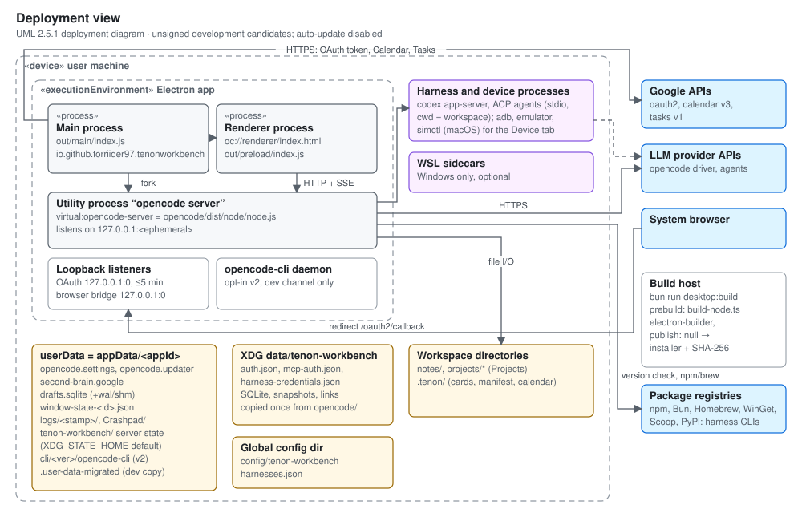
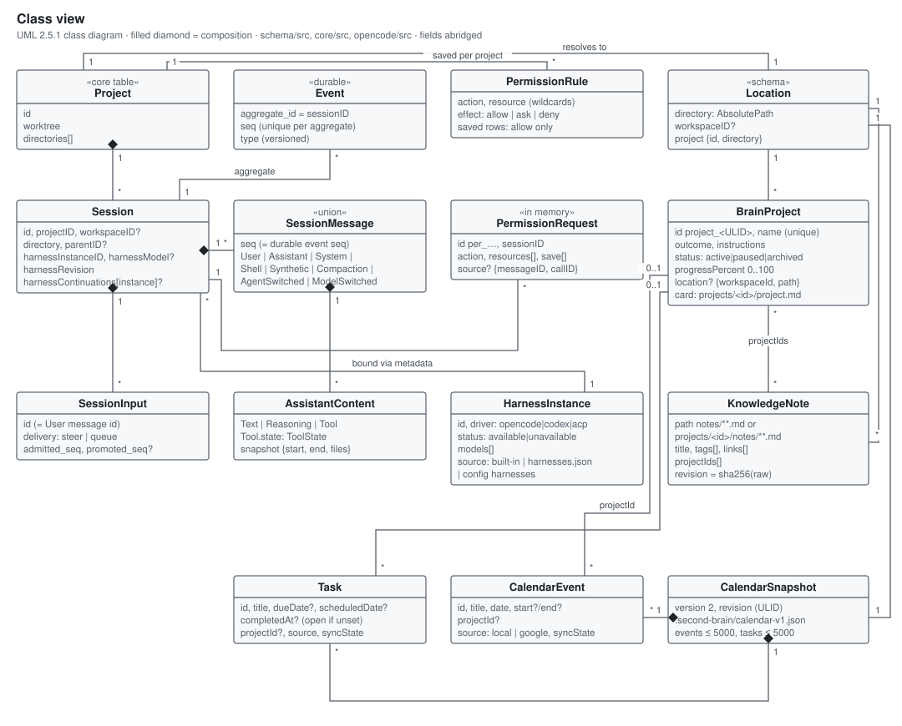
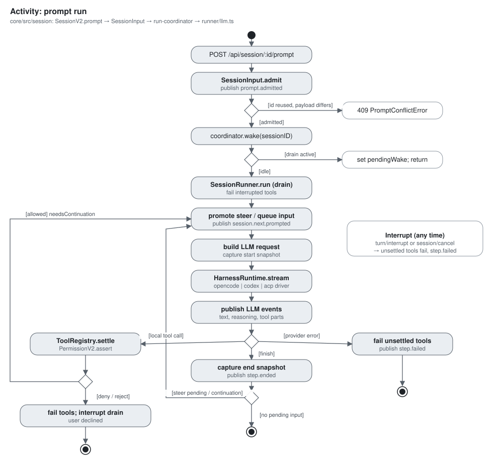
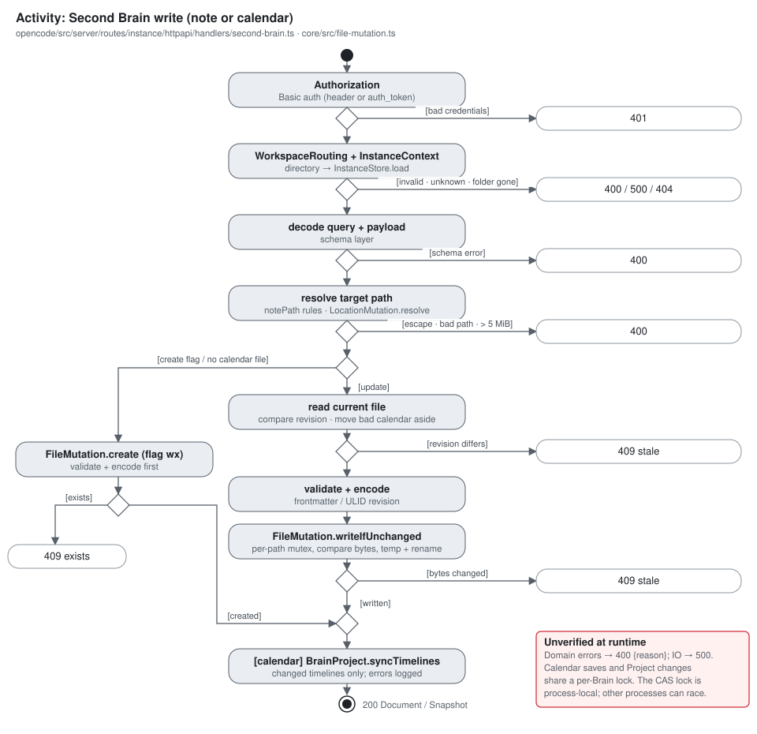
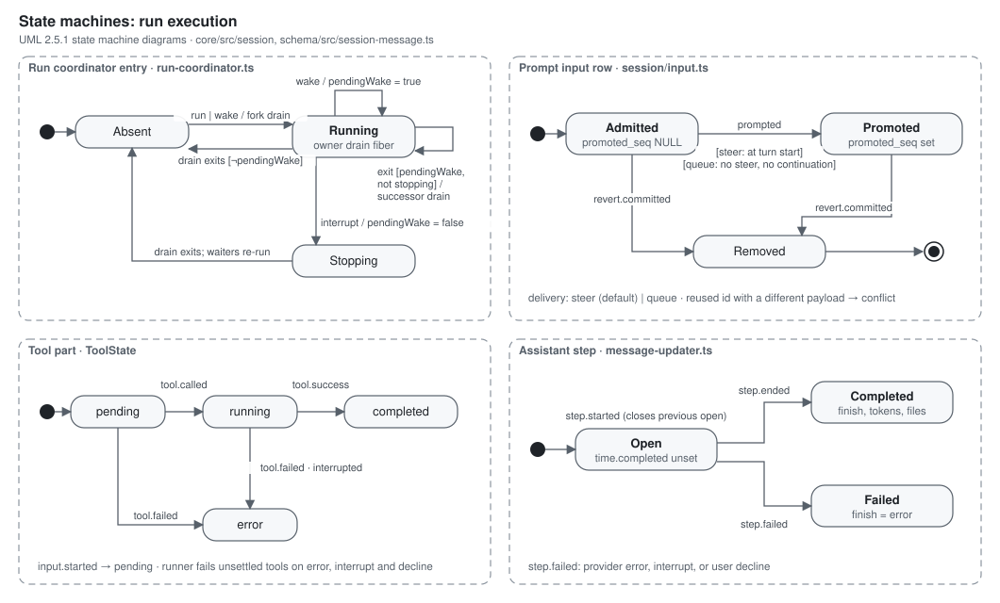
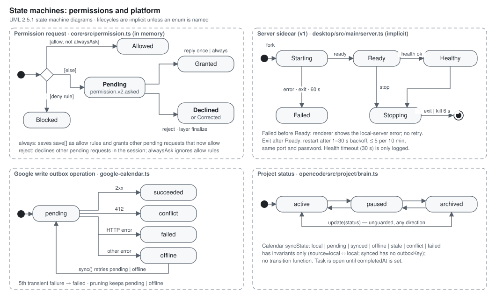
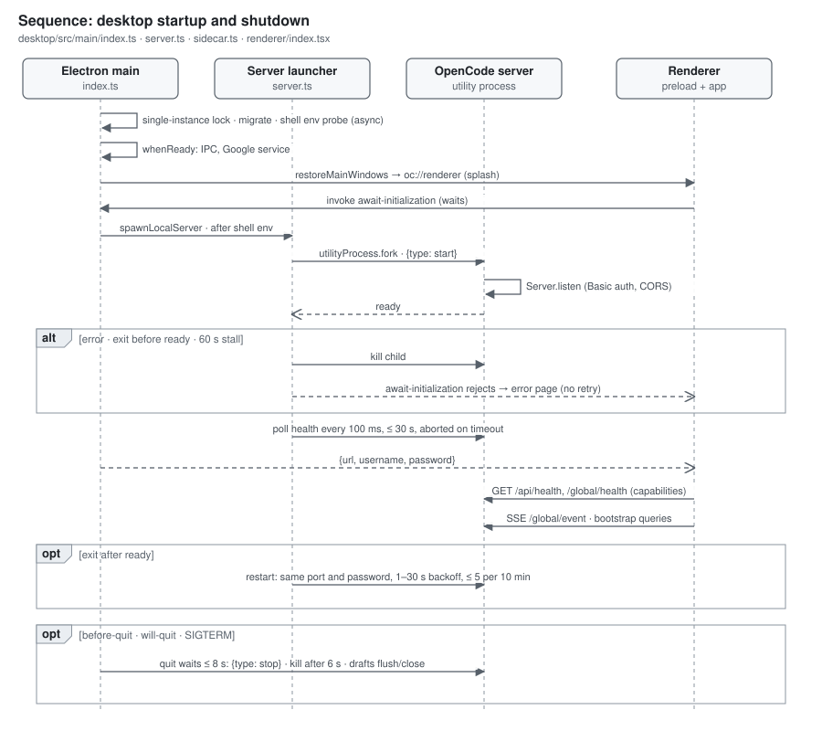
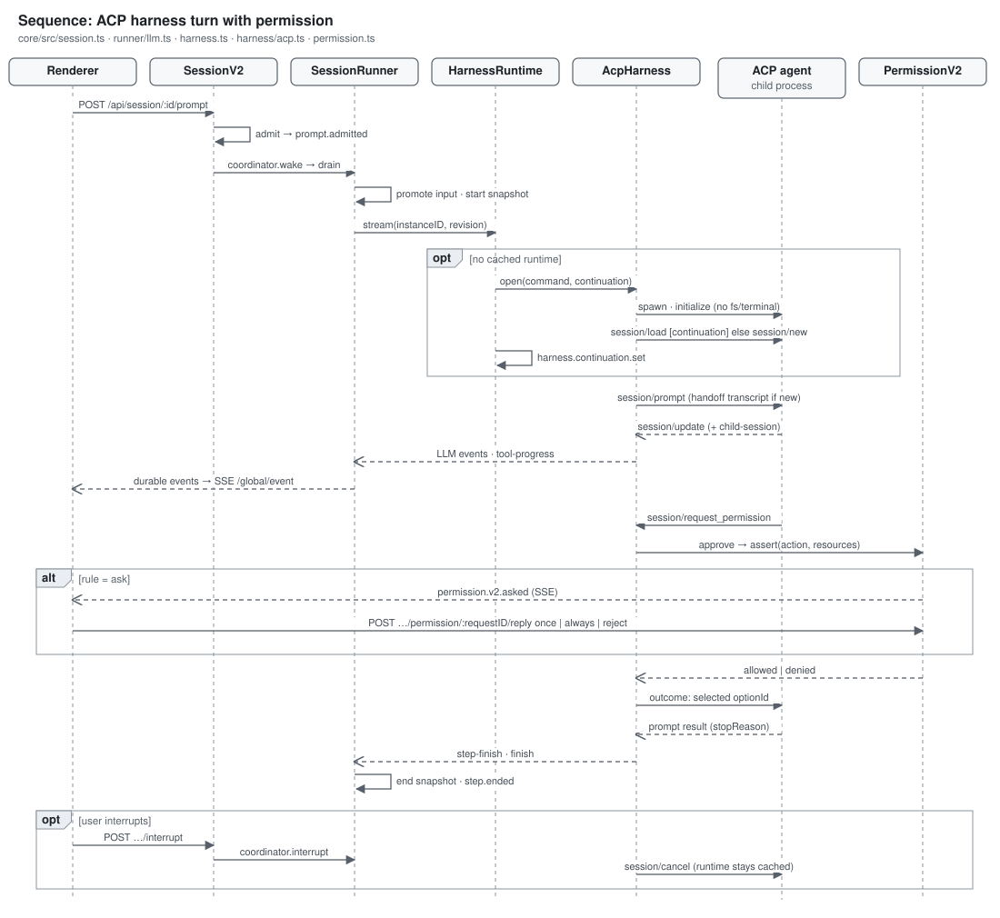

# Architecture views (UML)

This is the master graph document for the active Electron/OpenCode app. The
[architecture overview](README.md) explains component boundaries in prose,
and the [threat model](../security/threat-model.md) owns trust boundaries.
This document holds the detailed views.

Conventions:

- Notation follows [UML 2.5.1](https://www.omg.org/spec/UML/2.5.1). Each family
  appears in a fixed order: structural (component, deployment, class), then
  behavioral (activity, state machine), then interaction (sequence).
- Source paths are relative to `opencode/packages/` unless a diagram says
  otherwise.
- Solid arrows are calls or data flow, and dashed arrows are replies or
  optional paths. Red boxes mark known gaps or relationships that haven't been
  verified at runtime.
- The SVGs in [`docs/diagrams/`](../diagrams/) are generated by the Python
  scripts in [`docs/diagrams/generate/`](../diagrams/generate/). Edit a script
  and run the command in its header, or edit the SVG directly.

The views were mapped from source on 2026-10-05. They are a source-level
reading of the code, not a runtime trace, except where a step says it was run.

## Structural views

### Component


| Component | Responsibility | Source |
| --- | --- | --- |
| Solid renderer | Routes, server connection and capability detection, compat API, Second Brain pages | `app/src/app.tsx`, `app/src/context/server-sdk.tsx`, `app/src/utils/server-compat.ts`, `app/src/features/second-brain/client.ts` |
| Preload bridge | Exposes `window.api` through an allowlist of IPC wrappers | `desktop/src/preload/index.ts` |
| Electron main | App lifecycle, windows and URL policy, IPC handlers, server launch, Google service, drafts | `desktop/src/main/index.ts`, `ipc.ts`, `windows.ts`, `server.ts`, `google-calendar.ts`, `draft-store.ts` |
| HTTP API | Native `/api` routes plus legacy instance routes, with Basic auth and workspace routing | `server/src/handlers/`, `protocol/src/groups/`, `opencode/src/server/routes/instance/httpapi/` |
| Second Brain domains | Notes, project cards and timelines, local calendar | `opencode/src/knowledge/note.ts`, `opencode/src/project/brain.ts`, `opencode/src/planner/calendar.ts` |
| Location services | Path containment and compare-and-swap file writes | `core/src/location-mutation.ts`, `core/src/file-mutation.ts`, `core/src/location-services.ts` |
| Agent runtime | Prompt admission, run draining, harness dispatch, permissions, durable events, snapshots | `core/src/session.ts`, `core/src/session/`, `core/src/harness.ts`, `core/src/harness/`, `core/src/permission.ts`, `core/src/event.ts`, `core/src/snapshot.ts` |

### Deployment



- The server runs in an Electron `utilityProcess` on `127.0.0.1` at an
  ephemeral port. Its password is a UUID generated at each launch
  (`desktop/src/main/index.ts`, `server.ts`).
- `userData` is `appData/<appId>`. The server sets `XDG_STATE_HOME` to
  `userData` by default, but `auth.json` and `opencode.db` live in the XDG
  data directory (`core/src/global.ts`, `core/src/database/database.ts`,
  `opencode/src/auth/index.ts`).
- Those XDG directories are named `tenon-workbench`, separate from upstream
  OpenCode's `opencode` folders. `core/src/legacy-storage.ts` copies the
  legacy `opencode` data, config and state folders once on first start; see
  [Harness drivers and registration](README.md#harness-drivers-and-registration).
  The Electron app ID is `io.github.torriider97.tenonworkbench[.dev|.beta]`, so
  `userData` no longer collides with upstream OpenCode Desktop. On the dev
  channel, `desktop/src/main/user-data-migration.ts` copies the old
  `ai.opencode.desktop.dev` `userData` once before startup sets the path.
- The `opencode-cli` daemon (`OPENCODE_SIDECAR_V2=1`) ships only in the
  development channel. Packaging and update limits are covered in
  [release operations](../release-operations.md).

### Class



Notes on the class view:

- A session's harness binding (instance, model and revision) and its
  per-instance continuations (`harnessContinuations[instanceID]` =
  `{ nativeID, lastSeenMessageID }`) live in the session's `metadata` JSON.
  They have no separate table.
- Built-in `HarnessInstance` IDs are `opencode` (driver `opencode`, shown as
  Tenon Workbench), `codex`, `opencode-acp` (driver `acp`, shown as OpenCode) and
  `claude-code` (driver `acp`, shown as Claude Code).
  They are reserved, so `harnesses.json` and config files can't replace them.
- Permission requests exist only in memory. Saved permission rows are allow
  rules, scoped to a project. Values saved from a command or path are literal
  patterns (`[*]` and `[?]` stand for a literal `*` and `?`).
- `BrainProject` and `KnowledgeNote` are Markdown files. `CalendarSnapshot` is
  one JSON file per location. None of them is stored in SQLite. A note is
  deleted only with the revision the caller read; writes refuse a file that
  would exceed the read limit.
- `BrainProject.location.path` names the Project's folder (inside the
  workspace's `projects` folder, or an absolute linked folder). A legacy
  `location.workspaceId` is an OpenCode `Project.id`. A BrainProject's thread
  directory is its folder, else that Project's worktree, else its card folder
  `.tenon/projects/<id>/`. Sessions belong to it by the folder holding their
  `directory`, not by a stored foreign key.
- `WorkspaceManifest` (`.tenon/workspace.json`, linked folders) marks a
  workspace root. The linked-folder index (`workspace-links.json` in the data
  folder) maps linked folders back to their workspace; a scan rebuilds it.

## Behavioral views

### Activity: prompt run



Runtime notes:

- Tools run by Codex or ACP agents are provider-executed. The runner only
  records them, and their approvals arrive through the harness permission
  bridge.
- A provider-executed subagent can report progress while it runs. A
  `tool-progress` stream event becomes `session.next.tool.progress`, which
  replaces the running tool's `structured` checkpoint.
- If the user declines a local tool, the drain stops. A declined ACP
  permission instead sends a reject option back to the agent.

### Activity: Second Brain write



Some details of the write path:

- A calendar write replaces the whole `{events, tasks}` document; there is no
  per-task endpoint.
- Notes, projects and the calendar use different revisions:
  - notes: a SHA-256 hash of the file;
  - projects: `updatedAt`;
  - calendar: a ULID.
- No delete endpoints exist for notes, projects or tasks.
- One handler mapper turns failures into HTTP errors: a domain or path
  rejection is a 400 `SecondBrainInvalidError` whose `data.message` is the
  reason, a missing record is 404, a stale write is 409, and IO or permission
  failures are a logged 500. Logs carry the error tag, reason and relative
  path, never content.
- When a request's workspace folder (`directory`, `location[directory]` or
  `x-opencode-directory`) no longer exists, the server-wide error middleware
  turns the resulting defect into a 404 `WorkspaceFolderNotFoundError` instead
  of a 500. Other unexpected defects stay a logged 500 with an `err_` ref.
- `FileMutation` replaces a file through a synced sibling temp file and a
  rename, keeping the old permission bits. It refuses a target that isn't
  writable, and writes in place when the directory refuses new files. A
  calendar file that isn't JSON or isn't a calendar document is moved aside to
  `calendar-v1.json.corrupt-<time>` on the next save; one that only fails
  validation still fails the save.
- Calendar saves (with their timeline sync), Project create and update, and the
  Workspace migration share one lock per Brain directory. The timeline sync
  rewrites only `projects/<id>/timeline/calendar.json` files whose items
  changed; no code reads those files yet.
- Note and Project listings skip an unreadable or malformed file with a
  warning. Project cards are read only from `projects/project_*.md` and
  `projects/project_*/project.md`; a managed card wins over a flat card with
  the same id, and a card whose id differs from its path is ignored.

### State machines





Some lifecycles have no enum and are implicit in control flow: the sidecar
process and the coordinator entry. The diagrams name the states for
discussion. The V2 runtime emits no `session.status` busy or idle events, so
"busy" is derived from the coordinator's active set (`core/src/session/run-coordinator.ts`).

## Interaction views

### Sequence: desktop startup



### Sequence: ACP harness turn



The built-in `opencode-acp` instance (upstream OpenCode started as
`opencode acp`) and `claude-code` instance (`claude-agent-acp`) follow this
sequence unchanged. The Codex driver follows the
same outline. It speaks the `codex app-server`
JSON-RPC protocol (`thread/start` or `thread/resume`, `turn/start`,
`turn/interrupt`) instead of ACP. Its approvals come from
`item/*/requestApproval` requests.

Before `session/prompt` (not drawn in the diagram), the ACP driver switches the
model and then the reasoning effort (`thought_level` option) when they differ
from the session's, through `session/set_model` or `session/set_config_option`.
For older OpenCode, which lists levels as `<base>/<level>` models, the chosen
level is sent as a switch to that model instead.

Handoff text in the first prompt of a runtime (not drawn in the diagram):

1. Read `harnessContinuations[instanceID]`. If there is no entry, open a new
   thread or session.
2. If the resume succeeded and the entry has a `lastSeenMessageID`, send the
   messages after it inside `<handoff-history>`, then the user message. If
   nothing new happened, send only the user message.
3. If the resume failed, or the thread is new, send the bounded full history
   inside `<handoff-history>`, then the user message.
4. When a turn ends without an error, publish `HarnessContinuationSet` with the
   answered user message as `lastSeenMessageID`.

The first prompt of a runtime also starts with a `<tenon-context>` block:
workspace and Project folders, the AGENTS.md text in effect (one
`<agents-md>` element per file) and the abilities guidance, which names
`ask_user` only when the `tenon` server is attached (`renderHarnessPrompt`,
`core/src/tenon-context.ts`). Later turns in the same runtime send only the user message. See
[Harness handoff](README.md#harness-handoff) for the budget and wrapper.

### Sequence: cross-harness delegation


The built-in loop skips the MCP hop: its `delegate_task` tool calls the same
task handler directly. The same endpoint serves `ask_user` (not drawn): the call
becomes a `QuestionV2` request in the caller's session, answered in the
question dock; see [Questions from harnesses](README.md#questions-from-harnesses). See [Cross-harness delegation](README.md#cross-harness-delegation).

## Coverage index

| Subject | Kind | Views | Source |
| --- | --- | --- | --- |
| Renderer routing and server connection | Subsystem | Component, Deployment, Sequence: startup | `app/src/app.tsx`, `app/src/utils/server-protocol.ts` |
| Sidebar navigation (rail, workspace dropdown, Projects, General) and drafts | Subsystem | Component; text in [README](README.md#product-entry-points-and-persistence) and the [navigation map](../product/NAVIGATION-MAP-V1.md) | `app/src/components/second-brain-sidebar.tsx`, `app/src/components/sidebar/sidebar-controller.ts`, `app/src/features/second-brain/sidebar-threads.ts`, `app/src/context/global-sync/home-session-index.ts` (recent-session index shared with Home), `app/src/context/drafts.tsx`, `app/src/components/sidebar/dialog-archived-threads.tsx`, `app/src/components/sidebar/dialog-instructions.tsx` |
| Page frame and visual system (Material 3 shape and motion tokens, motion helpers) | Subsystem | Text in [README](README.md#product-entry-points-and-persistence) | `app/src/components/page.tsx`, `ui/src/v2/styles/theme.css`, `ui/src/theme/v2/mapping.ts`, `ui/src/v2/components/*-v2.css`, `ui/src/styles/tailwind/` (motion utilities), `ui/src/v2/components/{reveal,presence,view-switch,motion}` (motion helpers), `ui/src/context/dialog.tsx` (dialog exit), `app/src/pages/page-motion.ts` (page fade-through key), `app/src/features/second-brain/side-panel.tsx`, `app/src/utils/{focus-when-connected,fresh-items,replay-animation}.ts` (shell motion) |
| Preload and IPC | Subsystem | Component, Sequence: startup | `desktop/src/preload/index.ts`, `desktop/src/main/ipc.ts` |
| Server launch and lifecycle | Subsystem | Deployment, State: sidecar, Sequence: startup | `desktop/src/main/server.ts`, `desktop/src/main/sidecar.ts`, `desktop/src/main/sidecar-supervisor.ts` |
| Second Brain notes, projects, calendar | Subsystem | Component, Class, Activity: write, State: project status | `opencode/src/knowledge/`, `opencode/src/project/brain.ts`, `opencode/src/planner/calendar.ts` |
| Workspace project scan and AGENTS.md defaults | Critical workflow | Class; text in [README](README.md#projects-and-thread-directories) | `opencode/src/project/brain.ts` (`scan`, `link`, `unlink`, instructions), `core/src/workspace-instructions.ts`, `core/src/instruction-context.ts`, `opencode/src/session/instruction.ts` |
| Location services | Subsystem | Component, Activity: write | `core/src/location-mutation.ts`, `core/src/file-mutation.ts` |
| Session runtime | Subsystem | Component, Class, Activity: prompt run, State: run, Sequence: ACP turn | `core/src/session.ts`, `core/src/session/` |
| Harness drivers and registry (built-ins `opencode`, `codex`, `opencode-acp`, `claude-code`) | Subsystem | Component, Deployment, Class, Sequence: ACP turn | `core/src/harness.ts` (`configuredInstances`), `core/src/harness/acp.ts`, `core/src/harness/registry.ts`, `core/src/harness/env.ts`, `schema/src/harness.ts`, `server/src/handlers/harness.ts` |
| Harness handoff (bounded history, per-instance continuations, delta on return, `<tenon-context>` block) | Critical workflow | Class, Sequence: ACP turn (handoff notes) | `core/src/harness.ts` (`renderCodexPrompt`, `renderHarnessPrompt`, `continuationFor`), `core/src/tenon-context.ts`, `core/src/session/projector.ts` |
| Chat diagram windows (agent ```svg blocks in a sandboxed iframe, agent guidance) | Subsystem | Trust boundaries; text in [README](README.md#chat-diagram-windows) | `session-ui/src/components/svg-window.ts`, `session-ui/src/components/markdown.tsx`, `session-ui/src/components/markdown.worker.ts`, `core/src/chat-display.ts`, `core/src/system-context/builtins.ts`, `opencode/src/session/system.ts` |
| Design windows and Canvas tab (agent ```html and ```html canvas blocks in `allow-scripts` frames) | Subsystem | Trust boundaries; text in [README](README.md#design-windows-and-the-canvas-tab) | `session-ui/src/components/design-fence.ts`, `session-ui/src/components/html-window.ts`, `session-ui/src/context/design.tsx`, `app/src/pages/session/design-canvas.tsx`, `app/src/pages/session/canvas-tab.tsx`, `app/src/pages/session/session-side-panel.tsx`, `desktop/src/main/windows.ts` (`will-frame-navigate`), `desktop/src/main/external-url.ts` |
| File references in chat (peek, reveal in Files, range highlight, folder reveal in the tree) | Critical workflow | Text in [README](README.md#file-references-in-chat) | `session-ui/src/components/markdown-file-reference.ts`, `session-ui/src/components/markdown-file-reference-peek.tsx`, `session-ui/src/context/file-reference.tsx`, `app/src/pages/session/file-reference.tsx`, `app/src/pages/session/file-tabs.tsx`, `app/src/pages/session/v2/session-file-browser-tab.tsx`, `app/src/components/file-tree-v2.tsx` |
| Composer context strip and ring (worktree, branch; ring unfolds the context sheet) | Subsystem | Text in [README](README.md#composer-context-strip) | `app/src/components/prompt-input/context-strip.tsx`, `app/src/components/prompt-input/context-strip.css`, `app/src/components/prompt-input/context-strip-model.ts`, `app/src/components/prompt-input-v2.tsx` (`header`, `trailing`), `app/src/pages/session.tsx` |
| Rollback ("Edit from here", Restore, commit on the next prompt) | Critical workflow | Text in [README](README.md#session-compatibility-and-review) | `core/src/session.ts` (`prompt`, `revert`), `core/src/session/revert.ts`, `core/src/session/projector.ts` (`RevertEvent.Committed`), `core/src/harness.ts` (runtimes closed on commit), `app/src/pages/session.tsx` (`revertMutation`, `restoreMutation`), `app/src/context/server-session.ts`, `app/src/pages/session/composer/session-revert-dock.tsx` |
| Permissions | Subsystem | Activity: prompt run, State: permission, Sequence: ACP turn | `core/src/permission.ts`, `core/src/plugin/agent.ts` |
| Workspace files | Shared store | Component, Deployment, Activity: write | `notes/`, `projects/`, `.tenon/` (cards, `calendar-v1.json`) |
| Profile SQLite (`opencode.db`) | Shared store | Component, Deployment, Class | `core/src/database/`, `core/src/event.ts` |
| Snapshot repository | Shared store | Component, Class, Activity: prompt run | `core/src/snapshot.ts` |
| Global XDG paths and legacy-folder migration (`opencode` → `tenon-workbench`) | Critical workflow | Deployment; text in [README](README.md#harness-drivers-and-registration) | `core/src/global.ts`, `core/src/legacy-storage.ts` |
| `harnesses.json` | Shared store | Component, Deployment | `core/src/harness/registry.ts` (written only from Settings → Harnesses through `/api/harness/registry`) |
| `harness-preferences.json` (title agent) | Shared store | Text in [README](README.md#thread-titles) | `core/src/harness/registry.ts` (`titleAgent`, `setTitleAgent`; written only from Settings → Harnesses through `/api/harness/title-agent`) |
| `drafts.sqlite`, electron-store files | Shared store | Component, Deployment | `desktop/src/main/draft-store.ts`, `desktop/src/main/store.ts`; per-window `drafts` and `sidebar` keys from `app/src/context/drafts.tsx` and the sidebar controller |
| Google Calendar and Tasks (multiple accounts, sync, outbox) | External integration | Component, Deployment, State: outbox, Class: CalendarEvent; text in [README](README.md#google-accounts) | `desktop/src/main/google-calendar.ts`, `desktop/src/main/google-calendar-domain.ts`, `app/src/features/second-brain/calendar-domain.ts` (`mergeProviderEvents`) |
| LLM providers | External integration | Component, Deployment | `core/src/harness.ts` (`opencode` driver) |
| Codex app-server, ACP agents (including upstream OpenCode via `opencode acp`) | External integration | Component, Deployment, Sequence: ACP turn | `core/src/harness.ts`, `core/src/harness/acp.ts` |
| Cross-harness delegation and `ask_user` (loopback `tenon` MCP endpoint, per-runtime tokens, child Runs, questions to the dock) | Critical workflow | Component, Trust boundaries, Sequence: delegation; text in [README](README.md#questions-from-harnesses) | `core/src/harness/ask-user.ts`, `core/src/question.ts`, `app/src/pages/session/composer/session-question-dock.tsx`, `core/src/harness/delegation.ts`, `core/src/harness/delegation-tasks.ts`, `core/src/tool/delegate.ts`, `core/src/harness.ts` (`openCodex`, `makeAcpRuntime`, `acpStream`, `codexStream`), `core/src/harness/acp.ts` (`open`) |
| Built-in harness setup (install, sign-in, API keys, first-run dialog) | Critical workflow | Trust boundaries; text in [README](README.md#built-in-harness-setup) | `core/src/harness/setup.ts`, `core/src/harness.ts` (`setup`, `install`, `signIn`, `setApiKey`, `withSetupKeys`), `server/src/handlers/harness.ts`, `app/src/components/settings-v2/harness-setup.tsx`, `app/src/pages/brain-home.tsx` |
| Harness usage limits (Codex `account/rateLimits/read`, Claude Code OAuth usage with `.claude.json` fallback, Command Code `/alpha` usage, OpenCode Go `/zen/go/v1/usage` for the OpenCode harness and built-in agent, context sheet section, Settings → Harnesses) | External integration | Trust boundaries; text in [README](README.md#composer-context-strip) | `core/src/harness/usage.ts`, `core/src/harness.ts` (`usage`), `server/src/handlers/harness.ts` (`harness.usage`), `app/src/utils/server.ts` (`listHarnessUsage`), `app/src/components/prompt-input/context-strip.tsx` (`UsageLimits`), `app/src/components/harness-usage.tsx`, `app/src/components/settings-v2/harnesses.tsx` |
| Prompt run | Critical workflow | Activity: prompt run, Sequence: ACP turn | `core/src/session/runner/llm.ts` |
| Note or calendar write | Critical workflow | Activity: write | `opencode/src/server/routes/instance/httpapi/handlers/second-brain.ts` |
| Project thread directories, folder scan and link index | Critical workflow | Class | `opencode/src/project/brain.ts` (`ensureForWorkspace`, `threadDirectory`, `scan`, `link`, `linkedFolders`), `core/src/workspace-instructions.ts`, `opencode/src/server/routes/instance/httpapi/handlers/second-brain.ts` |
| Session archive, unarchive, pin, sidebar undo | Critical workflow | Text only ([README](README.md#session-compatibility-and-review), [navigation map](../product/NAVIGATION-MAP-V1.md#undo)): `time_archived` set or NULL, `metadata.pinned`; 5-second in-memory undo, deferred delete | `opencode/src/server/routes/instance/httpapi/handlers/session.ts`, `opencode/src/session/session.ts`, `core/src/session/projector.ts`, `app/src/context/global-sync/event-reducer.ts`, `app/src/utils/undo-action.ts` |
| Composer delivery (steer or queue), queued list with remove and send now, background send, prompt stash | Critical workflow | Activity: prompt run (server side); client text only ([README](README.md#composer-delivery-background-send-and-stash)) | `app/src/components/prompt-input/submit.ts`, `app/src/components/prompt-input/stash-store.ts`, `app/src/context/server-session.ts`, `app/src/pages/session/composer/queued-actions.ts`, `app/src/utils/server-compat.ts`, `session-ui/src/v2/components/prompt-input/machine.ts`, `core/src/session/input.ts` (`listQueued`, `withdraw`, `steer`), `core/src/session/projector.ts`, `server/src/handlers/session.ts` |
| Desktop startup and dev-channel `userData` migration | Critical workflow | Sequence: startup; Deployment | `desktop/src/main/index.ts`, `desktop/src/main/user-data-migration.ts` |
| Deep links (`tenon://open-project`, `tenon://new-session`) | Critical workflow | Text in [threat model](../security/threat-model.md#assets-and-boundaries): main-process validation and native confirmation before the renderer | `desktop/src/main/deep-links.ts`, `desktop/src/main/index.ts` (`receiveDeepLinks`), `app/src/pages/layout/deep-links.ts` |
| Renderer content policy, local file links, Electron fuses | Subsystem | Text in [threat model](../security/threat-model.md#renderer-content-policy) | `desktop/src/main/windows.ts`, `desktop/src/main/local-file-policy.ts`, `desktop/electron-builder.config.ts`, `session-ui/src/components/markdown-media.ts` |
| Markdown front matter parsing | Subsystem | Text in [threat model](../security/threat-model.md#assets-and-boundaries) | `core/src/frontmatter.ts`, `core/src/config/markdown.ts`, `opencode/src/knowledge/note.ts`, `opencode/src/project/brain.ts` |
| Session timeline (folded turn steps) and side-panel Session tab (session usage) | Subsystem | Text only ([README](README.md#session-compatibility-and-review)) | `app/src/pages/session/timeline/rows.ts`, `timeline/row-reconciliation.ts` (`foldTimelineRows`), `timeline/message-timeline.tsx`, `app/src/components/session/turn-steps-summary.tsx`, `app/src/components/session/session-usage.ts`, `app/src/components/session/session-context-metrics.ts` (`getSessionContext`, harness-reported `contextWindow` first), `app/src/components/session/session-context-tab.tsx`, `core/src/session/runner/publish-llm-event.ts` (`harnessContextWindow`), `session-ui/src/components/step-kind.ts` |
| Harness settings (add, assistant, verify, toggle, remove) | Critical workflow | Component | `app/src/components/settings-v2/harnesses.tsx`, `app/src/components/settings-v2/harness-assistant.tsx`, `server/src/handlers/harness.ts`, `core/src/harness/registry.ts` |
| Harness model lists (live discovery, background revalidation, persisted server and renderer lists, refresh, hidden models) | Critical workflow | Text in [README](README.md#harness-model-lists) | `core/src/harness.ts` (`cachedProbe`, `discoverAcpModels`, `refresh`), `core/src/harness/catalog-cache.ts` (`harness-models.json`, `harness-probes.json`), `makeCachedProbe`, `core/src/harness/acp.ts` (`probe`, `discover`), `app/src/components/prompt-input/harness-controller.ts` (`revalidate`, model retry, `harness.instances.v1`), `app/src/utils/server.ts` (`listHarnessesRemembered`), `app/src/pages/brain-home.tsx` (`harnessQuery`), `app/src/context/settings.tsx` (`harnesses.hiddenModels`, `harnesses.hiddenProviders`), `app/src/components/settings-v2/harnesses.tsx` |
| Harness CLI updates (check, notify, update) | Critical workflow | Deployment, trust boundaries; text in [README](README.md#harness-cli-updates) | `core/src/harness/update.ts`, `core/src/harness.ts` (`updates`, `upgrade`), `server/src/handlers/harness.ts`, `app/src/components/harness-update-notifier.tsx`, `app/src/components/settings-v2/harnesses.tsx` |
| Package registries for harness updates (npm, Bun, pnpm, Homebrew, WinGet, Scoop, Chocolatey, PyPI) and CLI self-updaters | External integration | Deployment, trust boundaries | `core/src/harness/update.ts` (`sourceFromPath`, `shimTarget`, `updateCommand`), `desktop/src/main/shell-env.ts` (`windowsPath`) |
| Default harness for new threads | Critical workflow | Text in [README](README.md#default-harness-for-new-threads) | `app/src/context/settings.tsx` (`harnesses.defaults`, `lastUsed`), `app/src/context/drafts.tsx`, `app/src/pages/brain-home.tsx`, `app/src/components/settings-v2/harnesses.tsx` (`HarnessDefaults`) |
| Thread references (@ mention, sidebar drag, server-side expansion) | Critical workflow | Trust boundaries (untrusted block); text in [README](README.md#thread-references) | `core/src/session/thread-reference.ts`, `core/src/session.ts` (`expandThreads`, `legacyThreadItems`), `opencode/src/session/prompt.ts`, `core/src/session/runner/to-llm-message.ts`, `app/src/components/prompt-input-v2.tsx`, `session-ui/src/v2/components/prompt-input/{index.tsx,attachments.ts}` |
| Calendar auto-sync | Critical workflow | Text in [README](README.md#google-accounts) | `app/src/features/second-brain/calendar-sync.ts`, `app/src/features/second-brain/calendar-auto-sync.tsx`, `app/src/components/settings-v2/calendar.tsx` |
| Folder service keys and shared harness cache | Subsystem | Text in [README](README.md#folder-services-and-startup) | `core/src/util/directory.ts`, `core/src/location-services.ts` (`canonicalKeys`, `buildLocationServiceMap`), `core/src/harness.ts` (`shared`), `desktop/src/main/server.ts` (sidecar cwd) |
| Workbench panel file viewers and `tenon-file://` | Subsystem | Trust boundaries; text in [README](README.md#workbench-panel) | `app/src/pages/session/file-viewer.tsx`, `app/src/pages/session/file-tabs.tsx`, `desktop/src/main/file-viewer.ts`, `desktop/src/main/windows.ts` (scheme, `plugins`, frame policy) |
| Workbench browser, device tab, and agent tools | Subsystem | Deployment, trust boundaries; text in [README](README.md#workbench-panel) | `desktop/src/main/browser.ts`, `desktop/src/main/device.ts`, `core/src/harness/browser-tools.ts`, `core/src/harness/delegation.ts`, `app/src/pages/session/browser-tab.tsx`, `app/src/pages/session/device-tab.tsx`, `app/src/pages/session/session-side-panel.tsx` |
| Renderer event stream reconnect and resync (backoff, directory list reload, busy status reconcile) | Critical workflow | Text in [README](README.md#product-entry-points-and-persistence) | `app/src/context/server-sdk.tsx` (`reconnectDelay`), `app/src/context/server-sync.tsx` (`createResyncTracker`, `reconcileActiveSessionStatuses`), `app/src/context/global-sync/event-names.ts` |
| Home one-step start (draft sends on open) | Critical workflow | Text in [README](README.md#home-navigation) | `app/src/pages/brain-home.tsx`, `app/src/context/drafts.tsx` (`takeSend`, `canSendOnOpen`), `app/src/pages/new-session/new-session-draft-controller.ts` |
| ACP subagent transcript and agent tabs (transcript, usage, live checkpoints, side-panel agent tab) | Critical workflow | Sequence: ACP turn (subagent updates); text in [README](README.md#harness-drivers-and-registration) and [README](README.md#session-compatibility-and-review) | `core/src/harness/acp.ts` (`recordChild`, `subagentSnapshot`), `app/src/utils/session-message.ts`, `app/src/pages/session/helpers.ts` (`agentTabs`), `app/src/components/session/subagent-detail.ts`, `app/src/components/session/subagent-tab.tsx`, `session-ui/src/components/message-part.tsx` (`acp_subagent` card), `app/src/components/session/turn-steps-summary.tsx` |
| `skills.json` (switched-off Tenon skills) | Shared store | Text in [README](README.md#harness-skills) | `core/src/skill/toggle.ts`, `core/src/skill.ts` (`list`, `all`), `core/src/harness/skills.ts` (`setEnabled`) |
| Thread titles for harness and V2 sessions | Critical workflow | Text in [README](README.md#thread-titles) | `core/src/session/runner/llm.ts` (`generateTitle`), `core/src/harness.ts` (`complete`), `core/src/session/title.ts`, `core/src/plugin/agent.ts` (`title` agent) |
| Skills catalog (Tenon and per-harness skills, Settings → Skills) | Subsystem | Text in [README](README.md#harness-skills); trust boundaries | `core/src/harness/skills.ts`, `core/src/harness.ts` (`reportedCommands`), `schema/src/skill.ts`, `protocol/src/groups/skill.ts`, `server/src/handlers/skill.ts`, `app/src/utils/server.ts` (`listSkillCatalog`, `setSkillEnabled`), `app/src/components/settings-v2/skills.tsx` |
| Harness skill folders (`~/.codex/skills`, `~/.claude/skills`, `~/.agents/skills`, `~/.config/opencode/skill(s)`, `/etc/codex/skills`, project equivalents up to the repo root) | Shared store (read-only) | Text in [README](README.md#harness-skills) | `core/src/harness/skills.ts` |

## Unverified relationships and assumptions

The following were inferred from source and haven't been confirmed at runtime.

- **Second Brain middleware order.** The middleware order for Second Brain
  routes (authorization outermost) was inferred from Effect layer types.
- **Process-local write lock.** File compare-and-swap uses a process-local
  mutex. A second process writing the same workspace isn't excluded, but
  writes go through a synced temp file and a rename, so a crash can't
  truncate a file.
- **Harness skill folders.** The folder lists in `core/src/harness/skills.ts`
  were checked against the Codex, OpenCode and Claude Code docs on
  2026-10-22. They will drift if those tools change their conventions.
- **Per-subagent usage.** Whether an ACP agent sends `usage_update` for a
  child session at all is up to the agent. Upstream OpenCode's behavior wasn't
  confirmed; the agent tab shows "Not reported" when it doesn't.
- **v2 CLI daemon.** The opt-in v2 sidecar is upstream's `opencode-cli`
  background service. It is allowed only on the development channel, the
  only one that bundles the CLI, and it outlives the app by design
  (`opencode-cli service stop` ends it).
- **Server health checks.** A server that exits after ready is restarted on
  the same port and password with backoff
  (`desktop/src/main/sidecar-supervisor.ts`); the renderer's status popover
  polls server health. If the first start fails because another process took
  the picked port, a new port is picked (up to three tries).

## Not drawn

- Renderer internals (providers, query caches, stores) are summarized in the
  component table instead of drawn. They change often and have no trust
  boundary.
- The legacy V1 session runtime in `opencode/src/session/` is still mounted
  for legacy routes but isn't used by Harness runs. It's left out to keep the
  views readable.
- WSL sidecars appear only in the deployment view. Their internals weren't
  mapped.
