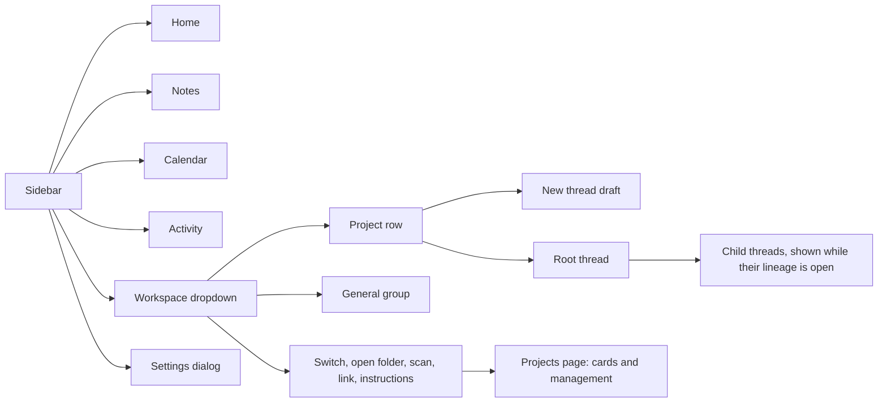

# Tenon Workbench v1 navigation map

- Status: implemented (sidebar-only navigation, roadmap Phase 4)
- Companion: [`PRODUCT-BRIEF-V1.md`](./PRODUCT-BRIEF-V1.md)
- Roadmap: [`t3-parity-roadmap`](../../implementations/t3-parity-roadmap/implementation.md)
- Updated: 2026-10-20

## Navigation model

The sidebar shows one workspace at a time: an opened folder, chosen from the
workspace dropdown at the top of the sidebar. Home, Notes, Calendar and
Projects have no workspace picker of their own and follow this selection. Its
notes, Project cards and calendar live in that folder. The workspace's Projects are the folders inside its `projects` folder (any letter
case) plus folders linked from elsewhere on the computer. A Project's threads
run in its folder. Threads from other workspaces never show. The left sidebar
is the only navigation. There is no tab strip and no separate workspace page.

## Sidebar

The sidebar has two columns: a navigation rail that is always shown and a
Projects panel beside it.

1. **Rail**, from top to bottom: a **New thread** button (same as `mod+n`),
   then **Home**, **Notes** (labelled Knowledge), **Calendar** and
   **Activity** as icons with a label underneath (the current page gets a
   pill highlight), and **Settings** at the bottom.
2. **Workspace** panel. The heading is a dropdown: the opened folders (the
   current one checked), **Open folder as workspace**, **Scan for projects**,
   **Link a folder as a project**, **Workspace instructions** (the workspace's
   default `AGENTS.md`) and **Manage projects** (`/projects`). The button next
   to it scans again. Each workspace is also scanned once per app session when
   it is first shown.
   - One row per active Project, sorted by name, expandable. Expanding shows
     **New thread** and the Project's root threads: pinned threads first (most
     recently pinned first, with a pin icon), then the rest newest first. A
     running thread shows an accent dot. Child threads (`parentID`) nest under their
     parent while that parent or one of its children is open.
     A thread belongs to the Project whose folder holds it (the deepest one for
     nested folders).
   - **General**: threads elsewhere in the workspace folder, at its root or in
     a subfolder that is not a Project.
   - Threads in folders outside the workspace and its linked folders belong
     to another workspace and are not listed. Home still lists recent threads
     from every folder.
3. **Settings** at the bottom opens the settings dialog.

Row actions:

| Row | Actions |
|---|---|
| Project | New thread, open project card (`/projects?project=<id>`), archived threads, instructions, archive project (unlink folder for a linked folder) |
| Thread | Rename (also double-click), pin / unpin, fork, archive, delete |

Pins are stored on the thread (`metadata.pinned`, the pin time) so they survive
restarts. Pinned threads sort first inside their own group (a Project or
General); pinning a child thread does not move it out of its parent.

**Archived threads** opens a dialog listing the Project's archived threads
(threads in its thread directory, up to the 500 most recently updated), each
with **Unarchive**.

### Undo

Archive thread, rename thread, delete thread and archive Project show a toast
with **Undo** for 5 seconds. While such a toast is open, `mod+z` undoes the most
recent one, unless focus is in a text field or editor, which keeps its own undo.

- Archive and rename happen at once; undo unarchives the thread or restores
  the previous title. Archive Project undo restores the previous status.
- Delete is deferred: the row (and its child threads) hides at once, and the
  hard delete (`session.remove`) runs only when the toast expires. If the app
  closes before then, the thread is not deleted.

`mod+b` or the titlebar button hides and shows the Projects panel; the rail
stays. The current Project and the
expanded Projects are remembered per window.

## Titlebar

The titlebar is window chrome only: the sidebar toggle, back and forward
(when enabled in Settings), the update pill, and the native window controls.

## Routes

| Route | Shows | Sidebar highlight |
|---|---|---|
| `/` | Home | Home |
| `/notes`, `/calendar`, `/activity` | That page | That item |
| `/projects`, `/projects?project=<id>` | Project cards; a selected card | None |
| `/new-thread?project=<id>&draftId=<id>` | Draft composer in the Project's thread directory | The Project |
| `/server/<server>/session/<id>` | A thread | The Project whose folder holds the thread's directory, else General |

Redirects keep old links working: `/brain` and `/workspaces` go to `/`,
`/new-session?draftId=<id>` goes to the new-thread route, `/<dir>/session/<id>`
goes to the server-scoped thread URL on the selected server, and
`/<dir>/session` opens a new draft in that folder. Any other path goes to `/`.

## Drafts

A draft is an unsent thread. It is stored per window with its server, thread
directory and Project, and its composer content is kept in `drafts.sqlite`.
Sending a draft replaces it with the new thread and opens it, except
`mod+alt+Enter`, which sends in the background and leaves the draft open and
empty. On the first
start after upgrading, drafts from the retired tab strip are imported and the
per-window `tabs`, `tabs.recent`, `tabs.info` and `tabs.closed` keys are
deleted.

## Keyboard shortcuts

| Key | Action |
|---|---|
| `mod+n` | New thread in the current Project (else in the workspace folder) |
| `mod+shift+n` | Open a folder as a workspace |
| `mod+b` | Toggle the sidebar |
| `alt+up` / `alt+down` | Previous / next visible thread in the sidebar |
| `mod+shift+[` / `mod+shift+]` | Previous / next Project |
| `mod+[` / `mod+]` | Back / forward |
| `mod+k` | Command palette |
| `mod+z` | Undo the last sidebar action while its undo toast is open (not in text fields) |

Composer keys (handled inside the prompt editor, listed read-only in Settings →
Shortcuts):

| Key | Action |
|---|---|
| `Enter` | Send (while the agent works: steer or queue per Settings → General) |
| `shift+Enter` | New line |
| `mod+Enter` | Send with the opposite delivery for this message |
| `mod+alt+Enter` | Send into a new thread in the same Project, in the background |
| `mod+s` | Stash the prompt; restore or delete from the composer's stash menu |
| `ArrowUp` | Previous prompt from history (empty composer) |

The desktop File menu uses `Cmd+N` for a new thread, `Cmd+Shift+N` to open a
folder as a workspace and `Cmd+Alt+N` for a new window. `mod+t`, `mod+shift+t`
and tab-closing `mod+w` were removed with the tab strip. In-session panels
keep their own `mod+w`.

## Deep links

The app shell handles `tenon://open-project?directory=<path>` (opens the
folder as a workspace and selects it) and `tenon://new-session?directory=<path>&prompt=<text>`
(opens a draft in that folder's Project, or in the folder itself).

## Pages

- **Home** is a dashboard: start a Run, today's events and tasks, active
  Projects, resume and running threads. Sending from Home's composer opens
  the new thread and sends the message in one step.
- **Projects** lists Project cards by status and opens a card with Overview,
  Plan, Work, Files, Activity and Map views.
- **Calendar** shows events and tasks. Today and Week are hour grids
  (07:00–22:00, widened to fit events) with all-day events and open tasks in a
  strip above; clicking a day's header opens it in Today. Agenda lists items by
  day, with the date on the left. Clicking an event or task, in any view and in
  the Tasks view, opens it read-only in the side panel; **Edit** opens the form
  (a task's Edit opens it in the Tasks view). Ticking a task completes it at
  once, Google tasks included, with an **Undo** toast. The page scrolls as one
  area. Its Google Calendar & Tasks panel
  connects one or more Google accounts: one **Sign in with Google** button when
  the build ships its own OAuth client, else (or under **Use your own OAuth
  client**) the client ID and secret fields. Once an account is connected the
  panel lists each account with its access, last sync, queued or failed
  changes and its own **Disconnect**; **Add account** shows the sign-in form
  again, and Google lets the user pick a different account. **Sync now** syncs
  every account. A new event or task's **Save to** offers Local and each
  account with read and write access.
- **Notes** holds global notes and Project notes.
- **Activity** lists threads needing attention, agent runs, changes and
  history. Agent runs shows recent threads with active runs first and a
  Running, Waiting for approval or Retrying status; finished and failed runs
  both read as idle, so they carry no status. History is the full searchable
  thread list.
- **Settings** contains General, Shortcuts, Servers, Providers, Models and
  Harnesses.
- **Thread** shows the timeline and composer. Each finished agent turn folds
  its tool and reasoning steps into one "Worked {duration}" row. The row stays
  open when a step failed. While the turn runs, the row shows a live ticker:
  the current step with a spinner and timer, the two steps before it, and
  "Show all" to open the full list. The
  side panel has **Review** and **Session** tabs, plus open files. Session
  replaced the Context tab and follows the Thread board's design: four tiles
  (tokens, context used, messages, harness), a context breakdown bar (system,
  messages, tools), then a details list of the session's totals per harness
  (model, provider, context window, input, output, cache hit, cost, times).
  Values the harness doesn't report are left out. Subagents and tool counts
  show only when there are any, and raw messages open from a button. The side panel keeps its own width (420px by default) and
  the chat takes the rest. Hide it with the arrow in its tab row, the
  titlebar button, `mod+shift+r`, or by dragging its edge past the minimum.
  While hidden, a slim rail at the right edge shows the changed-file count
  and context use and reopens the panel. Split diffs need an 800px panel;
  a narrower panel shows unified diffs.
