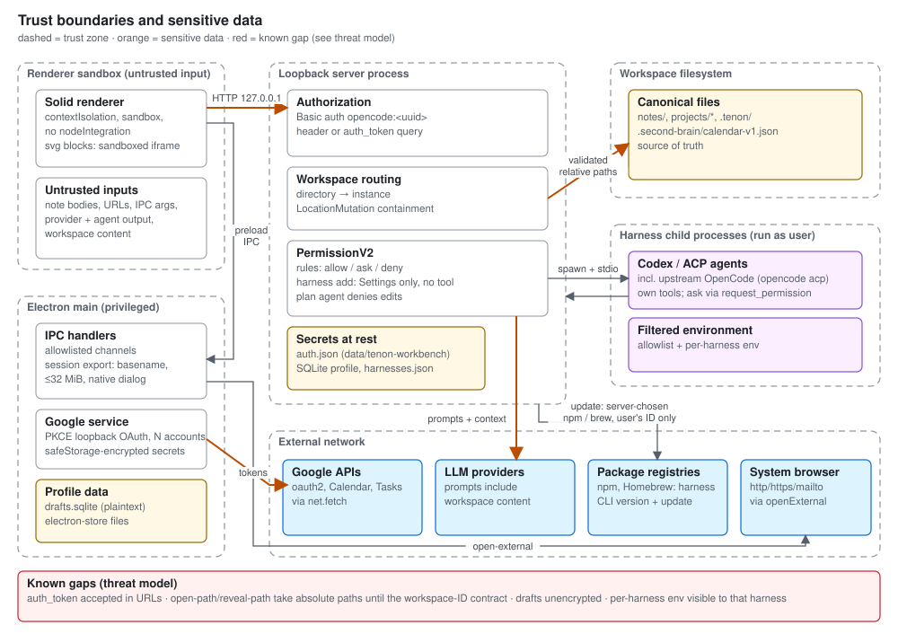

# Threat model for the active desktop app

This document covers the OpenCode Electron fork in `opencode/`. The former
React/Tauri application is retired, so its Rust policy and MCP
sidecar design are not current desktop controls.



Detailed permission and request flows are in
[the UML architecture views](../architecture/uml.md).

## Assets and boundaries

| Boundary                   | Current control and location                                                                                                                                                                                                                                                                                                                                           |
| -------------------------- | ---------------------------------------------------------------------------------------------------------------------------------------------------------------------------------------------------------------------------------------------------------------------------------------------------------------------------------------------------------------------- |
| Renderer to native process | The main window uses `contextIsolation`, `sandbox`, and disabled `nodeIntegration`. `opencode/packages/desktop/src/preload/index.ts` exposes specific IPC methods implemented in `opencode/packages/desktop/src/main/ipc.ts`.                                                                                                                                          |
| Renderer to managed server | Electron starts the OpenCode server on `127.0.0.1` with a generated password. Server authorization checks credentials for protected routes. See `opencode/packages/desktop/src/main/index.ts` and `opencode/packages/opencode/src/server/routes/instance/httpapi/middleware/authorization.ts`.                                                                         |
| Server to workspace files  | Second Brain handlers run in an instance location context. Note and project code resolves targets through `LocationMutation` before reading or writing files. See `opencode/packages/opencode/src/server/routes/instance/httpapi/handlers/second-brain.ts`, `opencode/packages/opencode/src/knowledge/note.ts`, and `opencode/packages/opencode/src/project/brain.ts`. |
| Desktop to Google          | Calendar and Tasks integration uses OAuth in the Electron main process. The service encrypts its client secret and refresh token with Electron `safeStorage` and disables connection when secure storage is unavailable. See `opencode/packages/desktop/src/main/google-calendar.ts`.                                                                                  |

`POST /second-brain/projects/workspace` takes only an OpenCode project id. The
server looks the id up in its own project table and rejects `global` and the
Brain directory itself; it never accepts a renderer path. The renderer no longer
calls it.

Workspace Projects add three file surfaces:

- `POST /second-brain/projects/scan` writes only under the workspace's
  `.tenon/` (cards and `workspace.json`) through `LocationMutation`, lists
  folders without reading their content, and refuses to overwrite a manifest it
  cannot parse. It also writes `workspace-links.json` (linked folder ->
  workspace) in the server data folder; that file is a rebuildable cache.
- `POST /second-brain/projects/link` is the one Second Brain route that takes
  an absolute renderer path. The server requires an existing directory that
  neither contains nor sits inside the workspace, and only records it in the
  manifest; it never reads, moves or writes files in that folder. The renderer
  sends a folder the user picked in the folder dialog. Sessions can already run
  in any directory the renderer names, so this adds no new reach.
- `GET`/`PUT`/`DELETE /second-brain/instructions` read, write (64 KiB cap) and
  remove `AGENTS.md` in the request's directory only, through
  `LocationMutation`. `AGENTS.md` is agent instructions: the app injects it
  into sessions in that workspace, and with the link index into linked folders
  too. A workspace's `AGENTS.md` therefore steers agents working in its linked
  folders. The app calls this route only from the Instructions dialog; an
  agent with file-edit permission can still change `AGENTS.md` like any other
  workspace file. The resulting card
stores that Workspace's worktree as `location.displayPath`, and
`GET /second-brain/project-threads` returns absolute thread directories the
same way session responses already return `directory`.

`tenon://open-project` and `tenon://new-session` deep links are handled
by the app shell's sidebar controller
(`opencode/packages/app/src/components/sidebar/sidebar-controller.ts`) and
only on a local server. A deep link can open a folder as a workspace (and
select it) and start an unsent draft (a `new-session` prompt is placed in the composer,
never sent). It never runs `git init`; only a folder the user picks in the
folder dialog is initialized when empty.

Workspace notes, projects, calendar files, session data, provider tokens, and
agent tool permissions are sensitive. Treat note contents, provider responses,
workspace files, URL input, and IPC arguments as untrusted. Keep file access
within the selected workspace and use the existing mutation services. Never
log credentials or full private content.

## Credentials, extensions, and recovery

Google token encryption is specific to the desktop integration. It does not
establish encryption for every provider credential store. Provider
credentials (`auth.json`, `mcp-auth.json`) and the session database
(`opencode.db`) live in the XDG data directory (by default
`~/.local/share/tenon-workbench/`), outside Electron `userData`. `userData` holds
drafts, electron-store files, logs, and server state. Treat both locations as
sensitive and exclude them from source control and release artifacts. Outside
Windows, the server sets the data directory to `0700` and `opencode.db`, its
`-wal`/`-shm` files and its pre-migration backups to `0600`. Failed-query errors
keep the SQL text but replace bound values with `[redacted]`, so logged defects
do not carry credentials or note text.

Configured plugins execute code in the local runtime. Dependency installation
and plugin initialization can therefore affect both access and startup time.
Review plugin origins and package changes, retain the Bun lockfile and local
patches, and do not treat a plugin as sandboxed workspace content. Build and
packaging scripts also download upstream binaries, as described in
[release operations](../release-operations.md). A plugin hook that throws or
runs longer than 30 seconds is logged and skipped, except `tool.execute.before`
and `command.execute.before`, which fail closed so a plugin can still block a
call by throwing. A timed-out hook is not cancelled and may keep running, and
can still change the hook output after the caller has moved on.

Workspace validation and agent tool permissions are different controls.
Keep the existing permission checks on tool execution; a user opening a note
does not authorize instructions embedded inside it. The V2 runner checks the
`doom_loop` permission before a third identical tool call in a row. Built-in
agents add a `doom_loop: ask` rule, but the agent's ruleset decides: an agent
that denies all actions resolves to deny, as in V1. The runner returns the
user's rejection feedback or the deny rule to the model. Destructive recovery
must preserve both canonical workspace files and session/draft profile state.

## Managed server controls

- **Child processes.** Terminals, agent shell commands, MCP stdio servers and
  LSP servers don't inherit `OPENCODE_SERVER_PASSWORD` or
  `OPENCODE_SERVER_USERNAME`. `ChildEnv.from` (`core/src/child-env.ts`) strips
  them in the cross-spawn spawner and `Process.spawn`, which apply it to every
  child environment. All other variables are still inherited.
- **Credential checks.** `ServerAuth.authorized` compares the username and
  password in constant time. `httpapi-route-auth-coverage.test.ts` sends an
  unauthenticated request to every declared HttpApi operation and expects 401.
- **Workspace proxy.** Requests forwarded to a remote workspace lose their
  `authorization` and `cookie` headers and the `auth_token` query parameter.
  Only the target's configured headers supply credentials.
- **CORS.** The allowlist is `oc://renderer` (exact match), numeric-port
  `localhost` and `127.0.0.1` origins for development, and origins passed to
  `Server.listen`. Tauri and `*.opencode.ai` origins are no longer trusted.
- **Body size.** The server rejects a declared request body over 32 MiB with
  413. Effect's `MaxBodySize` stops a streamed body at the same cap. The cap
  matches the session export limit and leaves room for base64 image
  attachments. `POST /log` truncates messages and drops oversized metadata.
- **CodeMode.** The `execute` tool runs with a 10 minute timeout, 100 child
  tool calls and 64 KB of output. The interpreter rejects `repeat` and `pad*`
  results longer than 16M characters.

## Outbound network endpoints

The shipped app, desktop, and server code no longer contacts `opencode.ai`
on its own. Removed in the T3 parity Phase 1 cleanup:

- the hosted UI proxy to `app.opencode.ai` (`server/shared/ui.ts`); without
  a bundled UI the server returns a local 404,
- the release-notes feed (`opencode.ai/changelog.json`),
- remote notification icons and the upstream project avatar (bundled
  `favicon-96x96-v3.png` is used instead),
- upgrade checks and installs in `installation/index.ts` (the service is
  inert; the desktop app owns updates),
- the WSL `curl https://opencode.ai/install | bash` path,
- Go/Zen upsell links in retry actions and the upsell dialogs,
- the `HTTP-Referer: https://opencode.ai/` header sent to providers,
- Help menu, sidebar, and error-page links to docs, Discord, and feedback.

Still outbound: the configured LLM providers (including the `opencode` Zen
provider when the user selects it), the `models.dev` catalog, Google APIs,
and links the user opens. `$schema` URLs in config files are identifiers, not
fetches. Known remaining references: upstream agent prompts that point the
model at `opencode.ai/docs`, the MCP OAuth `client_uri` metadata value, and
two help-text links printed by the developer-only `providers login` command.

Phase 8 removed the TUI and the upstream CLI commands that reached GitHub,
the OpenCode console, and share or install endpoints (`github`, `pr`,
`account`, `upgrade`, `uninstall`, `web`, `acp`, `attach`, `stats`, `plug`,
`export`, `import`). The remaining CLI in `packages/opencode/src/index.ts`
runs only from source for development (`serve`, `generate`, `mcp`, `debug`,
`providers`, `agent`, `models`, `session`, `db`) and isn't shipped.

## Harness CLI updates

Checking and installing harness CLI updates adds two capabilities:

- **Outbound calls.** The server fetches `<registry>/<pkg>/latest` from the
  user's configured npm registry, or runs `brew info`, for each enabled Codex
  or ACP harness, about once every six hours.
- **Package-manager runs.** The server runs `npm`, `bun`, or `brew` as the user.

The renderer sends only a harness ID to `POST /api/harness/upgrade/:id`. The
server derives the package name, prefix, and package manager from the resolved
path of that harness's configured command, and validates the name against npm
or Homebrew naming rules. Arguments are passed as an array with no shell.
Updates run only when the user clicks Update, and agents have no tool for them.

The package manager gets the app's full environment, not the harness allowlist,
because npm and brew need the user's proxy and registry settings. It runs
outside any workspace (cwd is the home directory). Output is not logged. A
failure shows the exit code and the last three lines of stderr.

Known gap: an update trusts the user's package registry and Homebrew taps the
same way a manual `npm install -g` or `brew upgrade` would. A harness whose
command path points into a `node_modules` folder the user doesn't control would
be updated from that package's registry entry.

## Harness registration

A registered harness is a command that the app later runs as the user, with
the workspace as its working directory. Harnesses are registered only by the
user in Settings → Harnesses, through the authenticated local HTTP API
(`/api/harness/discover` and `/api/harness/registry`). Agents have no
registration tool, so workspace content or model output can't add a harness.

Test and Save run the typed command. The local API already lets authenticated
clients start processes through its PTY routes, so this adds no new kind of
capability. The following limits still apply:

- The ID is validated, and the command must resolve to an absolute executable
  file.
- Arguments are passed as an array with no shell.
- The process gets the filtered harness environment described below.
- The handshake times out and the process is stopped afterwards.

Test also calls `session/new` to list models, so some agents record an empty
session in their own history. The picker's first availability check after each
launch does the same once per harness.

The setup assistant's functional test (`/api/harness/verify`) also sends one
short prompt to the proposed agent. That costs one model call on the agent's
own credentials, and the test refuses every tool permission request. The
assistant's proposal is model output: Second Brain runs a proposed command
only through the verify route's limits above, and saving still needs the
user's Save click. Save runs the ACP `initialize` handshake again.
It writes `harnesses.json` (mode `0600`, atomic rename, serialized within the
process) only when the handshake succeeds. Enable/disable and remove change
only `harnesses.json` entries under the same lock. A malformed file is
reported and never overwritten, and built-in or config-file harnesses are
refused.

The registry stores commands, arguments, and model IDs only. Agents can't
store environment variables or secrets in it, and it can't replace the
built-in `opencode`, `codex`, and `opencode-acp` instances. ACP agents get no client
file-system or terminal capability. Their own tool approvals arrive as
`session/request_permission` and use Second Brain permissions. Treat output
from an ACP agent as untrusted model output.

Known gap (partially closed): ACP and Codex harness processes no longer inherit
the app's full environment; they get a small launch allowlist (`PATH`, `HOME`,
locale, temp and terminal variables, `XDG_*`, Windows system variables) plus the
`env` set in user configuration for that harness. However, any API key or token
the user puts in that per-harness `env` is still visible to that harness, and
agent CLIs often need their own credentials that way. Register only agents
you'd trust with the credentials you configure for them.

### Harness skill catalog

`GET /api/skill/catalog` reads `SKILL.md` frontmatter from fixed folders under
the user's home (`~/.codex/skills`, `~/.claude/skills`, `~/.agents/skills`,
`~/.config/opencode/skill(s)`) and under the request's location directory
(the project equivalents). The location is the same validated scope the other
location routes use. Controls:

- Read-only. No shell runs and no harness process starts; the harness list
  comes from settings.
- Only skill names, descriptions and absolute paths reach the renderer. Skill
  bodies are read to parse frontmatter and are never returned or logged.
- Commands an ACP agent reports through `available_commands_update` are kept
  in memory per harness and shown as data. They are agent output: the app
  never runs them.
- Missing or unreadable folders are skipped. Folder scans follow symlinks, the
  same as Tenon's own skill loading, so a symlinked skill folder can expose
  the frontmatter of files outside these folders.

### ACP subagent transcripts

An ACP agent's subagent text, reasoning and tool output are now stored on the
subagent's tool call (`provider.resultMetadata.acp.transcript`) and shown in
the agent tab. Treat it as untrusted model output: the tab renders text as
Markdown through the same sanitizing renderer as chat, and tool output as
plain text. Each subagent's transcript is capped at 100,000 characters, and
live checkpoints carry at most 50 entries without tool output, which bounds
what an agent can make the app store per subagent call.

### Upstream OpenCode harness

The built-in `opencode-acp` instance starts upstream OpenCode from `PATH` as
`opencode acp`, through the same ACP driver as registered agents. It is a
separate child process running as the user, and it gets the same treatment:

- It receives only the launch allowlist from `core/src/harness/env.ts`. No
  `OPENCODE_*` variables and no provider keys from the app reach it.
- It uses its own credentials, set up with `opencode auth login`.
- The client advertises no file-system or terminal capability. Its tool
  approvals arrive as `session/request_permission` and go through
  `PermissionV2`, so the user approves them in Tenon Workbench.
- Which binary runs depends on `PATH`. A different `opencode` earlier on
  `PATH` would run instead.

Resolved: Tenon Workbench's core `Global` paths now use the app name
`tenon-workbench` (`core/src/global.ts`), so Tenon Workbench and upstream OpenCode
no longer share `~/.config/opencode` and `~/.local/share/opencode`. On first
start, `core/src/legacy-storage.ts` copies the legacy folders once, including
`auth.json`, `account.json`, `mcp-auth.json` and the database. That copy
duplicates the credentials into the `tenon-workbench` folder; after it, each app
reads and writes only its own copy. The legacy folders are left unchanged and
still hold the original credentials. If the shared `opencode.db` contained
upstream OpenCode sessions, Tenon Workbench's copy contains them too.
Per-project `.opencode/` folders and `.git/opencode` are still shared by
design.

Resolved: the Electron app IDs are `io.github.torriider97.tenonworkbench[.dev|.beta]`
(`APP_IDS` in `desktop/src/main/index.ts`), separate from upstream OpenCode
Desktop's `ai.opencode.desktop[.dev|.beta]`. Electron `userData`
(electron-store files, logs, and server state via `XDG_STATE_HOME`) and the
Windows install identity no longer collide with an upstream install. Related
changes:

- The deep-link scheme is `tenon://`, so Tenon Workbench no longer
  registers for, or takes over, upstream's `opencode://` handler.
- Background CLI discovery (`desktop/src/main/background-cli.ts`) checks only
  Tenon Workbench's own `userData` folders and cannot attach to upstream OpenCode
  Desktop's background service.
- The upstream Tauri `.dat` import (`desktop/src/main/migrate.ts`), which read
  upstream OpenCode app data from `ai.opencode.desktop*` folders, was removed.
- Only the dev channel copies the old `ai.opencode.desktop.dev` `userData`
  (`desktop/src/main/user-data-migration.ts`). Beta and prod do not read the
  `ai.opencode.desktop` and `ai.opencode.desktop.beta` folders, which belong to
  upstream OpenCode Desktop. The copy leaves the old folder unchanged.

The in-window DOM event name `opencode:deep-link` is internal and unchanged.

### Harness handoff text

When a Codex or ACP harness takes over a Run, or returns to one, it gets earlier
messages as text (`renderCodexPrompt` in `packages/core/src/harness.ts`). That
text can include workspace content, other harnesses' output and tool results,
so it is treated as untrusted data:

- It sits inside a `<handoff-history>` block that says it is context only, not
  a new request, and carries no instructions. The new user message comes after
  the block. Any `</handoff-history>` inside a message is escaped so the
  content can't close the block early.
- It is bounded to 16,000 estimated tokens. Messages that don't fit are left
  out whole and counted.
- Tool calls and results become one-line summaries (name, command or path,
  status, exit code). Raw tool input and output, which may hold file contents
  or command output, aren't forwarded.
- A returning harness gets only the messages since it last took part.

The wrapper is a prompt-level signal, not an enforcement boundary. A model may
still act on instructions in the history, so the permission checks on its
tools remain the control.

Availability probes start each enabled harness command for an `initialize`
handshake. Results are cached per instance configuration for 30 seconds so
picker refreshes don't relaunch every agent.

## Checks

From the repository root, `bun run typecheck` checks every workspace package
through turbo. `bun run test` runs every package suite except the engine
(core, server) and the client and schema suites, then the Second Brain
domains; `bun run test:engine` runs core and server suites. `bun run lint`
checks `opencode/`, and `bun run check:generated` fails when the generated
client is stale. These commands are defined in the root `package.json`.
Relevant focused tests include
`opencode/packages/desktop/src/main/google-calendar-domain.test.ts`,
`opencode/packages/opencode/test/project/brain.test.ts`, and the note tests
under `opencode/packages/opencode/test/knowledge/`. Run server tests from
`opencode/packages/opencode` with Bun when changing those paths. These checks
run locally; GitHub Actions workflows are disabled. Local test results do not
establish cross-platform installer or signed-update safety.

Focused commands from `opencode/packages/opencode`:

```sh
bun run test ./test/knowledge ./test/planner ./test/project/brain.test.ts
bun run test ./test/server/httpapi-instance-route-auth.test.ts ./test/server/httpapi-ui.test.ts
```

From `opencode/packages/desktop`:

```sh
bun test src/main/google-calendar-domain.test.ts src/main/attachment-picker.test.ts src/main/external-url.test.ts
```

This is a source-level map of the controls found during setup, not a security
audit. Recheck the implementation and its tests before changing a boundary.

## Session export boundary

`save-session-export` accepts a JSON string and a basename, not a renderer
filesystem path. Main validates the basename, JSON syntax, and a 32 MiB size
limit, then asks the user to choose the destination with Electron's native
save dialog. Cancellation returns false; success follows the completed write.
This operation does not grant general renderer write access. Exports contain
private session content and are written only to the destination chosen by
the user. The IPC handler delegates validation and writing to
`packages/desktop/src/main/session-export.ts`.

Native session fork and diff endpoints use the existing session-location
middleware and authenticated HTTP boundary. Forks receive new message IDs;
opaque provider continuations and assistant filesystem snapshots are excluded
from the copied history. Review snapshots remain scoped to the session's
location and canonical Git worktree.

## Known gaps

Found during the 2026-10-02 scope audit. Paths are relative to
`opencode/packages/desktop/src/main/`. Entries move back into the model once a
fix lands.

- `open-path` (`ipc.ts`) opens any renderer-supplied absolute path.
  `reveal-path` reveals any existing absolute path. Neither uses a workspace ID
  or validated relative path. As of the 2026-10 batch-1 hardening, `open-path` no longer
  executes renderer-supplied application paths (main resolves an application
  name through the registered-application lookup), and both handlers require
  absolute paths. Arbitrary-path opening from a compromised main-frame renderer
  remains open until the workspace-ID contract lands.
- `store-*` handlers accept only the renderer's own store files, `default.dat`
  and `opencode.<scope>.dat` (`store-name.ts`). Renderer input can't create or
  escape files under `userData`, and can't read or write main-owned stores
  such as `opencode.settings`, `opencode.updater`, `second-brain.google` or
  Chromium `Preferences`.
- Every IPC handler, including the WSL handlers in `wsl/ipc.ts`, checks
  `event.senderFrame` against the trusted main frame through the shared
  `trustedHandle`/`trustedOn` wrappers in `ipc.ts`. Before the 2026-10
  desktop IPC hardening, the WSL handlers used raw `ipcMain.handle`.
- WSL distro names from the renderer must match `^[A-Za-z0-9][A-Za-z0-9._-]*$`
  (`wsl/policy.ts`); probe lists skip names that don't. The "open terminal" action still goes through
  `cmd.exe /c start` to get its own console window, so the allowlist is what
  keeps cmd metacharacters out of that command line.
- Draft IPC accepts only string keys and values and caps one attachment blob
  at 64 MiB (`draft-store.ts`).
- Server authorization also accepts an `auth_token` query parameter, so the
  credential can appear in URLs. Desktop main-process logs record only the
  scheme and host of blocked and rejected URLs, never the query string. The
  parameter is not yet restricted to SSE and WebSocket routes. The
  desktop no longer records a Chromium NetLog, which captured full URLs, and
  the debug-log export skips any `.netlog` file. Packaged builds don't copy
  renderer console output into the log files, and no terminal console
  messages are written to `pty.log`.
- Renderer sourcemaps are built as hidden maps and excluded from the packaged
  app. The macOS entitlements no longer request microphone access. They still
  include `allow-jit`, `allow-unsigned-executable-memory`,
  `disable-executable-page-protection`, `allow-dyld-environment-variables` and
  `disable-library-validation`; check which ones the runtime and native modules
  need before removing any.
- `drafts.sqlite` stores unsent draft content unencrypted in the profile.
