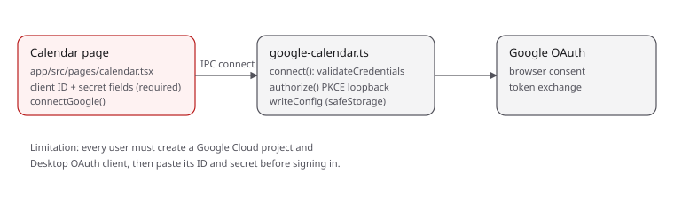
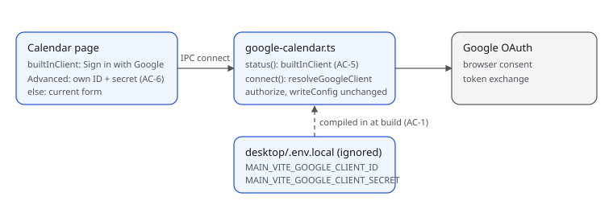
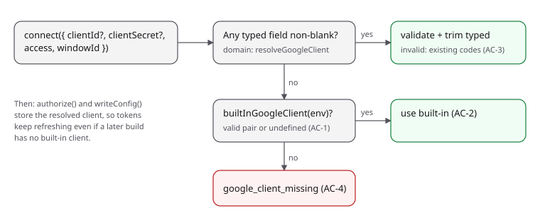

# Built-in Google OAuth client

## Problem

Connecting Google Calendar and Tasks requires every user to create a Google
Cloud project and a Desktop OAuth client, then paste its client ID and secret
into the Calendar page. Google requires a registered client for any sign-in,
but apps normally ship one so users only click "Sign in with Google".

- Before: Calendar → Google Calendar & Tasks shows client ID, client secret
  and access fields. Nothing works until both are filled.
- After: a build made with `MAIN_VITE_GOOGLE_CLIENT_ID` and
  `MAIN_VITE_GOOGLE_CLIENT_SECRET` in `opencode/packages/desktop/.env.local`
  shows the access choice and one **Sign in with Google** button. The typed
  fields move under a **Use your own OAuth client** toggle. A build without
  those values behaves as before.

## Scope

Files, all under `opencode/packages/`:

- `desktop/src/main/google-calendar-domain.ts`: add `builtInGoogleClient(env)`
  and `resolveGoogleClient(input, builtIn)`; move credential validation here.
- `desktop/src/main/google-calendar.ts`: read the build-time values through
  `import.meta.env`, report `builtInClient` from `status()`, resolve the client
  in `connect()`.
- `desktop/src/main/env.d.ts`: type the two env values.
- `desktop/.env.example`: document the two variables (no values).
- `app/src/context/platform.tsx`: `GoogleCalendarConnection.builtInClient`,
  `connect` credentials optional.
- `app/src/pages/calendar.tsx` and `app/src/i18n/en.ts`: the sign-in button,
  the toggle, and the `google_client_missing` message.
- Docs: `docs/security/threat-model.md`, `docs/release-operations.md`,
  `docs/product/NAVIGATION-MAP-V1.md` (Google setup is on the Calendar page,
  not in Settings).

Excluded: Google app verification, a hosted token broker, migrating stored
connections, other locales (they fall back to English).

Invariants:

- OAuth stays in the main process with PKCE and the loopback redirect.
- The stored client secret and refresh token stay encrypted with `safeStorage`;
  connecting stays disabled without secure storage.
- The resolved client is stored with the connection, so refresh keeps working
  if a later build lacks a built-in client.
- The env file is git-ignored; the values are never logged or sent to the
  renderer. The renderer only learns `builtInClient: boolean`.
- Google treats a desktop client secret as non-confidential, so compiling it
  into the main bundle is acceptable; anyone with the app can read it.

## Feature map

Calendar page `connectGoogle()` → preload `googleCalendar.connect` → IPC
`google-calendar-connect` (`desktop/src/main/ipc.ts`, adds `windowId`) →
`createGoogleCalendarService().connect` → `validateCredentials` → `authorize`
(loopback server, `shell.openExternal`, `requestGoogleToken`) → `writeConfig`.
`status()` feeds the page's `googleConnection` resource. Consumers of
`GoogleCalendarConnection`: `calendar.tsx`, `brain-home.tsx` (Connect Google
link), `activity.tsx` (pending/failed counts); the new field is additive.







## Acceptance criteria

- **AC-1** `builtInGoogleClient({ clientId, clientSecret })` returns the
  trimmed pair when the ID ends in `.apps.googleusercontent.com`, the secret is
  non-blank without whitespace, and both are at most 512 characters; otherwise
  `undefined`.
- **AC-2** `resolveGoogleClient(input, builtIn)` returns `builtIn` when both
  typed fields are absent or blank.
- **AC-3** When either typed field is non-blank, the typed pair is validated
  and returned trimmed, failing with `google_client_id_invalid` or
  `google_client_secret_invalid`; it never falls back to the built-in client.
- **AC-4** With no typed values and no built-in client it fails with
  `google_client_missing`.
- **AC-5** `status()` reports `builtInClient` (false when unavailable);
  `connect()` accepts omitted credentials and resolves them per AC-2..4.
- **AC-6** The Calendar page, when not connected and `builtInClient` is true,
  shows the access choice and **Sign in with Google**; typed fields are behind
  a **Use your own OAuth client** toggle. Without a built-in client it shows the
  current form and requires both fields.
- **AC-7** `opencode/packages/desktop/.env.local` is git-ignored.

| Criterion | Acceptance | Verification | Manual / review |
|---|---|---|---|
| AC-1 | yes | yes | |
| AC-2 | yes | yes | |
| AC-3 | yes | yes | |
| AC-4 | yes | yes | |
| AC-5 | | | typecheck, diff review |
| AC-6 | | | diff review; in-app check needs a real client |
| AC-7 | | yes | |

## Sequence

1. Domain functions (AC-1..4), then the main-process wiring (AC-5).
2. Platform type change, then the Calendar page and strings (AC-6).
3. `.env.example`, docs.

## Verification

From `opencode/packages/desktop`:

```sh
bun test ../../../implementations/google-builtin-client/acceptance
bun test ../../../implementations/google-builtin-client/verification
bun test src/main/google-calendar-domain.test.ts
```

From the repository root: `bun run check`.

Baseline (2026-10-25, before implementation): both sets fail to load with
`Export named 'builtInGoogleClient' not found`, the intended missing behavior.

Manual: with a real Desktop OAuth client in `.env.local`, `bun run
desktop:build`, install, open Calendar, click Sign in with Google, approve,
sync. Not possible until the user creates the client.

## Completion evidence

Implemented by the plan author (both test sets were written by the same
author, so they are not independently authored). Commands run on 2026-10-25:

- Both sets plus `src/main/google-calendar-domain.test.ts`: 23 pass, 0 fail.
- `bun run check` from the repository root: exit 0 (typecheck, lint,
  check:generated, test, build). The generated client files it rewrote with
  line endings only were restored.
- A separate verifier agent reviewed the diff read-only against AC-1..AC-7.
  It reported every criterion passing, typecheck clean in `desktop` and
  `app`, no regressions, and confirmed from electron-vite 5.0.0 source that
  `MAIN_VITE_` values reach the main bundle and never the renderer. Its minor
  findings were fixed: the release doc wrap, this section, and invalid typed
  credentials now show the credentials message instead of the generic error.

Limitations:

- Not run in the app: sign-in needs a real Desktop OAuth client in `.env.local`.
- A malformed built-in client silently falls back to the typed-credentials form.
- The env file is read from the build's working directory; all scripts use
  `opencode/packages/desktop`.
