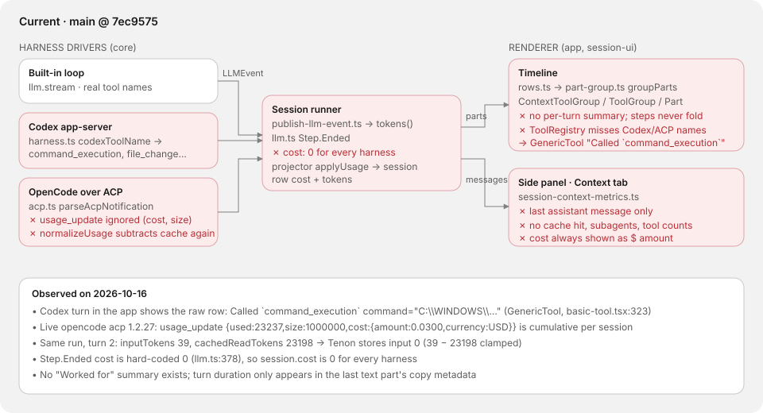
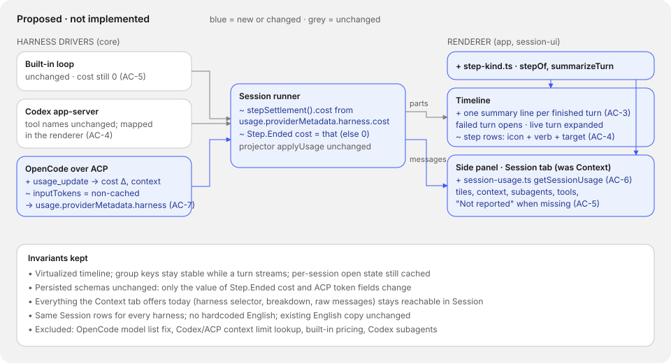
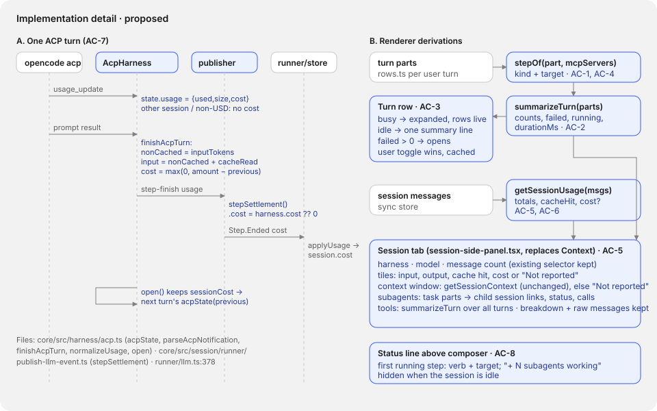

# Session view: folded turns and a Session tab

## Problem

While an agent works, the thread doesn't make it clear what the agent is doing.
Tool calls from Codex and OpenCode show up as raw rows such as
``Called `command_execution` command="C:\WINDOWS\…"``. Finished turns never fold,
so long runs bury the answer. The side panel's Context tab reads only the last
assistant message. It has no cache-hit figure, no subagent list and no tool
counts. It always shows cost as a dollar amount, even though every harness
records a cost of 0 today.

Two data bugs feed the panel bad numbers for OpenCode over ACP. They were found
against a live `opencode acp` 1.2.27 session on 2026-10-16:

- `usage_update` notifications are dropped (`acp.ts:342`). They carry the
  context window (`used`, `size`) and a **cumulative** session cost: 0.0236
  after the first turn, 0.0300 after the second.
- `inputTokens` from OpenCode already excludes cache reads. `normalizeUsage`
  (`acp.ts:459`) subtracts them again. On turn 2 (39 input, 23,198 cached) Tenon
  stored 0 input tokens.

The approved design is direction A on the
[session view canvas](https://claude.ai/artifact/Rn8tzEfHpLHAnK83hrAcY8): the
"A · Live turn + Session tab" and "A · Finished turn, failure, approval"
boards. It uses the remaster system from the
[Second Brain canvas](https://claude.ai/artifact/UENpgzHk645jk31WC8H5bs)
(`Thread.dc.html`): grey tonal rows, one blue accent, Inter, and pill tabs.
Step kinds are told apart by icon and verb, not by colour.

Before and after, for one Codex turn that read three files, searched twice and
ran the tests:

- **Before:** six separate rows. Two are `Called `command_execution` …`. They
  stay expanded after the turn ends. The Context tab shows the last message's
  tokens and "$0.00".
- **After:** while the turn runs, one expanded block shows "Working · 0:38".
  Each step is a row with an icon, a verb and a target, for example
  "Ran `bun run test:routes` 0:12", with a pulsing dot on running steps. A line
  above the composer reads "Running `bun run test:routes`". When the turn ends,
  the block folds to "Worked 2m 14s · Read 3 files, searched twice, ran 1
  command". The block stays open if a step failed. The Session tab shows session
  totals, cache hit, "Not reported" for cost, the context window, subagents and
  tool counts.

## Scope

Paths are under `opencode/packages/`.

- `session-ui/src/components/step-kind.ts` (new): `stepOf` and `summarizeTurn`
  (contract below).
- `session-ui/src/components/message-part.tsx`, `basic-tool.tsx`: render
  unregistered tools (Codex, ACP, MCP) as icon + verb + target from `stepOf`
  instead of `GenericTool`'s "Called `{{tool}}`". Add the turn summary
  component. Thinking stays a "Thought" step row.
- `app/src/pages/session/timeline/rows.ts`, `timeline-row.ts`,
  `message-timeline.tsx`: one turn-steps row per assistant turn, holding the
  existing part groups. Text parts stay outside it, in order. Open state:
  - expanded while the session is busy on that turn;
  - folded when it finishes;
  - open if `failed > 0`;
  - a user toggle wins and is cached per session, as `toolOpen` is today.
- `app/src/pages/session/composer/session-composer-region.tsx`: the status line
  above the composer (AC-8).
- `app/src/components/session/session-usage.ts` (new): `getSessionUsage`.
- `app/src/pages/session/session-side-panel.tsx`,
  `components/session/session-context-tab.tsx`: rename the Context tab to
  Session and rebuild it to the board's layout, keeping everything it offers
  today.
- `core/src/harness/acp.ts`: handle `usage_update`, fix input tokens, carry
  cost and context in `usage.providerMetadata.harness`, and keep the
  cumulative cost across turns in `open()`.
- `core/src/session/runner/publish-llm-event.ts`, `runner/llm.ts`: settle and
  publish the harness cost instead of the hard-coded `cost: 0`.
- i18n: new keys in `ui/src/i18n/en.ts` (step verbs, summary phrases with
  `.one`/`.other` plurals) and `app/src/i18n/en.ts` (Session tab labels,
  "Not reported"). Don't change any existing English string. Other locales fall
  back to English until they are translated.

Existing interfaces to reuse:

- `groupParts`, `toolGroupCounts` and group keys (`part-group.ts`).
- `turnDurationMs` (`message-timeline.tsx:841`).
- `getSessionContext` and `getSessionHarnesses` (`session-context-metrics.ts`).
- `session.cost` (projector `applyUsage`).
- Task-part child-session lookup (`message-part.tsx:588-602`).
- The v2 icon set (`ui/src/v2/components/icon.tsx`). Add any missing glyph in
  v2 style.

Exclusions (separate work):

- The OpenCode harness shows "No models available" and its default free-tier
  model rejects requests. That is a separate fix.
- Context-window lookup for Codex and ACP. The Session tab shows "Not reported"
  when `getSessionContext` has no limit. ACP's size is carried in
  `providerMetadata.harness` for a later change, but this change doesn't
  display it.
- Cost for the built-in loop and Codex: Codex reports no cost, and the built-in
  loop has no pricing. Both show "Not reported".
- Codex and ACP subagents. Neither driver exposes them, so the list shows built-in
  `task` subagents only.
- Directions B and C. Theme changes beyond the remaster tokens.

Invariants:

- The timeline stays virtualized, group keys stay stable while a turn streams,
  and existing open-state caching keeps working.
- No persisted schema changes. Only the value of `Step.Ended.cost` and ACP
  token fields change.
- Everything the Context tab has today stays reachable in the Session tab:
  harness selector, breakdown and raw messages.
- Every harness gets the same Session rows. A missing value reads
  "Not reported" and never hides its row.
- No hardcoded English, and no edits to existing English copy (both package
  `AGENTS.md` files).

## Feature map

| Node | Responsibility | Current source |
|---|---|---|
| ACP driver | ACP notifications to `LLMEvent`s, usage | `core/src/harness/acp.ts` `parseAcpNotification`, `finishAcpTurn`, `normalizeUsage`, `open` |
| Codex driver | App-server items to `LLMEvent`s | `core/src/harness.ts` `codexToolName`, `codexToolInput`, `normalizeUsage` |
| Runner | Persist a provider turn, settle tokens and cost | `core/src/session/runner/publish-llm-event.ts` `tokens`, `stepSettlement`; `runner/llm.ts:373-383` |
| Projector | Session totals | `core/src/session/projector.ts:91-109` `applyUsage` |
| Rows | Turn → row list | `app/src/pages/session/timeline/rows.ts:102-233` |
| Grouping | Part runs → groups | `session-ui/src/components/part-group.ts` |
| Tool rendering | Per-tool UI, generic fallback | `session-ui/src/components/message-part.tsx` `ToolRegistry`, `getToolInfo`; `basic-tool.tsx` `GenericTool` |
| Side panel | Tabs | `app/src/pages/session/session-side-panel.tsx` |
| Context tab | Usage display | `app/src/components/session/session-context-tab.tsx`, `session-context-metrics.ts` |

Indirect dependencies:

- `toolGroupCounts` and the "Exploring/Explored" trigger copy are used by
  existing e2e specs. Changing the grouped labels means updating
  `e2e/regression/session-timeline-*` specs in the same change.
- `rows.ts` feeds the virtualizer's measured heights. A collapsed summary row
  changes row heights, so `measure.test.ts` and the stability matrix
  (`bun run test:stability`) can move.
- `session.cost` feeds `SessionContextUsage` in the tab trigger and the Home
  page. A non-zero ACP cost now shows up there too.

## Diagrams

Current (baseline `main` @ `7ec9575`):



Proposed (not implemented):



Implementation detail:



## Contract

Both test sets depend only on these names and shapes.

`session-ui/src/components/step-kind.ts`:

- `type StepKind = "read" | "search" | "edit" | "run" | "fetch" | "mcp" |
  "skill" | "subagent" | "todo" | "question" | "other"`
- `stepOf(part: ToolPart, options?: { mcpServers?: readonly string[] }):
  { kind: StepKind; target?: string }`. `target` is omitted when no usable input
  exists.

| Tool names | Kind | Target from input |
|---|---|---|
| `read`, `acp_read` | read | `filePath` ?? `path` ?? `file_path` ?? `title` |
| `glob`, `grep`, `list`, `codesearch`, `acp_search` | search | `pattern` ?? `query` ?? `path` ?? `title` |
| `edit`, `write`, `patch`, `apply_patch`, `multiedit`, `acp_edit`, `acp_delete`, `acp_move` | edit | `filePath` ?? `path` ?? `title` |
| `file_change` | edit | first `changes[i].path` (array) or first key (object) |
| `bash`, `shell`, `command_execution`, `acp_execute` | run | `command`, joined with spaces when it is an array |
| `webfetch`, `websearch`, `web_search`, `acp_fetch` | fetch | `url` ?? `query` ?? `title` |
| `mcp_tool_call` | mcp | `` `${server} · ${tool}` `` |
| `skill` | skill | `name` |
| `task` | subagent | `description` |
| `todowrite` | todo | none |
| `question` | question | none |
| `<server>_<tool>` with `<server>` in `mcpServers` | mcp | `` `${server} · ${tool}` `` |
| anything else | other | the tool name |

Names in the table win over an MCP prefix match.

- `summarizeTurn(parts: readonly Part[], options?: { mcpServers?; startedAt?:
  number; endedAt?: number }): { counts: Partial<Record<StepKind, number>>;
  failed: number; running: number; durationMs?: number }`.
  - Only tool parts count.
  - `counts` includes failed and running steps.
  - `failed` counts status `error`.
  - `running` counts `pending` and `running`.
  - `durationMs = endedAt − startedAt` only when both are given.
  - An empty turn returns `{ counts: {}, failed: 0, running: 0 }`.

`app/src/components/session/session-usage.ts`:

- `getSessionUsage(messages: Message[], options?: { harness?: string }):
  { input; output; reasoning; cacheRead; cacheWrite; cacheHit?: number; cost?: number }`.
  - Only assistant messages count.
  - `harness` filters by `harnessInstanceID`. A missing ID means `"opencode"`,
    as in `getSessionHarnesses`.
  - `cacheHit = cacheRead / (input + cacheRead + cacheWrite)`. It is undefined
    when that sum is 0.
  - `cost` is the sum of `cost`. It is undefined when no counted message has a
    cost above 0, or the field is missing. A truly free paid model therefore
    also reads "Not reported". That limitation is accepted.

`core/src/harness/acp.ts`:

- `acpState(previousCost?: number)`.
- `parseAcpNotification` stores the latest `usage_update` for the same
  `sessionId` and emits nothing for it.
- `finishAcpTurn` step-finish usage:
  - `nonCachedInputTokens = inputTokens`.
  - `cacheReadInputTokens = cachedReadTokens`.
  - `inputTokens = nonCached + cacheRead + (cachedWriteTokens ?? 0)`.
  - When a `usage_update` arrived, `providerMetadata.harness = { contextUsed,
    contextSize, cost?, sessionCost? }`.
  - `cost` and `sessionCost` are set only for `currency: "USD"`.
    `cost = max(0, amount − previousCost)` and `sessionCost = amount`.
- `open()` passes the last `sessionCost` into the next turn's `acpState`.

`core/src/session/runner/publish-llm-event.ts`:

- `stepSettlement()` returns `{ finish, tokens, cost }`. `cost` is
  `usage.providerMetadata.harness.cost` when it is a finite number ≥ 0, else 0.
- `llm.ts` publishes `Step.Ended` with that cost.

## Acceptance criteria

| ID | Criterion | Checked by |
|---|---|---|
| AC-1 | `stepOf` maps built-in tool names and configured MCP prefixes to the kinds and targets in the contract table. | acceptance + verification `step-kind` |
| AC-2 | `summarizeTurn` counts steps by kind, failed and running steps, and the duration. | acceptance + verification `step-kind` |
| AC-3 | The timeline shows one turn-steps block per assistant turn. It is expanded while that turn runs, folds to "Worked {duration} · {counts}" when it ends, opens by default when a step failed, and remembers a user toggle per session. Text stays visible outside the block. | manual (board A) + e2e updated by the worker |
| AC-4 | Codex and ACP tool calls render as icon + verb + target rows. No "Called `command_execution`" row appears for any harness. | acceptance + verification `step-kind`; manual with a Codex turn |
| AC-5 | The side panel has Review and Session tabs, and Context is gone. Session shows the harness and model, input, output, cache hit, cost, context window, subagents, tool counts, the breakdown and raw messages. A missing value reads "Not reported". The rows are the same for the built-in loop, Codex and OpenCode. | acceptance + verification `session-usage`; manual for all three harnesses |
| AC-6 | Session totals and cache hit are summed across the whole session, not just the last message. | acceptance + verification `session-usage` |
| AC-7 | An ACP turn records `usage_update` cost as a per-turn difference, its context window, and the correct non-cached input. `Step.Ended.cost` carries the harness cost. | acceptance + verification `harness-usage` |
| AC-8 | While a session is busy, a status line above the composer names the first running step (verb + target) and how many subagents are working. It is hidden when idle. | manual |
| AC-9 | Existing English copy is unchanged, the new copy uses i18n keys, and the required checks and timeline benchmark don't regress. | commands below |

## Implementation sequence

1. Core usage (AC-7): `acp.ts` usage handling and the input fix, then
   `stepSettlement().cost` and `llm.ts`. Run the `harness-usage` sets and
   `bun run test:engine`.
2. `step-kind.ts` (AC-1, AC-2, AC-4), with unit tests beside it in
   `session-ui`.
3. Tool rows: replace the generic fallback with `stepOf` rows. Keep the
   registered renderers' detail views for expanded rows.
4. Turn-steps rows (AC-3) in `rows.ts` and `message-timeline.tsx`, plus the
   summary component. Record the benchmark baseline **before** this step (app
   `AGENTS.md`).
5. `session-usage.ts` and the Session tab (AC-5, AC-6).
6. Status line (AC-8). Then i18n review, docs, and the full checks.

Steps 1 and 2 are independent. Steps 3 and 4 depend on 2, and step 5 depends
on 1 and 2.

Docs to update in the same change:

- `docs/architecture/README.md`: the session view and the harness usage flow.
- `docs/architecture/uml.md`: coverage index for the timeline and side panel.
- `docs/product/NAVIGATION-MAP-V1.md`: the side-panel tabs.

## Verification

Setup, once per checkout. The `node_modules` junction is gitignored by
`implementations/*/node_modules` and lets the core tests resolve `effect` and
`@opencode-ai/llm`:

```powershell
New-Item -ItemType Junction -Path implementations\session-view\node_modules -Target (Resolve-Path opencode\packages\core\node_modules)
```

Commands. Run each from the named package directory:

| Package dir | Command |
|---|---|
| `opencode/packages/session-ui` | `bun test ../../../implementations/session-view/acceptance/step-kind.test.ts` |
| `opencode/packages/app` | `bun test ../../../implementations/session-view/acceptance/session-usage.test.ts` |
| `opencode/packages/core` | `bun test ../../../implementations/session-view/acceptance/harness-usage.test.ts` |

The verification set uses the same directories with
`verification/<name>.verify.test.ts`.

Repository checks, from the root: `bun run typecheck`, `bun run lint`,
`bun run test`, `bun run build`, `bun run test:engine` (core changes) and
`bun run test:routes`.

Timeline benchmark: from `opencode/packages/app`, run
`$env:PLAYWRIGHT_WORKERS="1"; bun run test:bench`. Run it before step 4 and
after. Compare the `BENCHMARK` lines. Also run `bun run test:stability`.

Baseline, observed 2026-10-16 on `main` @ `7ec9575`:

| Set | Result | Reason |
|---|---|---|
| acceptance/step-kind | 0 pass, 1 error | `step-kind.ts` doesn't exist |
| verification/step-kind | 0 pass, 1 error | same |
| acceptance/session-usage | 0 pass, 1 error | `session-usage.ts` doesn't exist |
| verification/session-usage | 0 pass, 1 error | same |
| acceptance/harness-usage | 1 pass, 5 fail | no `providerMetadata.harness`, input subtracted twice, `stepSettlement().cost` undefined; "no usage_update → no cost" already holds |
| verification/harness-usage | 2 pass, 3 fail | other-session and failed-turn cases already hold |

Manual checks:

- **AC-3, AC-4, AC-8:** run one turn on each harness that reads files, runs a
  command and fails once. Compare with boards A and A-states.
- **AC-5:** open the Session tab on a built-in, a Codex and an OpenCode session.
  The rows must be identical, with "Not reported" where data is missing.
- Check both light and dark themes.

## Completion evidence

Steps 1 and 2 were committed in `104f9f4`. Steps 3–6 are in the working tree
on `continue-implementation`, on top of `bacd937`. Implementer A did steps 3
and 6 (tool rows and the composer status line). Implementer B did steps 4 and
5 (folded turn rows and the Session tab) and the docs. See
[continuation.md](continuation.md) for the implementation notes.

| ID | Status | Evidence |
|---|---|---|
| AC-1 | Met | acceptance + verification `step-kind` pass (verifier) |
| AC-2 | Met | same |
| AC-3 | Met, not checked by hand | timeline unit tests (fold header rows and `foldTimelineRows`); e2e specs updated for folded turns (worker); manual board-A comparison not done |
| AC-4 | Met, not checked by hand | `step-kind` sets pass; generic "Called `<tool>`" fallback replaced (Implementer A); manual Codex turn not done |
| AC-5 | Met, not checked by hand | acceptance + verification `session-usage` pass; manual check on three harnesses not done |
| AC-6 | Met | acceptance + verification `session-usage` pass |
| AC-7 | Met | acceptance + verification `harness-usage` pass (verifier) |
| AC-8 | Met, not checked by hand | Implementer A. The line overlays the timeline bottom so the composer height stays constant; the jump-to-latest button moves up while the session is busy so the line doesn't cover it. No automated check |
| AC-9 | Met | i18n keys are additions only; required checks pass and timeline stability is back to the baseline 40 pass / 4 fail (verifier) |

Worker results (Implementer B; run from `opencode/packages/app`):

- `bun run typecheck`: clean. `bun run test:unit`: 790 pass, 0 fail.
- `bun test` on `acceptance/session-usage.test.ts` and
  `verification/session-usage.verify.test.ts`: 11 pass, 0 fail.
- Timeline unit tests (`src/pages/session/timeline`, including
  `measure.test.ts`): 38 pass.
- E2E, the `session-timeline-*` regression specs plus
  `subagent-child-navigation`, `smoke/session-timeline` and
  `review-open-file`: 54 pass, 6 fail. The same 6 fail with folding disabled.
- `scroll-interaction.spec.ts:137` passed 4/4 after the anchor wait was
  fixed, and the full spec passed 7/7.

Independent verifier results, against baseline `bacd937`:

- All six acceptance and verification sets pass.
- Root checks pass: `bun run typecheck`, `bun run lint` (0 errors),
  `bun run test`, `bun run build`, `bun run test:engine` (core 1,141 and
  opencode 2,795 pass) and `bun run test:routes` (10/10).
- E2E regression and smoke specs: 55 pass, 6 fail. The same 6 fail at
  baseline.
- `bun run test:stability`, first run: 33 pass, 11 fail, against 40 pass and
  4 fail at baseline. Six came from the status line changing the composer
  height, one from the scroll-interaction spec's anchor timing.
- After the fixes: 40 pass, 4 fail. The 4 are the baseline failures
  (`adverse:82`, `adverse:167`, `lifecycle:26`, `tools.spec`).
- The jump-button lift was added after that run; `scroll-interaction` and
  `shell-matrix` were re-run (13/13).

Timeline benchmark, details in `bench-baseline.txt`:

- `bun run test:bench` can't complete. Its Playwright part aborts because
  `e2e/performance/playwright.config.ts` loads
  `timeline-stability/fixture.test.ts`, which imports `bun:test`. This
  predates the change.
- The scenarios were run with `PLAYWRIGHT_WORKERS=1 bunx playwright test
  --config e2e/performance/playwright.config.ts e2e/performance/timeline/`.
  - Before: 13 pass and 1 first-navigation timeout.
  - After: 12 pass and 2 first-navigation timeouts.
- Streaming completion was 8–15% slower than the baseline in single runs.
- Back-to-back A/B of the two "v2 with review pane" scenarios, same machine:

  | Scenario | Folding off | Folding on |
  |---|---|---|
  | Review pane closed | 125.2s | 107.9s |
  | Review pane open | 142.2s | 105.0s |

  So the folding is not the cause. The run-to-run noise on this machine is
  large.

Remaining limitations:

- The turn block has no live "Working · 0:38" timer, no per-step durations
  and no pulsing dot on running steps.
- Subagent rows in the Session tab aren't links.
- The manual checks on the built-in loop, Codex and OpenCode, and in light
  and dark themes, weren't done.
- The Playwright part of `test:bench` aborts, as described above. This
  predates the change.
- The limitations in [continuation.md](continuation.md) "Things to watch"
  still apply: resumed ACP sessions, free models reading "Not reported", and
  the input-token heuristic.

The same author wrote this plan and both test sets. The verification set is
separately designed, but its authorship isn't independent, and it isn't hidden
from the implementer.
