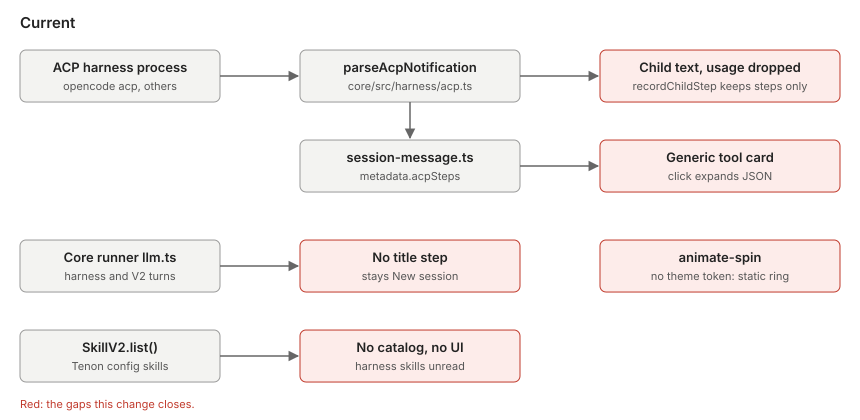
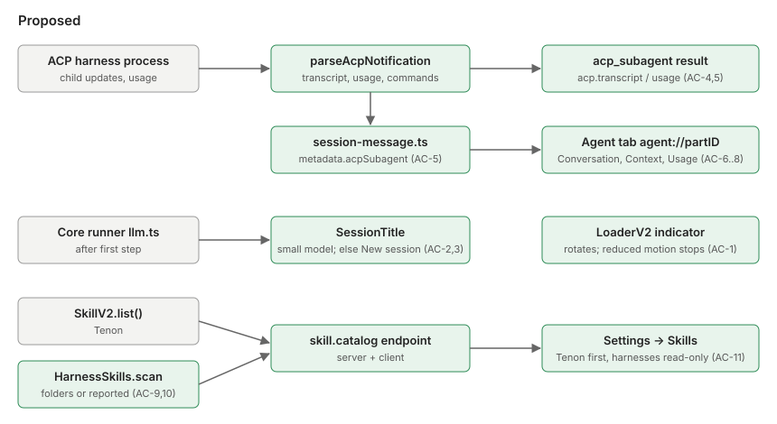
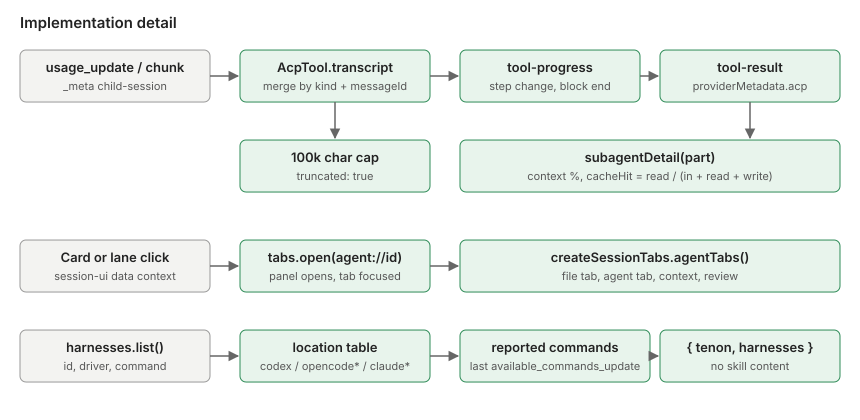

# Subagent inspector, skills manager, spinner and thread titles

Mode: TOR-2 (one implementor, one verifier). Plan author: the orchestrating
agent, which also wrote both test sets.

## Problem and expected behavior

- **Subagents.** When a harness starts a subagent, its row only expands raw
  JSON. The subagent's conversation and usage are discarded.
  After: clicking the subagent row (or its live lane) opens a tab for that agent
  in the right panel. The tab shows the agent's conversation, context window,
  token use and cache hit, or says plainly that the harness didn't report a
  value.
- **Spinner.** The tool-call ring is static. After: it rotates while the turn
  works and stops under reduced motion.
- **Thread titles.** Harness and V2 threads stay "New session". After: the
  first turn names the thread with a small model. If that fails, the thread
  stays "New session".
- **Skills.** There's no skills UI. After: Settings → Skills lists Tenon skills,
  then each harness's skills, read-only, so the two are clearly separate.

Example: a Claude-style ACP harness runs `explore` → the timeline row "Explore
agent" → click → right panel tab "Explore" shows the prompt, then "grep -rn
harness · 14 hits", then "Found 3 call sites"; Context 41k / 200k (21%); Usage
"Not reported by OpenCode ACP" for tokens it didn't send.

## Feature map and diagrams







Paths below are under `opencode/packages/`.

- Spinner: `app/src/components/session/turn-steps-summary.tsx:263-270` uses
  `animate-spin`; `ui/src/styles/tailwind/index.css` resets the theme with
  `--*: initial` and restores only `--animate-pulse`. `ui/src/v2/components/loader-v2.tsx`
  has its own keyframes and reduced-motion rule.
- Titles: only the legacy loop titles sessions (`opencode/src/session/prompt.ts:193-253`).
  Harness prompts and all V2 prompts run in `core/src/session/runner/llm.ts`
  (unticked title item at `:97`). The `title` agent exists in
  `core/src/plugin/agent.ts:39,188`. Renames are stored by publishing
  `SessionV1.Event.Updated` (projected at `core/src/session/projector.ts:243`).
  `catalog.model.small(providerID)` exists (`core/src/catalog.ts:242`).
- Subagents: `core/src/harness/acp.ts` `recordChildStep` keeps only child tool
  steps. `app/src/utils/session-message.ts` copies them to
  `part.metadata.acpSteps`. `acp_subagent` renders through the generic tool
  card. Right panel tabs come from `createSessionTabs`
  (`app/src/pages/session/helpers.ts`) and render in
  `pages/session/session-side-panel.tsx`.
- Skills: Tenon skills are `SkillV2.list()` (`core/src/skill.ts`) from the Tenon
  config dir (`core/src/config/plugin/skill.ts`; on this machine
  `~/.config/tenon-workbench/skills`). The ACP parser ignores
  `available_commands_update`. Settings tabs live in
  `app/src/components/settings-v2/dialog-settings-v2.tsx`.

Consumers affected: the session timeline (session-ui tool card), the turn
summary lanes, the right panel, the sidebar title, the Settings dialog, the
generated client in `packages/client`.

## Interfaces (contract for both test sets)

- `core/src/session/title.ts`, `export * as SessionTitle`:
  - `isDefault(title: string): boolean`: true for the store's default
    `New session - <ISO date>` (and `Child session - <ISO date>`).
  - `clean(text: string): string | undefined`: remove `<think>…</think>`
    blocks, take the first non-empty trimmed line, cap at 100 characters
    (97 + `...`). Empty result → `undefined`.
  - `eligible(input: { parentID?: string; title: string; userMessages: number }): boolean`:
    no `parentID`, default title, exactly one real user message.
- `core/src/harness/acp.ts`:
  - Tool result `providerMetadata.acp` and tool-progress `structured.acp` for an
    `acp_subagent` call carry `transcript`, and `usage` / `truncated` when set.
  - Transcript entries: `{ type: "text" | "reasoning", text }` and
    `{ type: "tool", tool, title?, status, output? }`. `tool` and `title`
    follow the existing step rules (`acp_<kind>`; title from `rawInput.command`,
    `rawInput.path`, then the update title without the subagent prefix).
    Consecutive chunks with the same kind and message ID merge.
  - `usage`: `{ used?, size?, cost? (USD amount), inputTokens?, outputTokens?, thoughtTokens?, cachedReadTokens?, cachedWriteTokens? }`
    from child-tagged `usage_update`; absent keys are omitted.
  - `truncated: true` once a subagent's transcript text passes 100,000
    characters; later text is dropped.
  - `AcpState.commands?: Array<{ name: string; description?: string }>` from
    `available_commands_update` (`availableCommands`).
- `core/src/harness/skills.ts`, `export * as HarnessSkills`:
  - `type Harness = { id: string; driver: string; command?: string }`
  - `type Reported = ReadonlyArray<{ name: string; description?: string }>`
  - `scan(input: { home: string; directory: string; harness: Harness; reported?: Reported }): Effect.Effect<{ source: "filesystem" | "reported" | "none"; skills: Skill[] }>`
    with `Skill = { name: string; description?: string; location?: string; scope: "global" | "project" }`.
- Server: a `skill.catalog` endpoint returning
  `{ tenon: Skill[]; harnesses: Array<{ id; name; source; skills: Skill[] }> }`,
  in the existing protocol group style, with the client regenerated.
- `app/src/pages/session/helpers.ts` `createSessionTabs` returns `agentTabs()`
  in addition to its current accessors.
- `app/src/components/session/subagent-detail.ts`:
  `subagentDetail(part: ToolPart)` →
  `{ agent?, description?, prompt?, status, transcript, truncated, context?: { used, size?, percent? }, usage: { input?, output?, reasoning?, cacheRead?, cacheWrite?, cacheHit?, cost? } }`.
- `app/src/components/settings-v2/skills-sections.ts`:
  `skillSections(catalog)` → `Array<{ id, title, editable, source, skills }>`.

## Acceptance criteria

- **AC-1** While a turn works, the turn-summary indicator has a running CSS
  animation, and it stops under `prefers-reduced-motion: reduce`. No source in
  app, session-ui or ui uses `animate-spin`, `animate-ping` or `animate-bounce`
  unless the theme defines the matching `--animate-*` token.
- **AC-2** After the first turn of an eligible session, the session is renamed
  with `clean(reply)`, for both the in-process agent and harness sessions. The
  title runs in the background after the turn's first step and never delays or
  fails the turn. Model order: the `title` agent's model if set, else the small
  model of the session's provider, else the session model, else the catalog
  default.
- **AC-3** Ineligible sessions (child, already named, not exactly one user
  message) are left alone. If no model resolves, the call fails, or the reply
  cleans to nothing, the title stays default and the sidebar shows
  "New session".
- **AC-4** A subagent's transcript is captured as specified above. The child's
  text never reaches the parent turn. Parallel subagents keep separate
  transcripts. Live progress carries the transcript so far, emitted on child
  step changes and when a child message block ends.
- **AC-5** Child-tagged `usage_update` becomes the subagent's `usage` and never
  changes the parent's usage. A parent `usage_update` still counts for the
  parent. The app maps `acp.transcript`, `acp.usage` and `acp.truncated` from the
  result metadata, or from `state.structured` while running, to
  `part.metadata.acpSubagent = { transcript, usage?, truncated? }`.
- **AC-6** `agent://<partID>` tabs are panel tabs: listed by `agentTabs()` in
  order, can be active and closable, and are not in `openedTabs()` or
  `activeFileTab()`. With nothing active, a file tab wins, then the first agent
  tab, then context, then review.
- **AC-7** Clicking an `acp_subagent` card in the timeline or a live lane in the
  turn summary opens the right panel on `agent://<partID>`. Clicking the same
  agent again focuses its tab. Agent tabs close like file tabs.
- **AC-8** The agent tab shows the agent name, status and three views.
  Conversation: the prompt, then the transcript; a note when `truncated`.
  Context: used / size and `percent = round(used / size × 100)` (absent without
  size; whole context absent without usage). Usage: input, output, cache read,
  cache write, cost, and
  `cacheHit = cacheRead / (input + cacheRead + cacheWrite)` when input and
  cacheRead are known. A value the harness didn't report is `undefined` and shows
  "Not reported by <harness>", never 0.
- **AC-9** The catalog returns Tenon skills from `SkillV2.list()` and one entry
  per harness except the in-process agent (`driver: "opencode"`, whose skills
  are Tenon's). Skill content is never returned.
- **AC-10** Harness locations, each searched for `**/SKILL.md`, global folders
  first, then project folders, each sorted by path:
  - `codex` driver: `~/.codex/skills`, `~/.agents/skills`; project
    `.codex/skills`, `.agents/skills`.
  - ACP command basename starting with `opencode`: `~/.config/opencode/skill`,
    `~/.config/opencode/skills`, `~/.claude/skills`, `~/.agents/skills`; project
    `.opencode/skill`, `.opencode/skills`, `.claude/skills`, `.agents/skills`.
  - ACP command basename starting with `claude` (case-insensitive, any path
    style, extension ignored): `~/.claude/skills`; project `.claude/skills`.
  - Name from frontmatter `name`, else the folder name. Description from
    frontmatter. Loose `.md` files that aren't `SKILL.md` are ignored.
  - Known locations give `source: "filesystem"`, even with no skills. Missing or
    unreadable folders are skipped silently.
  - Any other ACP harness: its reported commands (`source: "reported"`,
    `scope: "global"`, no location), else `{ source: "none", skills: [] }`.
    The server keeps each ACP harness's last reported commands in memory for
    the app process.
  - The folder lists for Codex and OpenCode are assumptions to confirm against
    those tools' docs.
- **AC-11** Settings → Skills (Server group). `skillSections` puts Tenon first
  (`{ id: "tenon", title: "Tenon", editable: true, source: "filesystem" }`),
  then harnesses in catalog order (`editable: false`, title is the harness
  name, source passed through). Skills are sorted by name, ignoring case. The
  page shows a lock icon on read-only sections, an "Open file" action on Tenon
  skills, an empty state per section, and a refresh control.

Deferred: on/off toggles for Tenon skills (needs a config write path). Native
`task` subagents keep their current navigation. Codex app-server subagents are
out of scope.

## Phases

All commands run from the repository root unless noted. Test sets need
`node_modules` links, which Git ignores:

```sh
P=Implementations/subagent-inspector-skills
for s in acceptance verification; do for k in core app; do [ -d $P/$s/$k ] && ln -sfn ../../../../opencode/packages/$k/node_modules $P/$s/$k/node_modules; done; done
```

Core set: `cd opencode/packages/core && bun test ../../../Implementations/subagent-inspector-skills/<set>/core/<file>`
App set: `cd opencode/packages/app && bun test --conditions=solid --preload ./happydom.ts ../../../Implementations/subagent-inspector-skills/<set>/app/<file>`

| ID | Outcome | Criteria | Edit scope | Depends on | Acceptance | Verification |
|---|---|---|---|---|---|---|
| P1 | Indicator rotates | AC-1 | `app/src/components/session/turn-steps-summary.tsx` | independent | `core/spinner-css.test.ts` | manual: computed `animation-name` in the browser preview |
| P2 | Threads get titles | AC-2, AC-3 | `core/src/session/title.ts` (new), `core/src/session/runner/llm.ts`, a new core runner test | independent | `core/title.test.ts` | `core/title.verify.test.ts`; review of the runner test; manual run |
| P3 | Subagent transcript and usage kept | AC-4, AC-5 (core and app mapping) | `core/src/harness/acp.ts`, `app/src/utils/session-message.ts`, `core/test/harness-acp.test.ts` | independent | `core/acp-subagent.test.ts` (AC-4, AC-5 parts) | `core/acp-subagent.verify.test.ts` |
| P4 | Agent tabs in the right panel | AC-5 (app), AC-6, AC-7, AC-8 | `app/src/pages/session/helpers.ts`, `session-side-panel.tsx`, `components/session/subagent-detail.ts(x)` (new), `turn-steps-summary.tsx`, session-ui `message-part.tsx` and `context/data.tsx`, `pages/directory-layout.tsx`, `app/src/i18n/en.ts` | P3 | `app/panel-tabs.test.ts`, `app/subagent-detail.test.ts` | `app/inspector.verify.test.ts` (tabs, detail); manual click-through |
| P5 | Skills catalog endpoint | AC-9, AC-10 | `core/src/harness/skills.ts` (new), `core/src/harness/acp.ts` (commands), `core/src/harness.ts` (report store), `protocol` group, `server/src/handlers/skill.ts`, regenerated `packages/client` | P3 (both touch `acp.ts`) | `core/harness-skills.test.ts`, `core/acp-subagent.test.ts` (AC-10 part) | `core/harness-skills.verify.test.ts` |
| P6 | Settings → Skills page | AC-11 | `app/src/components/settings-v2/skills.tsx` and `skills-sections.ts` (new), `dialog-settings-v2.tsx`, `app/src/i18n/en.ts` | P5 | `app/skills-sections.test.ts` | `app/inspector.verify.test.ts` (sections); manual page check |

Close-out also updates `docs/architecture/README.md`,
`docs/architecture/uml.md`, `docs/diagrams/` and `docs/security/threat-model.md`
(harness skill folders are read-only; only names, descriptions and paths leave
the server).

Repository checks before handoff: `bun run typecheck`, `bun run lint`,
`bun run check:generated`, `bun run test`, `bun run test:engine`,
`bun run build`.

## Baseline (main at a47befb, 2026-10-22)

- Acceptance: core 2 pass / 8 fail, app 0 pass / 4 fail. The passes are already
  correct behavior (child text kept out of the parent turn; reduced-motion class
  present). Failures are missing modules (`title`, `skills`, `subagent-detail`,
  `skills-sections`), missing `agentTabs`, missing transcript/usage/commands,
  and `turn-steps-summary.tsx uses animate-spin`.
- Verification: core 1 pass / 6 fail, app 0 / 1 (missing modules). Held outside
  the implementor worktree until close-out.

## Completion evidence

Pending.
